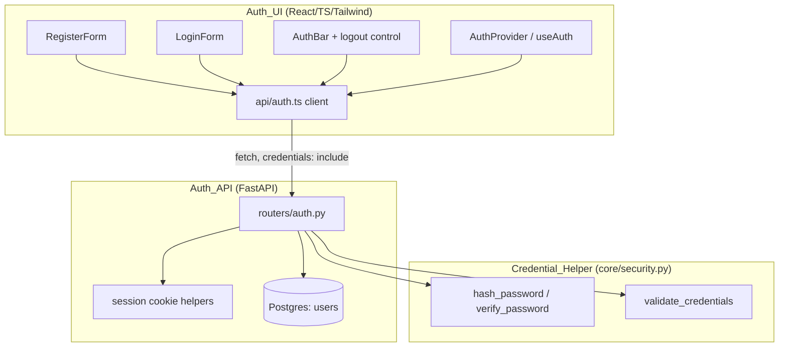
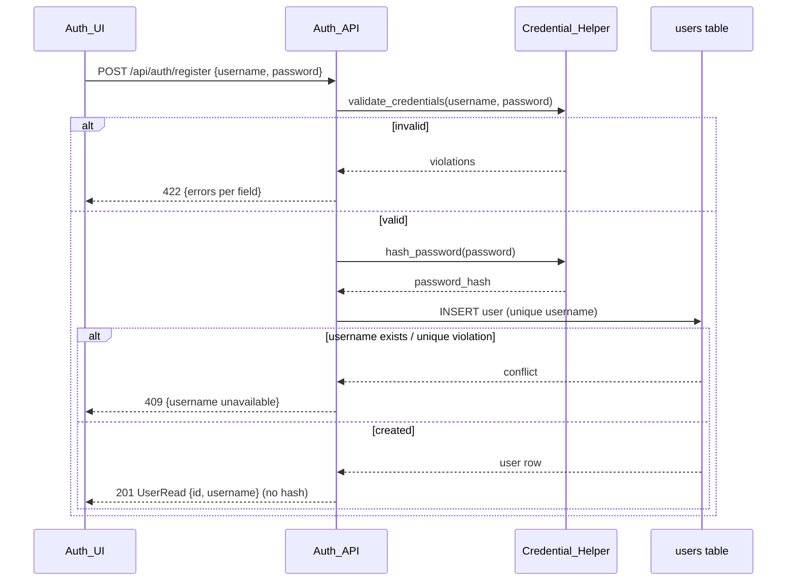

# Design Document

## Overview

The `accounts` feature adds lightweight username-and-password authentication to
the Open Science Paper Engine: registration, login, logout, authenticated-state
tracking, and a "current user" check. It introduces the `User` table and a
stable account identity that later features (notably `writer-workspace`) depend
on.

Per the mandated layering, the design is organized into three concerns, each
mapping back to specific requirements:

| Layer | Component | Location | Requirements |
| --- | --- | --- | --- |
| Frontend | `Auth_UI` | `frontend/src/components/`, `frontend/src/api/` | R1, R2, R3 |
| Backend | `Auth_API` | `backend/app/routers/auth.py`, `backend/app/models/user.py` | R4, R5, R6, R7 |
| Business logic | `Credential_Helper` | `backend/app/core/security.py` | R8 |

This spec also establishes two conventions for later specs: a `routers/`
package for API routes (structure.md says routes belong there; the existing
inline item routes in `main.py` are left untouched), and a thin,
framework-agnostic `core/security.py` business-logic module the `Auth_API`
imports.

### Key design decisions

- **Session mechanism: stateless signed HTTP-only cookie.** The requirements
  describe observable `Session` behavior (R5, R6) but leave the mechanism open.
  The stack is Postgres + FastAPI only — there is no Redis or other session
  store (tech.md), and CORS is already configured with
  `allow_credentials=True` for `http://localhost:5173`. We therefore use a
  signed, HTTP-only cookie carrying a session token signed with `itsdangerous`.
  The token payload is `{user_id, issued_at}`; its signature is verified on
  each request. **Trade-off:** a stateless signed cookie means logout is
  enforced client-side by clearing the cookie (R6.1, R6.2) rather than by
  deleting a server record, and tokens cannot be revoked individually before
  expiry. For a hackathon with no broker/store this is the simplest correct
  option; a server-side store (requiring new infra) is the alternative we
  explicitly reject. Token expiry (max-age) bounds the window and satisfies the
  "expired Session" cases (R5.6, R6.4). This decision is recorded for promotion
  to an ADR.
- **Password hashing: `pwdlib` with Argon2.** We add `pwdlib[argon2]` to the
  backend dependencies via `uv`. Argon2 is the current OWASP-recommended
  password hash, pwdlib is a small modern, maintained wrapper (the successor to
  passlib's role) that produces self-describing hash strings with per-hash
  random salts — directly satisfying R8.1 and R8.6. We never implement hashing
  ourselves.
- **Schema via Alembic, never `create_all`.** The `users` table is created by a
  committed migration under `backend/alembic/versions/`, applied by the
  container entrypoint (`alembic upgrade head`). This honors tech.md and R7.2.

## Architecture



### Register flow (R1, R4, R7, R8)



### Login flow (R2, R5, R8)

```mermaid
sequenceDiagram
    participant UI as Auth_UI
    participant API as Auth_API
    participant CH as Credential_Helper
    participant DB as users table

    UI->>API: POST /api/auth/login {username, password}
    API->>DB: SELECT user WHERE username = ?
    alt no user
        API-->>UI: 401 {username or password incorrect}
    else found
        API->>CH: verify_password(password, user.password_hash)
        alt mismatch
            CH-->>API: false
            API-->>UI: 401 {username or password incorrect}
        else match
            CH-->>API: true
            API-->>UI: 200 UserRead + Set-Cookie: session=<signed>; HttpOnly
        end
    end
```

### Logout flow (R3, R6)

```mermaid
sequenceDiagram
    participant UI as Auth_UI
    participant API as Auth_API

    UI->>API: POST /api/auth/logout (cookie: session)
    alt valid session
        API-->>UI: 200 + Set-Cookie: session=; Max-Age=0 (clears cookie)
    else absent/expired/already terminated
        API-->>UI: 401 unauthenticated (no state change)
    end
```

## Components and Interfaces

### 1. Frontend — `Auth_UI` (R1, R2, R3)

React/TS/Tailwind components added under `frontend/src/components/`, consistent
with the existing `App.tsx` fetch + Tailwind style. A small typed API client is
added under `frontend/src/api/auth.ts`.

**`api/auth.ts`** — one place that talks to `Auth_API`. Every call uses
`credentials: "include"` so the session cookie is sent/received (compatible with
the existing CORS `allow_credentials=true`). A per-request `AbortController`
enforces the timeouts the requirements specify.

```ts
interface UserRead { id: number; username: string; }
interface FieldError { field: string; rule: string; message: string; }

// 30s timeout (R1.4, R1.8)
register(username: string, password: string):
  Promise<{ ok: true; user: UserRead }
        | { ok: false; kind: "conflict" | "validation" | "network"; errors?: FieldError[] }>;

// 30s timeout (R2.3, R2.6)
login(username: string, password: string):
  Promise<{ ok: true; user: UserRead }
        | { ok: false; kind: "invalid" | "network" }>;

// 10s timeout (R3.3, R3.5)
logout(): Promise<{ ok: boolean }>;

// current-user check used on app load to restore authenticated state (R5.5)
me(): Promise<UserRead | null>;
```

**`AuthProvider` + `useAuth` hook** — holds authenticated state: the current
`UserRead | null` and the active mode (`"reader" | "writer"`). On mount it calls
`me()` to restore state. Exposes `register`, `login`, `logout`, `setMode`.
Responsibilities:

- Reader mode is active by default on first entry to the authenticated state;
  exactly one mode is active at a time (R3.2).
- When unauthenticated, exposes only login/register views; never surfaces modes,
  username, or logout control (R3.6).

**`RegisterForm`** (R1):
- Renders username, password, submit (R1.1).
- Submit disabled while either field is empty (R1.2) and while a request is in
  flight, with a progress indicator (R1.4).
- Client-side length gate (username 3–32, password 8–128) before sending
  (R1.3); server remains the source of truth (R4.4, R8.7).
- On success: confirmation + authenticated state (R1.5). On 409: "username
  unavailable", retain username, re-enable (R1.6). On 422: show field errors,
  re-enable (R1.7). On timeout/network error: error message, retain username,
  re-enable (R1.8).

**`LoginForm`** (R2):
- Renders username, password, enabled submit (R2.1).
- Blocks submit with a "both required" message when a field is empty (R2.2).
- Disables submit during the request (R2.3). On success: authenticated state
  (R2.4). On 401: re-enable, retain username, clear password, "username or
  password is incorrect" (R2.5). On timeout/unreachable: re-enable + retry
  message (R2.6).

**`AuthBar`** (R3): shows the signed-in username and a logout control on every
authenticated view (R3.1); the mode toggle (Reader/Writer, R3.2); logout control
disabled during the request (R3.3). On logout success: discard session state,
show login view (R3.4). On failure/timeout: keep authenticated state, re-enable,
error message (R3.5).

### 2. Backend — `Auth_API` (R4, R5, R6, R7)

New `backend/app/routers/auth.py` exposing an `APIRouter(prefix="/api/auth")`,
registered on the app in `main.py` via `app.include_router(auth.router)`. The
existing `/health` and `/api/items` routes are unchanged. Uses the existing
`get_session` dependency from `app/db/session.py`.

**Session cookie helpers** (module-level in `auth.py` or a small
`app/core/session.py`), built on `itsdangerous.URLSafeTimedSerializer` keyed by
`settings.session_secret`:

```python
def issue_session(user_id: int) -> str          # signed token string
def read_session(token: str | None) -> int | None  # user_id, or None if absent/bad/expired
SESSION_COOKIE = "session"
COOKIE_KWARGS = dict(httponly=True, samesite="lax", secure=<prod>, max_age=<ttl>)
```

**`current_user` dependency** — reads the cookie, calls `read_session`, loads the
`User`, or raises `401` (R5.5, R5.6). Reused by `/me` and `/logout`.

### 3. Business logic — `Credential_Helper` (R8)

New thin, framework-agnostic module `backend/app/core/security.py`. No FastAPI
or SQLModel imports — pure functions the `Auth_API` calls.

```python
# Rules: username 3..32 chars, password 8..128 chars.
USERNAME_MIN, USERNAME_MAX = 3, 32
PASSWORD_MIN, PASSWORD_MAX = 8, 128

class CredentialError(Exception):
    violations: list[FieldViolation]  # [{field, rule}]

def hash_password(plain: str) -> str
    # 1..128 chars -> argon2 hash via pwdlib; raises CredentialError if out of range (R8.1, R8.2)

def verify_password(plain: str, password_hash: str) -> bool
    # True iff plain matches hash; malformed/empty hash -> report malformed + return False (R8.3, R8.4, R8.5)

def validate_credentials(username: str, password: str) -> list[FieldViolation]
    # [] when both satisfy format rules; otherwise one entry per violated rule (R8.7, R8.8)
```

`hash_password` enforces the 1..128 plaintext bound before hashing (R8.1, R8.2).
`validate_credentials` enforces the registration format rules (username 3..32,
password 8..128) and is called by the register endpoint (R4.4, R8.7, R8.8).

## Data Models

### `User` table (R7)

New `backend/app/models/user.py` following the Base/Create/Read split from
`item.py`. The `password_hash` lives only on the table model and
`UserCreate` — **never** on `UserRead` (R4.2).

```python
from datetime import datetime, timezone
from sqlmodel import Field, SQLModel

class UserBase(SQLModel):
    username: str = Field(index=True, unique=True, min_length=3, max_length=32)

class User(UserBase, table=True):
    __tablename__ = "users"
    id: int | None = Field(default=None, primary_key=True)
    password_hash: str = Field(nullable=False)         # never plaintext (R7.1)
    created_at: datetime = Field(
        default_factory=lambda: datetime.now(timezone.utc), nullable=False
    )

class UserCreate(UserBase):
    password: str  # plaintext in, hashed before persist; never stored

class UserRead(UserBase):
    id: int        # NO password / password_hash field (R4.2)
```

| Field | Type | Constraints | Requirement |
| --- | --- | --- | --- |
| `id` | int | PK, assigned at creation, stable, never reused | R7.1, R7.5 |
| `username` | str | unique, indexed, 3–32 chars | R7.1, R7.4 |
| `password_hash` | str | not null, Argon2 hash, never plaintext | R7.1, R4.5 |
| `created_at` | datetime (UTC) | not null | — |

The **unique constraint on `username`** is what guarantees at most one `User`
per username under concurrent registration (R7.4): the second insert fails the
constraint and the endpoint maps it to a 409 conflict (R4.3, R7.3).

### Alembic migration (R7.2)

A new revision under `backend/alembic/versions/` (generated via
`alembic revision --autogenerate -m "create users table"`, then reviewed)
creates the `users` table with the unique index on `username`. It is applied by
the container entrypoint's `alembic upgrade head` (R7.2) — **not** `create_all`,
which exists only for tests.

### Configuration (R7.6)

Extend `app/core/config.py` `Settings` (pydantic-settings, env-driven):

```python
session_secret: str        # REQUIRED — signs session cookies; no default
session_ttl_seconds: int = 60 * 60 * 24   # cookie max-age
cookie_secure: bool = False # True in prod (HTTPS)
```

`session_secret` has **no default**, so if it is absent from the environment the
app fails to start rather than reading a secret from committed source (R7.6).
`.env.example` documents it; the real value lives in `.env` (gitignored).

## Correctness Properties

*A property is a characteristic or behavior that should hold true across all
valid executions of a system — essentially, a formal statement about what the
system should do. Properties serve as the bridge between human-readable
specifications and machine-verifiable correctness guarantees.*

These properties target the `Credential_Helper` (pure functions) and the
`Auth_API` endpoints — the parts with input-varying logic. The `Auth_UI`
(R1–R3) is UI rendering/interaction and is covered by example/manual tests, not
property-based tests. Each property maps to the requirement clauses it
validates.

### Property 1: Hash/verify round-trip, and hash is not the plaintext

*For any* plaintext password of length 1 to 128, `verify_password(p,
hash_password(p))` returns `true`, and `hash_password(p)` is not equal to `p`.

**Validates: Requirements 8.1, 8.3, 4.5, 7.1**

### Property 2: Hashing the same password twice yields distinct, verifiable hashes

*For any* plaintext password of length 1 to 128, two independent calls to
`hash_password(p)` produce two distinct hash strings, and each verifies
successfully against `p` (per-hash random salt).

**Validates: Requirements 8.6**

### Property 3: Verification rejects non-corresponding passwords

*For any* two distinct plaintext passwords `p1` and `p2`,
`verify_password(p2, hash_password(p1))` returns `false`.

**Validates: Requirements 8.4**

### Property 4: Password-length validation on hashing

*For any* plaintext that is empty or longer than 128 characters,
`hash_password` reports a validation error and returns no hash; *for any*
plaintext of length 1 to 128 it returns a hash.

**Validates: Requirements 8.2**

### Property 5: Malformed hashes fail verification safely

*For any* hash string that is empty or not in the format produced by the hashing
algorithm, `verify_password(p, badhash)` reports the hash as malformed and
returns `false` (never raises, never returns `true`).

**Validates: Requirements 8.5**

### Property 6: Credential validation reports exactly the violated rules

*For any* `(username, password)` pair, `validate_credentials` returns no
violations exactly when the username is 3–32 characters and the password is
8–128 characters; otherwise the set of reported violations equals exactly the
set of length rules that are broken.

**Validates: Requirements 8.7, 8.8, 4.4**

### Property 7: Register-then-login succeeds and the response never leaks the hash

*For any* valid credential pair `(username, password)`, registering it yields a
`201` whose body contains `id` and `username` and contains neither `password`
nor `password_hash`, and a subsequent login with the same credentials succeeds.

**Validates: Requirements 4.1, 4.2, 5.1**

### Property 8: Username uniqueness — at most one record per username

*For any* username, after any number of registration attempts with that
username, exactly one `User` row exists for it; every attempt after the first
returns a conflict response and leaves the existing record unchanged.

**Validates: Requirements 4.3, 7.3, 7.4**

### Property 9: Login failures are non-disclosing

*For any* login attempt that is either an unknown username or a known username
with a wrong password, the response is an identical generic authentication
failure that does not reveal which field was wrong, and no session is
established.

**Validates: Requirements 5.2, 5.3**

### Property 10: Session cookie round-trip identifies the acting user

*For any* `user_id`, `read_session(issue_session(user_id))` returns that same
`user_id`, and a request carrying that cookie resolves to that user.

**Validates: Requirements 5.5**

### Property 11: Absent, tampered, or expired sessions never authenticate

*For any* session token that is absent, random, tampered from a valid token, or
expired, `read_session` returns `None` and a protected request is rejected as
unauthenticated with no acting user.

**Validates: Requirements 5.6, 6.4**

### Property 12: Logout invalidates the session

*For any* authenticated session, after a successful logout the response clears
the session cookie and the previously accepted credential no longer
authenticates on subsequent requests.

**Validates: Requirements 6.1, 6.2, 6.3**

## API Endpoint Contracts

All endpoints live on the `/api/auth` router. Request/response bodies are JSON.
Cookies use `HttpOnly; SameSite=Lax; Path=/` and `Secure` in production.

### POST /api/auth/register (R4)

- **Request:** `{ "username": string, "password": string }`
- **201 Created:** `{ "id": int, "username": string }` — no password/hash (R4.2)
- **409 Conflict:** `{ "detail": "username unavailable" }` (R4.3, R7.3)
- **422 Unprocessable Entity:** `{ "detail": [{ "field": "...", "rule": "..." }] }` (R4.4, R8.8)

### POST /api/auth/login (R5)

- **Request:** `{ "username": string, "password": string }`
- **200 OK:** `{ "id": int, "username": string }` + `Set-Cookie: session=<signed>` (R5.1)
- **401 Unauthorized:** `{ "detail": "username or password is incorrect" }` — identical for unknown user and wrong password (R5.2, R5.3); no cookie set
- **422 Unprocessable Entity:** missing/empty field (R5.4); no cookie set

### POST /api/auth/logout (R6)

- **Request:** no body; carries the session cookie
- **200 OK (valid session):** empty body + `Set-Cookie: session=; Max-Age=0` (R6.1, R6.2)
- **401 Unauthorized (absent/expired/malformed/already-terminated):** `{ "detail": "not authenticated" }`, no state change, idempotent (R6.4, R6.5)

### GET /api/auth/me (current-user check, R5.5/R5.6)

- **200 OK (valid session):** `{ "id": int, "username": string }` (R5.5)
- **401 Unauthorized:** `{ "detail": "not authenticated" }` (R5.6)

Used by the `Auth_UI` on load to restore authenticated state.

## Error Handling

- **Validation errors (R4.4, R5.4, R8.2, R8.8):** `Credential_Helper` returns
  structured `FieldViolation`s; the register endpoint maps them to `422` with a
  per-field list. `hash_password` raises `CredentialError` for out-of-range
  plaintext, surfaced as `422`.
- **Username conflict (R4.3, R7.3, R7.4):** the DB unique constraint is the
  source of truth. The endpoint attempts the insert and catches
  `IntegrityError`, rolling back the session and returning `409`. Relying on the
  constraint (not a prior `SELECT`) closes the concurrent-registration race.
- **Authentication failures (R5.2, R5.3, R5.6, R6.4):** always a single generic
  message so the response never discloses whether the username or password was
  at fault. Unknown user and wrong password take the same code path and body.
- **Malformed/expired session (R5.6, R6.4):** `read_session` catches
  `itsdangerous` `BadSignature`/`SignatureExpired` and returns `None`; the
  `current_user` dependency then raises `401`. Logout treats these as a no-op
  (R6.5).
- **Malformed hash (R8.5):** `verify_password` catches the hashing library's
  parse errors and returns `false` rather than raising, so a corrupt stored
  value can never authenticate.
- **Frontend network/timeouts (R1.8, R2.6, R3.5):** the API client uses
  `AbortController` (30s for register/login, 10s for logout); on
  abort/network/5xx the components show a retry-oriented error, retain input,
  and re-enable controls.
- **Missing config (R7.6):** `session_secret` has no default; a missing value
  fails `Settings` construction at startup, so the app will not boot with an
  unsigned/undefined secret.

## Security

- **Password hashing (R4.5, R8.1):** Argon2 via `pwdlib[argon2]`; we never roll
  our own hashing. Hashes are self-describing with per-hash random salts
  (Property 2 / R8.6).
- **No plaintext at rest (R7.1, R4.5):** only `password_hash` is persisted;
  `UserRead` has no password field, so hashes never cross the API boundary
  (R4.2).
- **Non-disclosing auth errors (R5.2, R5.3):** identical `401` body for unknown
  username and wrong password; constant-time password comparison is provided by
  the hashing library's `verify`.
- **Session cookie flags:** `HttpOnly` (no JS access, mitigates XSS token
  theft), `SameSite=Lax` (CSRF mitigation for cross-site navigations),
  `Secure` in production, bounded `Max-Age` (R5.6/R6.4 expiry). Signed with
  `session_secret` via `itsdangerous`; tampering invalidates the signature
  (Property 11).
- **Secrets via env (R7.6):** `session_secret` and `database_url` come from the
  environment (`.env`, gitignored); `.env.example` carries placeholders only,
  never real values.
- **Trade-off (stateless cookie):** individual tokens cannot be revoked before
  expiry; logout clears the client cookie (R6.2) but a copied token stays valid
  until it expires. Acceptable for the hackathon scope; a server-side store
  would be required for immediate revocation and is explicitly deferred.

## Testing Strategy

Backend tests run with **pytest + testcontainers** against a throwaway
`postgres:17`, on the host (`cd backend && uv run pytest`), per `backend/README`.
Existing fixtures (`client`, `session`, transaction-rollback isolation) are
reused. The frontend has **no automated test gate** (team tests UI manually), so
R1–R3 are verified by manual example-based checks, not an invented suite.

**Dual approach:** property-based tests cover the universal invariants above;
example/edge and integration tests cover concrete scenarios, boundaries, and
infrastructure.

### Property-based tests (Hypothesis)

Use **Hypothesis** (added to the dev dependency group via `uv`) — we do not
hand-roll generators. Each property test runs **a minimum of 100 iterations**
and is tagged with a comment referencing its design property, e.g.:

```python
# Feature: accounts, Property 1: Hash/verify round-trip, and hash is not the plaintext
```

- Properties 1–6 (`Credential_Helper`): pure, fast, in-memory — ideal PBT. Note
  Argon2 is CPU-heavy, so cap generated password length at 128 and keep
  Hypothesis `max_examples` reasonable (100) to bound runtime.
- Properties 7–12 (`Auth_API`): driven through `TestClient` against the
  testcontainer DB, generating valid/invalid credential pairs and session
  tokens. Property 10/11 also test `issue_session`/`read_session` directly.

### Example / edge tests (pytest)

- R5.4: login with missing/empty username or password → `422`, no cookie.
- R6.5: logout twice is idempotent — both unauthenticated, no error.
- R6.4: logout with no/expired/tampered cookie → `401`, no state change.
- Representative register/login/logout happy-path smoke through `TestClient`.

### Integration / smoke tests

- R7.2: a `test_migrations`-style upgrade → downgrade → upgrade asserting the
  `users` table (and its unique `username` index) exist after upgrade — single
  run, not PBT.
- R7.4 (concurrency): a targeted test issuing two near-simultaneous inserts of
  the same username and asserting exactly one row persists via the unique
  constraint.
- R7.6: constructing `Settings` without `session_secret` raises — single-run
  smoke test.
