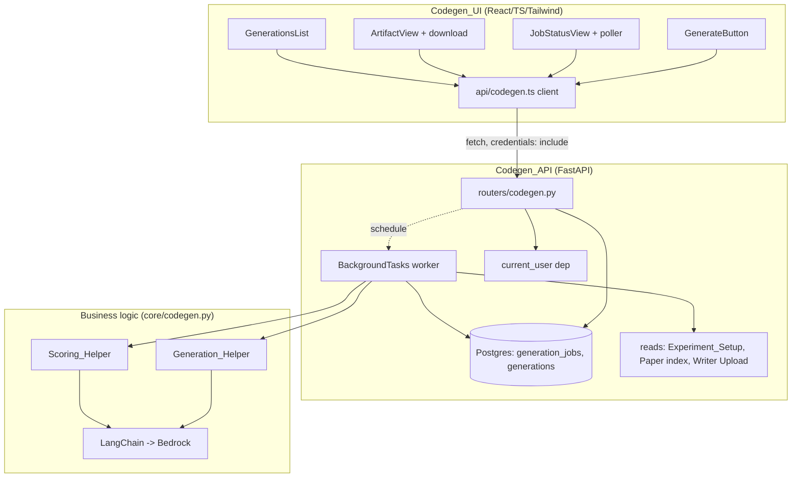
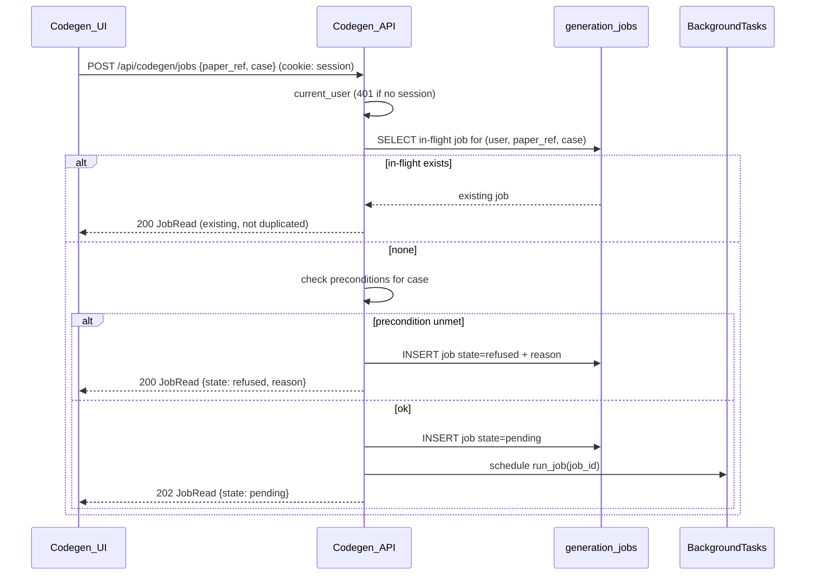
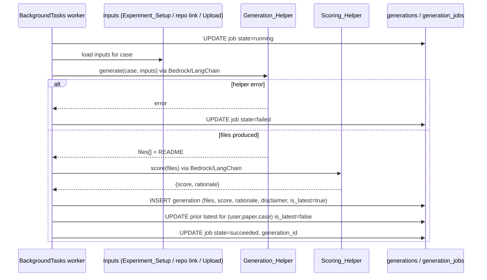
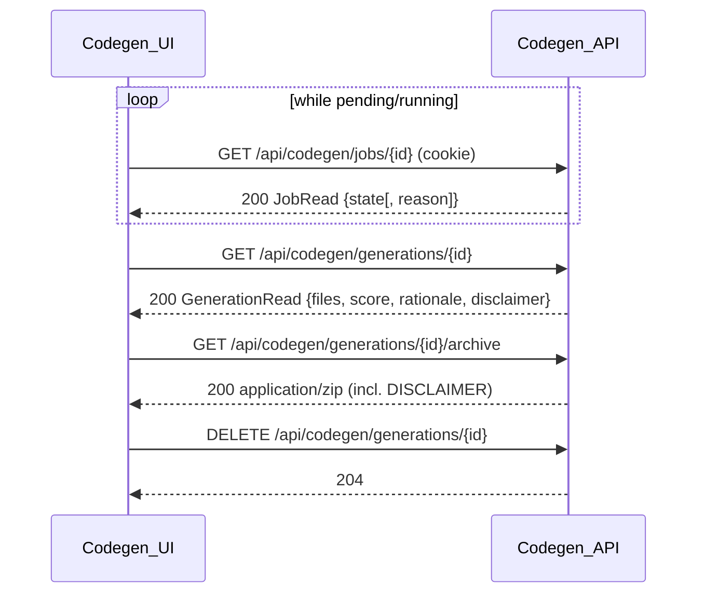

# Design Document

## Overview

The `code-generation` feature lets a `User` produce candidate code for a `Paper`,
opt-in and off by default, across all three Code Generation cases — **Generate**
(Reader, no repo), **Align** (Reader, has repo), and **Writer generation**
(Writer, from uploads). Generation runs **asynchronously**: a `User` starts a
`Generation_Job`, the UI polls its status, and on success retrieves a persisted
`Generation` (generated files + a README, an `Artifact_Code_Quality_Score`, and
an "unverified, not executed" `Disclaimer`). The system never executes or
verifies generated code.

Per the mandated layering (set by `accounts`), the design is organized into three
concerns, each mapping back to specific requirements:

| Layer | Component | Location | Requirements |
| --- | --- | --- | --- |
| Frontend | `Codegen_UI` | `frontend/src/components/`, `frontend/src/api/` | R1, R2, R3 |
| Backend | `Codegen_API` | `backend/app/routers/codegen.py`, `backend/app/models/generation.py` | R4, R5, R6, R8 |
| Business logic | `Generation_Helper`, `Scoring_Helper` | `backend/app/core/codegen.py` | R7 |

This spec **consumes** the `Experiment_Setup` and the Paper-level
`Reproducibility_Score` as existing inputs produced by other features; it does
not extract the `Experiment_Setup` or compute the Paper-level
`Reproducibility_Score`. It builds on the `accounts` session mechanism (the
`current_user` dependency and signed session cookie) for ownership and
authentication, and on persisted `Writer` uploads (`docs/adr/0003`).

### Key design decisions

- **Asynchronous jobs run on FastAPI `BackgroundTasks`, not a broker.** The
  requirements describe observable async behavior (start → poll → fetch) but
  leave the mechanism open. The stack is Postgres + FastAPI only — there is no
  Celery/Redis/queue (tech.md). So the start endpoint persists a
  `Generation_Job` row in `pending`, schedules the work via FastAPI
  `BackgroundTasks`, and returns immediately; the worker transitions the row
  `pending → running → succeeded|failed|refused` and the client polls a status
  endpoint. **Trade-off:** background tasks run in the API process, so a process
  restart orphans an in-flight job (it stays `running` with no worker). We bound
  that risk with a job timeout and treat a `running` job past its deadline as
  `failed` on the next status read. A durable queue is the alternative we
  explicitly reject for hackathon scope; this decision is a candidate for
  promotion to an ADR.
- **The job state row is the source of truth for in-flight de-duplication.** A
  partial unique index guarantees at most one in-flight (`pending`|`running`)
  `Generation_Job` per `(user_id, paper_ref, case)` (R4.2, R8.4). A duplicate
  start reads the existing in-flight row and returns it rather than inserting.
- **Generated files are stored as a JSON document on the `Generation` row.** A
  `Generation` holds a small set of text files; we persist them as a
  `list[{path, content}]` in a JSON column rather than modeling a `file` table.
  This keeps the derived artifact self-contained and easy to return/zip, and
  matches the Writer-uploads carve-out (storing Writer-owned/derived content is
  allowed; `docs/adr/0003`). We store **only** generated/derived text — never a
  copy of a Paper's external full text or an external repository's contents
  (R5.2, R8.5).
- **Artifact score never touches the Paper (`docs/adr/0004`).** The
  `Artifact_Code_Quality_Score` lives on the `Generation` row only; nothing in
  this feature writes a Paper's `Reproducibility_Score` (R5.8).
- **AI behind a thin seam (`docs/adr/0002`).** `Generation_Helper` and
  `Scoring_Helper` are the only modules that call Bedrock via LangChain; the API
  and UI never see the provider. Credentials come from env, never committed
  (R7.1, R7.6).
- **Schema via Alembic, never `create_all`.** The `generation_jobs` and
  `generations` tables are created by committed migrations applied by the
  container entrypoint (`alembic upgrade head`), per tech.md and R8.1.

## Architecture



### Start flow (R1, R4)



### Execute flow (R5, R7)



### Poll / fetch / download / delete flow (R2, R3, R6)



Every owner-scoped read/delete for a resource owned by another `User` returns
`404` — the response does not reveal that the resource exists (R6.5).

## Components and Interfaces

### 1. Frontend — `Codegen_UI` (R1, R2, R3)

React/TS/Tailwind under `frontend/src/components/`, with a typed client at
`frontend/src/api/codegen.ts`. Every call uses `credentials: "include"` so the
session cookie flows (consistent with the existing CORS `allow_credentials`), and
a per-request `AbortController` enforces the 30-second request timeout the
requirements specify.

**`api/codegen.ts`** — the single place that talks to `Codegen_API`:

```ts
type Case = "generate" | "align" | "writer";
type JobState = "pending" | "running" | "succeeded" | "failed" | "refused";

interface JobRead {
  id: string;
  paper_ref: string;
  case: Case;
  state: JobState;
  reason: string | null;      // present when state === "refused"
  generation_id: string | null; // present when state === "succeeded"
}
interface GenFile { path: string; content: string; }
interface GenerationRead {
  id: string;
  paper_ref: string;
  case: Case;
  files: GenFile[];
  code_quality_score: number;
  code_quality_rationale: string;
  disclaimer: string;
  is_latest: boolean;
  created_at: string;
}

startJob(paperRef: string, c: Case): Promise<JobRead | NetworkError>;   // 30s
getJob(id: string): Promise<JobRead | NetworkError>;                    // 30s, polled
getGeneration(id: string): Promise<GenerationRead | NetworkError>;
downloadArchive(id: string): Promise<Blob | NetworkError>;              // 30s
listGenerations(): Promise<GenerationRead[] | NetworkError>;
deleteGeneration(id: string): Promise<{ ok: boolean }>;                 // 30s
```

**`GenerateButton`** (R1): the per-action opt-in trigger, never pre-activated
(R1.1). The parent decides the offered `Case` from the Paper's repository link
and the active mode (R1.2–R1.4): Reader + no repo link → `generate`; Reader +
repo link → `align`; Writer on a claimed paper → `writer`. On activation it calls
`startJob`, disables itself until a response or the 30s timeout, and on success
hands off to `JobStatusView` (R1.5, R1.6). On timeout/network/5xx it re-enables
and shows a start-failed message (R1.7).

**`JobStatusView`** (R2): while a job is `pending`/`running` it polls `getJob`
(fixed interval with backoff cap) and shows a progress indicator (R2.1). On
`succeeded` it loads and renders the `Generation` (R2.2). On `failed` it shows an
error with a **Try again** control that restarts the job (R2.5). On `refused` it
shows the server's `reason` and offers **no** retry for the same unmet
precondition (R2.6).

**`ArtifactView`** (R2): read-only view of each generated file, the
`Artifact_Code_Quality_Score` with its rationale, the always-present
`Disclaimer`, and a **Download code** control that fetches the zip (R2.2–R2.4).
When the parent supplies the Paper's `Reproducibility_Score`, it is shown as
read-only information with no control that could change it (R2.7).

**`GenerationsList`** (R3): lists only the current `User`'s generations (R3.1),
marks the latest per `(paper, case)` (R3.2), and offers **Delete** per item;
delete calls `deleteGeneration` and removes the row on success, or keeps it and
shows a deletion-failed message on timeout/error (R3.3, R3.4).

#### Visual direction (frontend-design)

The subject is reproducible science: the UI's job is to make an *unverified,
machine-produced* artifact feel clearly provisional, never finished-and-trusted.
That intent drives the choices below rather than a default card kit.

- **Palette (4 named values + ink):** `paper` `#FBFAF7` (base), `ink` `#1A1D21`
  (text), `graphite` `#5B6269` (secondary text/dividers), `signal` `#2F6F6A`
  (deep teal — the single accent, used only for the primary action and the
  "latest" marker), `caution` `#B4551D` (burnt amber, reserved exclusively for
  the unverified `Disclaimer` and the `refused`/`failed` states). No gradient
  washes; no terracotta; teal and amber are chosen so the one "trust-sensitive"
  color (amber) is never reused as decoration.
- **Type:** one family, `IBM Plex Sans`, for UI text; `IBM Plex Mono` for file
  contents and the score value only (code is the subject, so monospace earns its
  place there rather than as generic data-label chrome). Clear scale: 28/20/16/14
  with weight, not color, carrying hierarchy.
- **Layout:** a two-pane artifact view — a left file-tree rail and a right
  read-only viewer — rather than identical stacked cards. The `Disclaimer` is a
  persistent amber band pinned above the viewer, not a dismissible toast, because
  the "unverified" status must travel with the artifact (and into the download).
  Job status is a single calm inline state line, not a spinner-in-a-card.
- **Motion:** none on load; the only motion answers the poll — the status line
  updates in place as `pending → running → succeeded`. Reduced-motion respected;
  visible keyboard focus on every control.
- **Copy:** active and plain. Button is **Generate code** (Reader-generate),
  **Align code** (Reader-align), **Generate from upload** (Writer); the toast on
  completion reads **Generated** / **Alignment ready**. Refused/failed states
  explain what to do next in the interface's voice (e.g. "No experiment setup for
  this paper yet, so there's nothing to generate from.").

### 2. Backend — `Codegen_API` (R4, R5, R6, R8)

New `backend/app/routers/codegen.py` exposing `APIRouter(prefix="/api/codegen")`,
registered in `main.py` via `app.include_router(codegen.router)`. It reuses the
`accounts` `current_user` dependency for authentication/ownership and the
existing `get_session` DB dependency. The existing routes are untouched.

**Start endpoint** persists a job and schedules the worker:

```python
@router.post("/jobs", response_model=JobRead)
def start_job(payload: JobCreate, bg: BackgroundTasks,
              user: User = Depends(current_user),
              session: Session = Depends(get_session)) -> ...:
    # 1. return existing in-flight job for (user, paper_ref, case) if any (R4.2)
    # 2. evaluate preconditions for payload.case; if unmet -> persist refused (R4.3-R4.5)
    # 3. else INSERT pending job, bg.add_task(run_job, job.id), return 202 (R4.1)
```

**Worker** `run_job(job_id)` (module-level, own DB session) implements R5: set
`running`, load inputs for the case, call `Generation_Helper` then
`Scoring_Helper`, persist the `Generation` (flipping the prior latest), set the
job `succeeded`; on any helper error set `failed` and persist no `Generation`
(R5.7). It never writes a Paper score (R5.8).

**Precondition evaluation** (R4.3–R4.5), per case:
- `generate` / `align`: an `Experiment_Setup` must exist for `paper_ref`, else
  `refused("no experiment setup")`.
- `align`: the Paper index must carry a repository link, else
  `refused("no repository")`.
- `writer`: the `Writer` must have an uploaded manuscript for the claimed paper,
  else `refused("no upload")`.

**Owner scoping** (R6.5): every `/jobs/{id}` and `/generations/{id}` handler
filters by `owner_id == user.id` and returns `404` otherwise, so existence is not
disclosed.

### 3. Business logic — `Generation_Helper` + `Scoring_Helper` (R7)

New thin module `backend/app/core/codegen.py`. No FastAPI/SQLModel imports — it
takes plain inputs and returns plain data. It is the only place that constructs
prompts and calls Bedrock through LangChain (`docs/adr/0002`).

```python
@dataclass
class GenFile: path: str; content: str

@dataclass
class ArtifactScore: score: float; rationale: str

class GenerationError(Exception): ...   # helper/LLM failure -> job failed (R5.7)

def generate(case: Case, inputs: GenerationInputs) -> list[GenFile]:
    """Build a case-specific prompt, call Bedrock via LangChain, parse the
    model's response into files. Always includes a README.md (R7.3).
    If the material does not determine a language, produce Python (R7.2).
    Never executes/compiles the output (R7.5)."""

def score(files: list[GenFile]) -> ArtifactScore:
    """Ask Bedrock via LangChain to rate the files; return numeric score +
    short rationale (R7.4). Never executes the code (R7.5)."""
```

`GenerationInputs` carries only what the case needs: the `Experiment_Setup` text,
the optional repository link (align), or the uploaded manuscript text + optional
uploaded source (writer). The LangChain chat model is constructed from env
config; a missing Bedrock/AWS value raises rather than reading a committed value
(R7.1, R7.6).

## Data Models

### `GenerationJob` table (R8.1, R8.2, R8.4)

New `backend/app/models/generation.py`. `paper_ref` is the Paper's **index
identifier** (R8.5) — never stored full text.

```python
import uuid
from datetime import datetime, timezone
from enum import Enum
from sqlmodel import Field, SQLModel, Column, JSON

class Case(str, Enum):
    generate = "generate"; align = "align"; writer = "writer"

class JobState(str, Enum):
    pending = "pending"; running = "running"
    succeeded = "succeeded"; failed = "failed"; refused = "refused"

class GenerationJob(SQLModel, table=True):
    __tablename__ = "generation_jobs"
    id: uuid.UUID = Field(default_factory=uuid.uuid4, primary_key=True)
    owner_id: int = Field(foreign_key="users.id", index=True)   # R4.1 ownership
    paper_ref: str = Field(index=True, max_length=255)          # index id (R8.5)
    case: Case = Field()
    state: JobState = Field(default=JobState.pending, index=True)
    reason: str | None = Field(default=None)                    # refused reason (R4.3-R4.5)
    generation_id: uuid.UUID | None = Field(default=None, foreign_key="generations.id")
    created_at: datetime = Field(default_factory=lambda: datetime.now(timezone.utc))
    updated_at: datetime = Field(default_factory=lambda: datetime.now(timezone.utc))
```

### `Generation` table (R8.3)

```python
class Generation(SQLModel, table=True):
    __tablename__ = "generations"
    id: uuid.UUID = Field(default_factory=uuid.uuid4, primary_key=True)
    owner_id: int = Field(foreign_key="users.id", index=True)   # R3.1 visibility
    paper_ref: str = Field(index=True, max_length=255)          # index id only (R8.5)
    case: Case = Field()
    files: list[dict] = Field(sa_column=Column(JSON))           # [{path, content}] derived only (R8.5)
    code_quality_score: float = Field()                         # artifact score (R8.3, ADR-0004)
    code_quality_rationale: str = Field()
    disclaimer: str = Field()                                   # "unverified, not executed"
    is_latest: bool = Field(default=True, index=True)           # latest per (owner,paper,case) (R5.6)
    created_at: datetime = Field(default_factory=lambda: datetime.now(timezone.utc))
```

Read schemas (`JobRead`, `GenerationRead`) expose the fields in the API contracts
below; neither exposes another User's rows (owner scoping is enforced in the
handlers).

| Constraint | Purpose | Requirement |
| --- | --- | --- |
| partial unique index on `(owner_id, paper_ref, case)` WHERE `state IN (pending, running)` | at most one in-flight job per tuple | R4.2, R8.4 |
| partial unique index on `(owner_id, paper_ref, case)` WHERE `is_latest` | at most one latest Generation per tuple | R5.6 |
| `generation_jobs.owner_id` / `generations.owner_id` FK → `users.id` | ownership + visibility | R3.1, R4.1, R6.5 |
| `files` stored as JSON of `{path, content}` | derived artifact only, no external full text/repo | R8.5 |

### Alembic migration (R8.1)

A new revision under `backend/alembic/versions/` (autogenerated, then reviewed —
autogenerate does **not** emit partial `WHERE` indexes, so both partial unique
indexes are added by hand with `op.create_index(..., postgresql_where=...)`)
creates `generation_jobs` and `generations`. Applied by the entrypoint's
`alembic upgrade head`, never `create_all` (R8.1).

### Configuration (R7.6)

Extend `app/core/config.py` `Settings`:

```python
bedrock_region: str                 # REQUIRED - no default
bedrock_model_id: str               # REQUIRED - no default
codegen_job_timeout_seconds: int = 600   # running past this -> treated as failed
# AWS credentials via the standard provider chain (env), never committed
```

`bedrock_region` and `bedrock_model_id` have **no defaults**, so a missing value
fails `Settings` construction at startup rather than reading a secret from
committed source (R7.6). `.env.example` documents them with placeholders.

## Correctness Properties

*A property is a characteristic or behavior that should hold true across all valid
executions of a system — a formal statement about what the system should do,
bridging the human-readable spec and machine-verifiable guarantees.*

These target the input-varying logic: the `Codegen_API` job lifecycle/ownership
and the pure parts of the helpers. The `Codegen_UI` (R1–R3) is rendering/
interaction, covered by manual example checks (no frontend test gate). Helper LLM
calls are **mocked** in tests — we assert the contract around them (files parsed,
README present, errors mapped), never real Bedrock calls.

### Property 1: At most one in-flight job per (user, paper, case)

*For any* sequence of start requests for the same `(user, paper_ref, case)`, at
no time does more than one job in `pending`/`running` exist; every start while one
is in-flight returns the existing job rather than creating another.

**Validates: Requirements 4.2, 8.4**

### Property 2: Unmet preconditions refuse without calling the helper

*For any* start request whose case precondition is unmet (no `Experiment_Setup`
for generate/align; no repo link for align; no upload for writer), the job ends
`refused` with a reason and the `Generation_Helper` is never invoked.

**Validates: Requirements 4.3, 4.4, 4.5**

### Property 3: A succeeded job yields exactly one latest, scored Generation

*For any* job that runs its helpers successfully, exactly one `Generation` is
persisted for it, it becomes the sole `is_latest` row for its
`(owner, paper_ref, case)`, it carries a numeric score, a rationale, and the
disclaimer, and the job references it.

**Validates: Requirements 5.1, 5.4, 5.5, 5.6**

### Property 4: Helper failure fails the job and persists no artifact

*For any* job whose `Generation_Helper` or `Scoring_Helper` raises, the job ends
`failed` and no `Generation` row is persisted for it.

**Validates: Requirements 5.7**

### Property 5: Generation never writes a Paper's Reproducibility Score

*For any* job (succeeded, failed, or refused), no Paper's `Reproducibility_Score`
is modified; the artifact score is written only to the `Generation` row.

**Validates: Requirements 5.8, (ADR-0004)**

### Property 6: Owner scoping — cross-user access is indistinguishable from absent

*For any* two distinct users and any `Generation_Job`/`Generation` owned by one,
every status/fetch/download/delete request from the other returns a
not-found response that does not disclose the resource's existence.

**Validates: Requirements 6.5**

### Property 7: Unauthenticated requests never act

*For any* codegen request carrying no valid session, the request is rejected as
unauthenticated and no job is created, read, or deleted.

**Validates: Requirements 4.6, 6.6**

### Property 8: Re-run supersedes but retains the prior Generation

*For any* `(user, paper_ref, case)` with an existing latest `Generation`, a new
succeeded job produces a new latest `Generation` and the previously-latest row
still exists with `is_latest = false`.

**Validates: Requirements 5.6**

### Property 9: Delete removes only the targeted Generation

*For any* set of a user's generations for a `(paper_ref, case)`, deleting one
removes exactly that row and leaves the others unchanged.

**Validates: Requirements 6.4, 8.6**

### Property 10: Stored artifacts contain only derived text

*For any* persisted `Generation`, its `files` contain only generated/derived
content keyed by `paper_ref`; no Paper external full text or external repository
contents are stored.

**Validates: Requirements 5.2, 8.5**

### Property 11: Generated output always includes a README and defaults to Python

*For any* successful `generate` call where the inputs do not determine a language,
the produced files include a `README` and the code files are Python.

**Validates: Requirements 7.2, 7.3**

## API Endpoint Contracts

All endpoints live on the `/api/codegen` router; JSON unless noted. Every
endpoint requires a valid session (`current_user`); a missing/invalid session is
`401` (R4.6, R6.6).

### POST /api/codegen/jobs (R4)

- **Request:** `{ "paper_ref": string, "case": "generate"|"align"|"writer" }`
- **202 Accepted:** `JobRead {state: "pending"}` — new job scheduled (R4.1)
- **200 OK:** `JobRead` — existing in-flight job returned (R4.2) **or** a job
  immediately `refused` with `reason` (R4.3–R4.5)
- **401:** `{ "detail": "not authenticated" }` (R4.6)

### GET /api/codegen/jobs/{id} (R6.1)

- **200 OK:** `JobRead {state[, reason][, generation_id]}`
- **404:** owned by another user or absent (R6.5)
- **401:** no session (R6.6)

### GET /api/codegen/generations/{id} (R6.2)

- **200 OK:** `GenerationRead {files, code_quality_score, code_quality_rationale, disclaimer, is_latest, ...}`
- **404 / 401:** as above

### GET /api/codegen/generations/{id}/archive (R6.3)

- **200 OK:** `application/zip` of the files plus a top-level `DISCLAIMER.txt`
  (R2.4, R6.3)
- **404 / 401:** as above

### GET /api/codegen/generations (R3.1)

- **200 OK:** `GenerationRead[]` — only the caller's generations, newest first

### DELETE /api/codegen/generations/{id} (R6.4)

- **204 No Content:** removed (R6.4, R8.6)
- **404 / 401:** as above

## Error Handling

- **Precondition unmet (R4.3–R4.5):** evaluated at start; the job is persisted
  directly as `refused` with a human-readable `reason`. The UI shows the reason
  and suppresses retry for that precondition (R2.6).
- **Helper/LLM failure (R5.7):** `Generation_Helper`/`Scoring_Helper` raise
  `GenerationError` (or any exception); the worker catches it, sets the job
  `failed`, persists no `Generation`. The UI offers **Try again** (R2.5).
- **Orphaned running job:** a `running` job older than
  `codegen_job_timeout_seconds` is reported as `failed` on the next status read
  (bounds the background-task restart risk noted in Key Design Decisions).
- **In-flight race (R4.2, R8.4):** the partial unique index is the source of
  truth; a concurrent second start that loses the race catches the
  `IntegrityError`, rolls back, re-selects, and returns the winning in-flight job.
- **Cross-user / absent resource (R6.5):** handlers filter by `owner_id` and
  return `404` — identical for "not yours" and "doesn't exist", disclosing
  nothing.
- **Unauthenticated (R4.6, R6.6):** the reused `current_user` dependency raises
  `401` before any handler logic runs.
- **Frontend network/timeout (R1.7, R2.5, R3.4):** the client uses
  `AbortController` (30s); on abort/network/5xx the components show a
  retry-oriented message, keep state, and re-enable controls.
- **Missing config (R7.6):** `bedrock_region`/`bedrock_model_id` have no
  defaults; a missing value fails `Settings` at startup so the app will not boot
  misconfigured.

## Security

- **No external content at rest (R5.2, R8.5):** only derived/generated text and
  the Paper's index identifier are stored; the index-only rule holds for the
  Reader side (`docs/adr/0001`), and the Writer carve-out
  (`docs/adr/0003`) covers only Writer-owned uploads/derivations.
- **Ownership isolation (R3.1, R6.5):** every job/generation is owner-scoped;
  cross-user access is a `404`, so one User cannot enumerate or read another's
  derived artifacts.
- **Opt-in, non-executing (R7.5):** generation is per-action and off by default;
  the system never runs, compiles, or verifies generated code, and every artifact
  (view and download) carries the unverified `Disclaimer`.
- **Unverified score containment (R5.8, ADR-0004):** the artifact score cannot
  inflate a Paper's search standing because it never writes the Paper's
  `Reproducibility_Score`.
- **Secrets via env (R7.1, R7.6):** Bedrock/AWS config comes from the environment;
  `.env.example` carries placeholders only; no credentials in committed source.
- **Prompt-input provenance:** `Experiment_Setup`, repo links, and uploaded
  manuscript/source are treated as untrusted input to the LLM prompt; the helper
  never executes anything they contain and the output is always marked unverified.

## Testing Strategy

Backend tests run with **pytest + testcontainers** against a throwaway
`postgres:17`, on the host (`cd backend && uv run pytest`), per `backend/README`.
Existing fixtures (`client`, `session`, transaction isolation) are reused. The
frontend has **no automated test gate** (team tests UI manually), so R1–R3 are
verified by manual example checks, not an invented suite. **All Bedrock/LangChain
calls are mocked** — tests assert the contract around the helpers (files parsed,
README present, score attached, errors mapped to `failed`), never live inference.

**Dual approach:** property-based tests for the universal invariants above;
example/edge and integration tests for concrete scenarios and infrastructure.

### Property-based tests (Hypothesis)

Use **Hypothesis** (dev dependency via `uv`), minimum **100 iterations** per
property test, each tagged with a comment referencing its design property, e.g.:

```python
# Feature: code-generation, Property 1: At most one in-flight job per (user, paper, case)
```

- Properties 1, 2, 6, 7, 9 (`Codegen_API`): driven through `TestClient` against
  the testcontainer DB with a mocked helper, generating case/precondition/owner
  permutations and session states.
- Properties 3, 4, 5, 8, 10 (worker + persistence): invoke `run_job` with a
  mocked helper that returns files or raises, asserting job state, the single
  `is_latest` invariant, no Paper-score writes, supersede-and-retain, and
  derived-only storage.
- Property 11 (`Generation_Helper`): with the LLM response mocked, assert a README
  is always present and the language defaults to Python when inputs are
  language-silent.

### Example / edge tests (pytest)

- R4.2 race: two near-simultaneous starts for the same tuple → exactly one
  in-flight job; the loser returns the winner.
- R2.6/R4.3: generate/align with no `Experiment_Setup` → `refused` with reason,
  helper never called.
- R6.3: archive download for an owned succeeded generation contains every file
  plus `DISCLAIMER.txt`.
- R6.5: cross-user status/fetch/download/delete → `404`.
- Happy-path smoke for each case (generate/align/writer) with a mocked helper.

### Integration / smoke tests

- R8.1: a `test_migrations`-style upgrade → downgrade → upgrade asserting
  `generation_jobs` and `generations` (and both partial unique indexes) exist
  after upgrade.
- R8.4 (concurrency): targeted test asserting the in-flight partial unique index
  rejects a second concurrent in-flight insert for the same tuple.
- R7.6: constructing `Settings` without `bedrock_region`/`bedrock_model_id`
  raises — single-run smoke test.

## Addendum: cancel, mock mode, robust parsing (post-implementation)

Three small additions settled while testing the shipped backend (R9–R11). They
touch the job contract and the helper, so they are recorded here.

### Robust generation parsing (R11)

**Problem:** the shipped `Generation_Helper` asked the model for strict JSON
(`{"files":[{"path","content"}]}`) and parsed it with `json.loads`. Model
responses embed real source code — raw newlines, tabs, quotes — inside the
`content` string, which is invalid JSON (control chars in a string). Every real
Bedrock call failed with `could not parse generation files`.

**Fix:** change the prompt and parser to a **delimiter-based** format that cannot
be broken by file contents:

```
=== FILE: <relative path> ===
<verbatim file text>
=== END ===
```

`generate` splits on the `=== FILE: … ===` / `=== END ===` markers; no escaping
of the body is required. The README guarantee (R7.2) and Python default (R7.3)
are unchanged. `score` keeps its small JSON reply (`{"score","rationale"}`) —
that payload has no code body, so JSON is fine there. No parseable block → still
`GenerationError` (R7.5, R11.2).

### Mock mode (R10)

A `codegen_mock: bool = False` setting. When true, `generate` returns a fixed
`[README.md, main.py]` file set and `score` returns a fixed score+rationale —
both **before** constructing the Bedrock client — so the full start→poll→succeed
→artifact→download flow (and cancel) is testable with no AWS access or cost. Off
by default; set via env only.

### Cancel (R9)

A new terminal `JobState.cancelled`. New endpoint
`POST /api/codegen/jobs/{id}/cancel` (owner-scoped, 404 otherwise): if the job is
pending or running, set `cancelled`; if already terminal, return it unchanged
(idempotent). The background `run_job` worker already re-reads the job and only
advances a `pending` job to `running`; to honour a late cancel it **re-checks the
job state before persisting** and aborts (persisting nothing) if the state is no
longer `running` — so a cancel that lands mid-run is not overwritten (R9.4).

**Migration required:** `state` is stored as a real Postgres `ENUM` type
(`sa.Enum(name='jobstate')`, verified in migration `8f3c1a9b2d47`), not a
VARCHAR, so adding a Python enum value alone is not enough — inserting
`'cancelled'` raises `invalid input value for enum jobstate`. A new Alembic
revision runs `ALTER TYPE jobstate ADD VALUE IF NOT EXISTS 'cancelled'` in an
autocommit block (`ADD VALUE` cannot run inside a transaction). Downgrade is a
no-op — Postgres cannot drop an enum value — which is acceptable and noted in
the revision.

The `Codegen_UI` `JobStatusView` gains a **Cancel** control while pending/running
that calls the endpoint and stops polling on success.

### Writer case wiring (R5.3, post-writer-workspace)

The `writer` case is specified in R5.3 but was shipped **stubbed**: the
`_precondition` arm for `Case.writer` in `backend/app/routers/codegen.py`
unconditionally refuses ("No uploaded manuscript…") because, when
code-generation shipped, Writer uploads were not persisted. The
`writer-workspace` spec has since landed the persistence (`PaperClaim`,
`WriterManuscript`, `WriterSourceFile`), so the case can now be wired.

**Lookup seam.** For the writer case the inputs come from the requesting
Writer's own claim, not from an indexed `Paper`:

1. The job's `paper_ref` for a writer job is the claim's reference. Resolve the
   `PaperClaim` by `(owner_id, paper_ref)` — matching on the claim's stored
   reference (the writer-workspace `normalize_reference` canonical form; the
   trigger sends the claim's `paper_ref`). If no claim, refuse.
2. Load the claim's `WriterManuscript` (one per claim). **No manuscript →
   refuse** with the existing reason (this is the genuine R4.5 refusal, now
   real instead of unconditional).
3. Load the claim's `WriterSourceFile` rows; join them into a single
   `uploaded_source` string (e.g. `=== path ===\n<content>` blocks), or `None`
   when there are none.
4. Build `GenerationInputs(experiment_setup=<manuscript text or a short
   stand-in>, manuscript_text=<manuscript.text>, uploaded_source=<joined or
   None>)`. Per R5.3: source present → the helper refines it to the manuscript;
   source absent → generate from the manuscript from scratch. The existing
   `_CASE_INSTRUCTION[Case.writer]` prompt already covers both.

**Signature change (important).** `_precondition(session, case, paper_ref)` has
no `User`, but the claim lookup is owner-scoped. Thread the owner id through:
change it to `_precondition(session, case, paper_ref, owner_id)` and pass
`user.id` from `start_job`, and `job.owner_id` from `run_job`. The generate/align
arms ignore the new argument. `GenerationInputs.experiment_setup` is a required
field; for the writer case there is no `ExperimentSetup`, so pass the manuscript
text (or a short derived summary) as `experiment_setup` to satisfy the dataclass
while `manuscript_text` carries the real payload — do not fabricate an
`ExperimentSetup` row.

**Frontend.** The writer workspace needs a trigger that starts a `writer` job for
the open claim (reusing `GenerateButton`/`JobStatusView`, which are case-agnostic)
and shows the artifact. No automated frontend gate — verify in the browser.

**Owner scoping / no cross-spec FK.** The lookup stays on the `paper_ref` string
seam (design decision above); it does not add an FK from `Generation`/
`GenerationJob` to `PaperClaim`. A writer `Generation` remains a point-in-time
snapshot that can outlive the claim's uploads.
