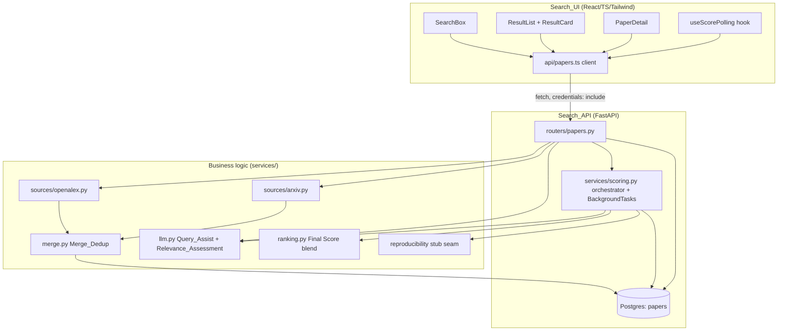
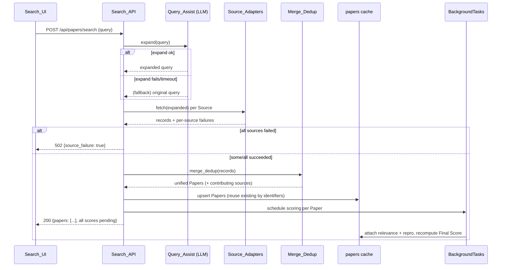
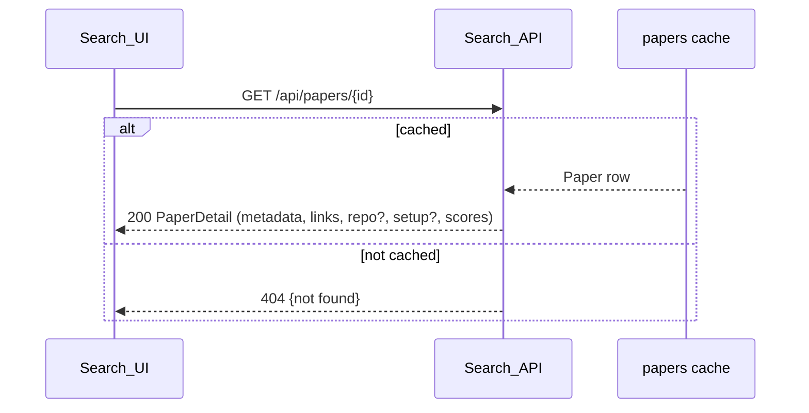

# Design Document

## Overview

The `paper-search` feature is the Reader entry point of the Open Science Paper
Engine. A `User` in `Reader` mode submits a query; the backend expands it with the
LLM, fetches candidate records from OpenAlex and arXiv, merges and de-duplicates
them into unified `Paper`s, caches those `Paper`s in Postgres, kicks off
asynchronous scoring, and returns ranked result cards that lead to a `Paper`
detail view. It introduces the `Paper` table.

Per the mandated layering, the design is organized into three concerns, each
mapping back to specific requirements:

| Layer | Component | Location | Requirements |
| --- | --- | --- | --- |
| Frontend | `Search_UI` | `frontend/src/components/`, `frontend/src/api/` | R1, R2, R3 |
| Backend | `Search_API` | `backend/app/routers/papers.py`, `backend/app/models/paper.py`, `backend/app/services/scoring.py` | R4, R5, R6, R9 |
| Business logic | `Source_Adapter` + `Merge_Dedup`, `Query_Assist` + `Relevance_Assessment`, `Final Score` blend | `backend/app/services/sources/`, `backend/app/services/merge.py`, `backend/app/services/llm.py`, `backend/app/services/ranking.py` | R7, R8 |

This spec reuses the conventions set by `accounts`: API routes under
`routers/`, tables under `models/`, env-driven `Settings` in `core/config.py`,
and the Alembic-only schema rule. It adds one new convention — a
`backend/app/services/` package for business logic that is heavier than the thin
`core/security.py` helpers (external HTTP adapters, LLM calls, merge, ranking,
and the async scoring orchestrator).

### Scope and seams

- **Reproducibility is stubbed here.** `reproducibility-scoring` is a later spec.
  This spec defines a `reproducibility` seam — a single function the scoring
  orchestrator calls — and ships a stub implementation that returns a fixed value
  with Score_Status `ready`. When `reproducibility-scoring` lands it replaces the
  stub behind the same seam; nothing else in `paper-search` changes (R5.6).
- **Experiment Setup is read-only and optional here.** The detail endpoint and
  view surface an Experiment Setup when present but never produce one — that is
  `reproducibility-scoring`'s job (R6.4). For this spec it is always absent. The
  `papers.experiment_setup` JSON column is the agreed read location:
  `reproducibility-scoring` mirrors its normalized `experiment_setups` row into
  it as `{hyperparameters, datasets, environment, available}`, so this read path
  needs no change when that feature ships.
- **The code-generation action is surface-only.** The detail view renders an
  opt-in, off-by-default action whose availability depends on repo presence; its
  behavior is defined by `code-generation` and is out of scope (R3.5).

### Key design decisions

- **Scoring runs via FastAPI `BackgroundTasks`, polled by the client.** The
  stack has no broker or websocket layer (tech.md), and the user confirmed the
  simple option for the first iteration. The search response returns immediately
  with each component score at Score_Status `pending`; background tasks compute
  the `Relevance_Assessment` and the (stubbed) `Reproducibility Score`, attach
  them to the cached `Paper`, and the `Search_UI` polls a lightweight scores
  endpoint until nothing is `pending` (R2.7, R5.1, R5.5). **Trade-off:** polling
  is less efficient than a push channel, but it needs no new infra and is easy to
  replace in a later redesign. BackgroundTasks run in-process, so a backend
  restart loses in-flight scoring for an uncached-but-not-yet-scored `Paper`;
  because scores are persisted on the `Paper` row, a re-search re-schedules only
  the still-`pending` components.
- **Ranking is a non-AI blend, computed in Python.** The LLM produces only the
  `Relevance Score` + blurb (`Relevance_Assessment`) and the expanded query
  (`Query_Assist`). `Final Score = w_rel · relevance + w_repro · reproducibility`
  with `w_rel=0.7`, `w_repro=0.3` read from config. The LLM is never asked for
  the `Final Score` or the ordering (R5.7, R8.5). This is enforced structurally:
  `ranking.final_score()` is a pure arithmetic function with no LLM import.
- **De-duplication is heuristic (first iteration).** `Merge_Dedup` collapses
  records by, in order: (1) matching normalized DOI, (2) matching normalized
  arXiv id, (3) matching normalized title with overlapping authors. The user
  confirmed heuristics for the first iteration. The rule lives in one pure
  function so it can be tightened later without touching adapters or the API.
- **Papers cached, searches not persisted.** Each unified `Paper` is upserted
  into the `papers` table keyed by its external identifiers; the query text and
  the search request are never stored (R4.2). A re-search that produces an
  already-cached `Paper` reuses the existing row (R9.4).
- **Source adapters are isolated and fault-tolerant.** One adapter per `Source`;
  a failing or slow adapter does not fail the search — `Merge_Dedup` proceeds
  with the survivors and reports which `Source`s failed, so the API can
  distinguish partial success, total source failure, and a genuinely empty result
  (R4.6, R4.7, R7.5).
- **Schema via Alembic, never `create_all`.** The `papers` table is created by a
  committed migration under `backend/alembic/versions/`, applied by the container
  entrypoint (`alembic upgrade head`). `create_all` exists only for test speed
  (R9.2).

## Architecture



### Search flow (R4, R5, R7, R8)



### Score polling flow (R2.7, R5.3, R5.5)

```mermaid
sequenceDiagram
    participant UI as Search_UI
    participant API as Search_API
    participant DB as papers cache

    loop until no component is pending (bounded)
        UI->>API: GET /api/papers/scores?ids=1,2,3
        API->>DB: read scores + statuses
        DB-->>API: per-paper {relevance, repro, final, statuses}
        API-->>UI: 200 scores
        UI->>UI: replace pending cells; re-sort if Final Score changed
    end
```

### Paper detail flow (R3, R6)



## Components and Interfaces

### 1. Frontend — `Search_UI` (R1, R2, R3)

React/TS/Tailwind components under `frontend/src/components/`, consistent with
the existing `App.tsx` fetch + Tailwind style, plus a typed client under
`frontend/src/api/papers.ts`. All calls use `credentials: "include"` (CORS
already allows credentials for `http://localhost:5173`) and a per-request
`AbortController` for timeouts.

**`api/papers.ts`** — the one place that talks to `Search_API`:

```ts
type ScoreStatus = "pending" | "ready" | "unavailable";
interface ScoreCell { status: ScoreStatus; value: number | null; }
interface SourceBadge { source: "openalex" | "arxiv"; }

interface PaperCard {
  id: number;
  title: string;
  authors: string[];
  sources: SourceBadge[];
  relevance: ScoreCell;
  reproducibility: ScoreCell;
  final: ScoreCell;
  blurb: string | null;
}

interface PaperDetail extends PaperCard {
  abstract: string | null;
  publishedDate: string | null;      // ISO date
  sourceLinks: { source: string; url: string }[];
  repoUrl: string | null;            // null => no repository (R3.3)
  // null => not yet available; else the agreed shape (R3.4), filled by
  // reproducibility-scoring
  experimentSetup: {
    hyperparameters: string | null;
    datasets: string | null;
    environment: string | null;
    available: boolean;
  } | null;
}

// 30s timeout (R1.3, R1.6); abandons the previous in-flight call (R1.7)
search(query: string): Promise<
  | { ok: true; papers: PaperCard[] }
  | { ok: false; kind: "empty" | "source_failure" | "validation" | "network" }>;

// scores poll (R2.7, R5.5)
scores(ids: number[]): Promise<Record<number, Pick<PaperCard,
  "relevance" | "reproducibility" | "final" | "blurb">>>;

// 30s timeout (R3.7)
paper(id: number): Promise<
  | { ok: true; paper: PaperDetail }
  | { ok: false; kind: "not_found" | "network" }>;
```

**`SearchBox`** (R1): search input + submit; submit disabled while the input is
empty/whitespace (R1.1); on submit sends the query and shows a loading indicator
with the submit control disabled (R1.3); abandons an earlier in-flight request so
only the latest query's results render (R1.7); renders the empty-result message
(R1.5) and the error/retry state on timeout or network/server error, retaining
the query text (R1.6).

**`ResultList` + `ResultCard`** (R2): renders cards in the API's returned order
(R1.4); each card shows title, authors, and a `Source` badge per contributing
`Source` (R2.1); the three labeled component scores (R2.2); a `pending` score
renders as pending (not a number), and the Final Score renders pending while any
contributing component is pending (R2.3); an `unavailable` score renders as
unavailable (R2.4); the relevance blurb shows when present (R2.5); activating a
card navigates to the detail view (R2.6).

**`useScorePolling`** hook (R2.7): while any rendered card has a `pending`
component, it polls `scores(ids)` on an interval, replaces each pending cell with
its value or `unavailable`, re-sorts when a Final Score resolves, and stops when
nothing is `pending` or after a bounded number of attempts. No resubmission by
the Reader.

**`PaperDetail`** (R3): fetches the Paper by id (R3.1), renders title, authors,
abstract, publication date, every `Source` badge, and external source links
(R3.1); the full score breakdown with each Score_Status (R3.2); the repo link as
an outbound link or a "no repository" indicator (R3.3); the Experiment Setup
section populated when available, else "not yet available" (R3.4); the opt-in,
off-by-default code-generation action whose availability depends on repo presence
(R3.5, behavior deferred); a not-found message with a path back to search (R3.6);
an error/retry state on timeout/failure (R3.7).

### 2. Backend — `Search_API` (R4, R5, R6, R9)

New `backend/app/routers/papers.py` exposing `APIRouter(prefix="/api/papers")`,
registered in `main.py` via `app.include_router(papers.router)`. Existing
`/health` and `/api/items` routes are untouched. Uses the existing `get_session`
dependency.

**Endpoints** (full contracts below): `POST /search`, `GET /scores`,
`GET /{paper_id}`.

**Scoring orchestrator** — `backend/app/services/scoring.py`:

```python
def schedule_scoring(paper_ids: list[int], query: str, tasks: BackgroundTasks) -> None
    # queues one background job per paper (R5.1)

def run_scoring_for_paper(paper_id: int, query: str) -> None
    # opens its own Session; computes Relevance_Assessment and the
    # reproducibility value via the seam; on each result, attaches value +
    # sets status "ready"; on failure sets that component "unavailable"
    # (R5.3, R5.4); recomputes Final Score from available components (R5.3).
```

Background jobs open their own DB `Session` (they run after the request session
closes). Each job is independent, so one `Paper`'s failure never blocks another.

**Reproducibility seam** — `backend/app/services/reproducibility.py`:

```python
def score_reproducibility(paper_id: int) -> float
    # STUB for this spec: returns a fixed in-range value (e.g. 0.5) with
    # status "ready". Replaced by reproducibility-scoring behind this signature
    # (R5.6). Kept in its own module so the later spec swaps one file.
```

### 3. Business logic — `services/` (R7, R8)

**`Source_Adapter`s** — `backend/app/services/sources/`:

```python
# common pre-merge shape produced by every adapter (R7.1)
@dataclass
class SourceRecord:
    source: str                 # "openalex" | "arxiv"
    title: str
    authors: list[str]
    abstract: str | None
    published_date: date | None
    doi: str | None
    arxiv_id: str | None
    source_links: list[tuple[str, str]]   # (source, url)
    repo_url: str | None

class SourceAdapter(Protocol):
    name: str
    def fetch(self, query: str, *, limit: int, timeout: float) -> list[SourceRecord]: ...
```

- `sources/openalex.py` — queries the OpenAlex REST API (keyless), maps works to
  `SourceRecord`, filters to the CS + Medicine domains via OpenAlex concept/field
  filters (R7.2), extracts a repo URL when present. Index metadata/links only;
  never full text (R7.6).
- `sources/arxiv.py` — queries the arXiv API, maps entries to `SourceRecord`,
  restricts to CS categories (and Medicine-adjacent where applicable) (R7.2).
- Each adapter is called with a timeout; a failure/timeout raises a
  `SourceError` the orchestration catches and records as a failed `Source`
  (R7.5).

**`Merge_Dedup`** — `backend/app/services/merge.py`:

```python
def merge_dedup(record_groups: list[list[SourceRecord]]) -> list[MergedPaper]
    # collapse records that are the same publication; MergedPaper records every
    # contributing source and keeps the richer non-empty value per field.

def same_publication(a: SourceRecord, b: SourceRecord) -> bool
    # heuristic (first iteration): same normalized DOI, OR same normalized
    # arXiv id, OR normalized-title match with overlapping authors (R7.3).
```

Pure functions over the adapter output — no HTTP, no DB — so the de-dup heuristic
is unit-testable in isolation and tightenable later.

**`Query_Assist` + `Relevance_Assessment`** — `backend/app/services/llm.py`,
Amazon Bedrock via LangChain, called from the backend (R8, ADR-0002):

```python
def expand_query(raw: str) -> str
    # returns an enriched query; on failure/timeout the caller falls back to
    # `raw` (R8.1, R8.2)

@dataclass
class RelevanceResult:
    score: float      # 0..1
    blurb: str

def assess_relevance(paper: PaperSummary, query: str) -> RelevanceResult
    # Bedrock/LangChain; raises on failure so the orchestrator records the
    # relevance component "unavailable" rather than fabricating a value (R8.3, R8.4)
```

Bedrock model id and AWS credentials come from env via `Settings` (R8.6, R9.6).

**`Final Score` blend** — `backend/app/services/ranking.py`:

```python
def final_score(relevance: float | None, reproducibility: float | None,
                *, w_rel: float, w_repro: float) -> float | None
    # pure arithmetic: w_rel*relevance + w_repro*reproducibility; returns None
    # (-> Final Score pending) if a contributing component is not yet available.
    # No LLM import anywhere in this module (R5.7, R8.5).
```

## Data Models

### `Paper` table (R9)

New `backend/app/models/paper.py` following the Base/Create/Read split from
`item.py`. Component scores and their statuses live on the row so current scores
are retrievable without recomputation (R9.3). Authors, contributing sources, and
source links are JSON columns (small, read-mostly index metadata).

```python
from datetime import date, datetime, timezone
from enum import Enum
from sqlalchemy import Column, JSON
from sqlmodel import Field, SQLModel


class ScoreStatus(str, Enum):
    pending = "pending"
    ready = "ready"
    unavailable = "unavailable"


class PaperBase(SQLModel):
    title: str = Field(index=True, max_length=1024)
    authors: list[str] = Field(default_factory=list, sa_column=Column(JSON))
    abstract: str | None = Field(default=None)                 # index metadata only
    published_date: date | None = Field(default=None)
    doi: str | None = Field(default=None, index=True)
    arxiv_id: str | None = Field(default=None, index=True)
    sources: list[str] = Field(default_factory=list, sa_column=Column(JSON))
    source_links: list[dict] = Field(default_factory=list, sa_column=Column(JSON))
    repo_url: str | None = Field(default=None)                 # None => no repo (R6.3)


class Paper(PaperBase, table=True):
    __tablename__ = "papers"

    id: int | None = Field(default=None, primary_key=True)

    # scores + statuses (R9.3)
    relevance_score: float | None = Field(default=None)
    relevance_status: ScoreStatus = Field(default=ScoreStatus.pending)
    relevance_blurb: str | None = Field(default=None)
    reproducibility_score: float | None = Field(default=None)
    reproducibility_status: ScoreStatus = Field(default=ScoreStatus.pending)
    final_score: float | None = Field(default=None)
    final_status: ScoreStatus = Field(default=ScoreStatus.pending)

    # Experiment Setup is produced by reproducibility-scoring; absent here (R6.4).
    # Shape (agreed with reproducibility-scoring): a JSON object
    #   {"hyperparameters": str | null, "datasets": str | null,
    #    "environment": str | null, "available": bool}
    # where null fields mean "not provided" and available=false means extraction
    # was unavailable. reproducibility-scoring mirrors its normalized
    # experiment_setups row into this column so this read path is unchanged.
    experiment_setup: dict | None = Field(default=None, sa_column=Column(JSON))

    created_at: datetime = Field(
        default_factory=lambda: datetime.now(timezone.utc), nullable=False
    )


class PaperRead(PaperBase):
    id: int
    relevance: "ScoreCell"
    reproducibility: "ScoreCell"
    final: "ScoreCell"
    blurb: str | None
    experiment_setup: dict | None
```

`ScoreCell` is a small read schema `{status: ScoreStatus, value: float | None}`
assembled from the row's score/status pair, so the API never leaks raw nullable
columns and the frontend sees the clean shape above.

| Field | Type | Constraints | Requirement |
| --- | --- | --- | --- |
| `id` | int | PK, assigned at creation, stable, referenceable | R9.5 |
| `title` | str | indexed | R9.1 |
| `authors` | json(list[str]) | — | R9.1 |
| `doi` / `arxiv_id` | str? | indexed (de-dup + upsert key) | R9.1, R9.4 |
| `sources` | json(list[str]) | every contributing Source | R7.4, R9.1 |
| `repo_url` | str? | null => no repo | R6.3 |
| `*_score` / `*_status` | float? / enum | per component | R9.3 |
| `experiment_setup` | json? `{hyperparameters, datasets, environment, available}` | absent here; filled by reproducibility-scoring | R6.4 |

**Upsert / reuse (R9.4):** before inserting a merged paper, the API looks up an
existing row by `doi`, else `arxiv_id`; on a hit it reuses that row (and merges
any newly-contributing `Source`s) rather than inserting a duplicate. The DOI and
arXiv-id indexes back this lookup.

### Alembic migration (R9.2)

A new revision under `backend/alembic/versions/` (generated via
`alembic revision --autogenerate -m "create papers table"`, then reviewed)
creates the `papers` table with indexes on `title`, `doi`, and `arxiv_id`. It is
applied by the container entrypoint's `alembic upgrade head` — not `create_all`,
which exists only for tests (R9.2).

### Configuration (R8.6, R9.6)

Extend `app/core/config.py` `Settings` (pydantic-settings, env-driven):

```python
# ranking weights (non-AI blend) — R5.7, R8.5
relevance_weight: float = 0.7
reproducibility_weight: float = 0.3

# source scope + limits — R7.2
source_domains: list[str] = ["computer science", "medicine"]
source_result_limit: int = 25
source_timeout_seconds: float = 10.0

# Bedrock / LangChain — REQUIRED, no committed default (R8.6, R9.6)
bedrock_model_id: str
aws_region: str = "us-east-1"
# AWS credentials themselves come from the standard AWS env vars / provider chain
llm_timeout_seconds: float = 20.0
```

`bedrock_model_id` has **no default**, so the app fails to start if it is absent
rather than reading a value from committed source (R9.6). `.env.example`
documents it and the AWS credential vars; real values live in `.env`
(gitignored). The ranking weights are config (R5.7) with the specified defaults.

## Correctness Properties

*A property is a characteristic or behavior that should hold true across all
valid executions of a system — essentially, a formal statement about what the
system should do. Properties serve as the bridge between human-readable
specifications and machine-verifiable correctness guarantees.*

These properties target the pure business logic (`Merge_Dedup`, `ranking`) and
the `Search_API` behavior with input-varying logic. The `Search_UI` (R1–R3) is
rendering/interaction, covered by manual example checks, not property-based
tests. The LLM calls (`Query_Assist`, `Relevance_Assessment`) are stubbed/mocked
in tests — their non-determinism is not property-tested; their failure handling
is. Each property maps to the requirement clauses it validates.

### Property 1: Final Score is the exact configured non-AI blend

*For any* `relevance` and `reproducibility` in `[0,1]` with both components
`ready`, `final_score` equals `w_rel · relevance + w_repro · reproducibility` for
the configured weights, lies in `[0,1]` when the weights sum to 1, and is
computed without any LLM call.

**Validates: Requirements 5.7, 8.5**

### Property 2: Final Score is pending exactly when a component is pending

*For any* component states, `final_score` returns a value with status `ready`
exactly when both contributing components are `ready`; if either component is
`pending`, the Final Score is `pending`.

**Validates: Requirements 2.3, 4.4, 5.3**

### Property 3: Results are sorted by Final Score, pending last

*For any* set of scored Papers, the search/scores response orders Papers by
descending Final Score, and every Paper whose Final Score is `pending` sorts after
every Paper with a computed Final Score.

**Validates: Requirements 4.3, 4.4**

### Property 4: De-duplication merges same-publication records and keeps all sources

*For any* multiset of `SourceRecord`s where some share a normalized DOI, a
normalized arXiv id, or a matching normalized title with overlapping authors,
`merge_dedup` yields one `Paper` per distinct publication, and that `Paper`'s
`sources` equals exactly the set of sources of the records that were merged.

**Validates: Requirements 7.3, 7.4**

### Property 5: Merge keeps the richer value and never fabricates full text

*For any* records merged into one `Paper`, each scalar field takes a non-empty
contributing value when one exists, and no field contains full text beyond the
index metadata the adapters produced.

**Validates: Requirements 7.3, 7.6, 9.1**

### Property 6: One source failing never fails the search

*For any* combination of adapter outcomes with at least one success, the search
returns the Papers from the succeeding Source(s) and reports the failed Source(s);
*for any* combination where every adapter fails, the response signals
source-failure distinctly from an empty-but-successful result.

**Validates: Requirements 4.6, 4.7, 7.5**

### Property 7: Query validation rejects before any fetch

*For any* query that is empty, whitespace-only, or longer than 512 characters,
the search endpoint returns a validation error and performs no Source fetch and no
LLM call.

**Validates: Requirements 1.1, 4.5**

### Property 8: Caching persists Papers but never the query

*For any* successful search, every returned Paper exists in the `papers` cache
afterward, and no table holds the query text or a record of the search request.

**Validates: Requirements 4.2, 9.1**

### Property 9: Re-search reuses cached Papers rather than duplicating

*For any* Paper identifiable by DOI or arXiv id, repeating a search that yields
that publication reuses the existing cached row (same `id`) and persists no second
row for it.

**Validates: Requirements 9.4, 9.5**

### Property 10: Score lifecycle terminates — no component stays pending forever

*For any* Paper scheduled for scoring, after its background jobs run each
component score ends in `ready` (value attached) or `unavailable` (computation
failed) and never remains `pending`; a failed component is `unavailable`, not a
fabricated value.

**Validates: Requirements 5.3, 5.4, 8.4**

### Property 11: The reproducibility stub produces a full score lifecycle

*For any* search run against the stub, every Paper receives a Reproducibility
Score with status `ready` and therefore a computable Final Score, so ranking works
before `reproducibility-scoring` ships.

**Validates: Requirements 5.6**

### Property 12: Detail is served from cache and 404s for unknown ids

*For any* cached Paper id the detail endpoint returns that Paper from Postgres
without any Source re-fetch; *for any* id not in the cache it returns not-found.

**Validates: Requirements 6.1, 6.2, 6.5**

## API Endpoint Contracts

All endpoints live on the `/api/papers` router. Bodies are JSON.

### POST /api/papers/search (R4)

- **Request:** `{ "query": string }` (1–512 chars, non-whitespace)
- **200 OK:**
  ```json
  {
    "papers": [
      {
        "id": 12,
        "title": "...",
        "authors": ["..."],
        "sources": ["openalex", "arxiv"],
        "relevance": { "status": "pending", "value": null },
        "reproducibility": { "status": "pending", "value": null },
        "final": { "status": "pending", "value": null },
        "blurb": null
      }
    ],
    "failed_sources": []
  }
  ```
  Papers sorted by Final Score descending, `pending` Final Scores last (R4.3,
  R4.4). On first return all components are typically `pending` (R5.2).
- **422 Unprocessable Entity:** empty/whitespace/over-512 query (R4.5); no fetch.
- **502 Bad Gateway:** `{ "detail": "all sources failed", "source_failure": true }`
  when every Source failed (R4.6), distinct from a `200` with `papers: []`.

### GET /api/papers/scores?ids=1,2,3 (R5.5, R2.7)

- **200 OK:** `{ "<id>": { "relevance": ScoreCell, "reproducibility": ScoreCell, "final": ScoreCell, "blurb": string | null }, ... }`
  — current component scores and statuses for the requested cached Papers.
- Unknown ids are omitted from the map (the client stops polling them).

### GET /api/papers/{paper_id} (R6, R3)

- **200 OK:** `PaperRead` — title, authors, abstract, published_date, sources,
  source_links, `repo_url` (null when absent, R6.3), `experiment_setup` (null when
  absent, R6.4), and `relevance`/`reproducibility`/`final` ScoreCells (R6.1).
  Served from the cache; no Source re-fetch (R6.5). `reproducibility-scoring`
  later adds one additive, nullable `reproducibility_breakdown` field to this
  response (code-quality, setup-completeness, repo-exists, explanation); it is
  `null` until that feature runs, so this contract is forward-compatible.
- **404 Not Found:** `{ "detail": "paper not found" }` for an uncached id (R6.2).

## Error Handling

- **Query validation (R4.5):** the endpoint rejects empty/whitespace/over-512
  queries with `422` before any LLM or Source call (Property 7).
- **Query_Assist failure (R8.2):** `expand_query` failures/timeouts are caught;
  the search falls back to the Reader's original query and proceeds.
- **Partial / total source failure (R4.6, R4.7, R7.5):** adapter calls are
  wrapped so a `SourceError`/timeout is recorded in `failed_sources` instead of
  propagating; the search succeeds on survivors. Only when *all* adapters fail
  does the endpoint return `502` with `source_failure: true`, distinguishing it
  from a successful empty result.
- **Relevance_Assessment failure (R8.4):** a per-Paper failure sets
  `relevance_status = unavailable` (never a fabricated score); the orchestrator
  continues with other Papers.
- **Reproducibility (stub) (R5.6):** the stub always returns `ready`; when the
  real scorer lands, a failure there sets `reproducibility_status = unavailable`
  through the same seam (R5.4).
- **Score lifecycle termination (R5.4):** every background job sets each
  component to `ready` or `unavailable` in a `finally`-style guarantee, so a
  component never stays `pending` after its job runs (Property 10).
- **Detail not-found (R6.2):** an uncached id returns `404`; no Source re-fetch.
- **Frontend network/timeouts (R1.6, R3.7):** the client uses `AbortController`
  (30s for search and detail); on abort/network/5xx the UI shows a retry-oriented
  error and retains input. A new search aborts the previous in-flight request
  (R1.7). The score poll is bounded and backs off; it never blocks the UI.
- **Missing config (R9.6):** `bedrock_model_id` has no default; a missing value
  fails `Settings` construction at startup, so the app will not boot without the
  LLM configured.

## Security

- **Secrets via env (R8.6, R9.6):** Bedrock model id, AWS region, and AWS
  credentials come from the environment; `.env.example` carries placeholders only.
  `bedrock_model_id` has no committed default — a missing value stops startup.
- **Outbound calls only to known Sources and Bedrock:** adapters call the fixed
  OpenAlex and arXiv endpoints and Bedrock via LangChain; the Reader's query is
  passed as a query parameter / request body to those services, never
  interpolated into a shell or SQL string. DB access is through SQLModel
  (parameterized), so the query text cannot inject SQL.
- **Index-only storage (R7.6, R9.1):** only index metadata and links are stored
  for `Paper`s; no full text is fetched or persisted, honoring the product's
  index-only rule for search-side content.
- **No query persistence (R4.2):** the Reader's query text is never written to
  the database, limiting what the search surface retains.
- **LLM output is data, not instructions:** `Query_Assist` output is used only as
  a search string, and `Relevance_Assessment` output is parsed into a bounded
  score (clamped to `[0,1]`) plus a text blurb; the LLM never determines ranking
  or control flow (R5.7, R8.5).
- **Bounded external work:** every adapter and LLM call has a timeout from
  config; the search response is never blocked on scoring (R5.1).

## Testing Strategy

Backend tests run with **pytest + testcontainers** against a throwaway
`postgres:17`, on the host (`cd backend && uv run pytest`), per `backend/README`.
Existing fixtures (`client`, `session`, transaction-rollback isolation) are
reused. External `Source`s and the LLM are **not** called in tests — adapters and
`services/llm.py` are mocked/faked so tests are deterministic and offline. The
frontend has **no automated test gate** (team tests UI manually), so R1–R3 are
verified by manual example checks, not an invented suite.

**Dual approach:** property-based tests cover the universal invariants above;
example/edge and integration tests cover concrete scenarios, boundaries, and
infrastructure.

### Property-based tests (Hypothesis)

Use **Hypothesis** (added to the dev dependency group via `uv`) — we do not
hand-roll generators. Each property test runs **a minimum of 100 iterations** and
is tagged with a comment referencing its design property, e.g.:

```python
# Feature: paper-search, Property 1: Final Score is the exact configured non-AI blend
```

- Properties 1–3 (`ranking`): pure, fast arithmetic/ordering — ideal PBT over
  generated score tuples and statuses.
- Properties 4–5 (`Merge_Dedup`): pure functions over generated `SourceRecord`
  lists (shared/distinct identifiers, overlapping authors) — ideal PBT.
- Properties 6–12 (`Search_API`): driven through `TestClient` against the
  testcontainer DB with faked adapters and a mocked LLM, generating
  success/failure outcome combinations, valid/invalid queries, and repeated
  searches.

### Example / edge tests (pytest)

- R4.5: search with empty / whitespace / 513-char query → `422`, no fetch.
- R4.6 vs empty: all-adapters-fail → `502 source_failure` vs. adapters-succeed-
  with-zero-records → `200 {papers: []}`.
- R4.7: one adapter fails, one succeeds → results returned, failed source listed.
- R5.6: a search end-to-end with the reproducibility **stub** yields a `ready`
  Final Score for each Paper.
- R6.2: detail for an uncached id → `404`; R6.5: detail never triggers a Source
  fetch (assert adapters not called).
- Representative search → scores-poll → detail happy-path smoke through
  `TestClient`.

### Integration / smoke tests

- R9.2: a `test_migrations`-style upgrade → downgrade → upgrade asserting the
  `papers` table (and its `title`/`doi`/`arxiv_id` indexes) exist after upgrade —
  single run, not PBT.
- R9.4: run two searches that both yield the same publication (same DOI) and
  assert exactly one `papers` row exists with both searches reusing the same `id`.
- R9.6: constructing `Settings` without `bedrock_model_id` raises — single-run
  smoke test.
