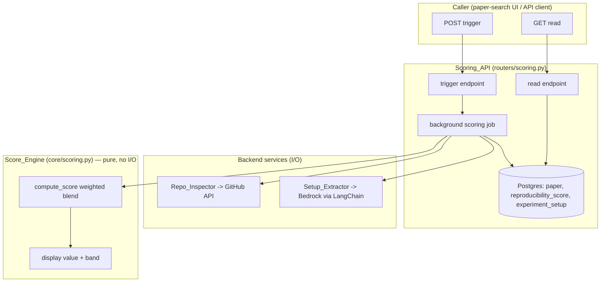
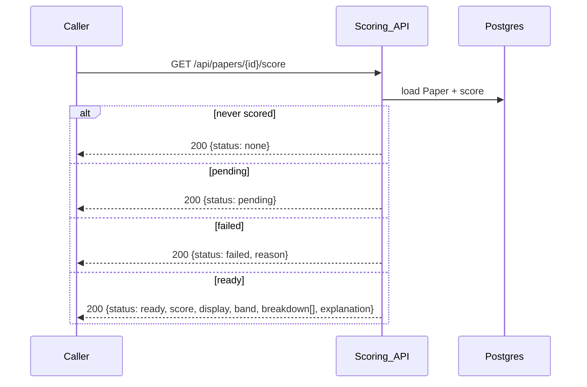

# Design Document

## Overview

The `reproducibility-scoring` feature computes a **Reproducibility Score** for a
`Paper` and the structured **Experiment Setup** it rests on. The score is
**rule-based** (see `docs/adr/0004`): a deterministic weighted blend of
independent **Score Signals** — repo existence, repo quality (via the GitHub
API), and Experiment Setup completeness — producing a `0.0–1.0` value surfaced to
callers as `0–100` plus a band label. The LLM (Amazon Bedrock via LangChain,
ADR-0002) is bounded to two jobs: extracting the Experiment Setup and writing a
human-readable explanation. It never produces or adjusts the number.

Scoring runs **asynchronously** (FastAPI `BackgroundTasks`, no broker — the stack
has only FastAPI + Postgres per `tech.md`) and caches on the `Paper`: a trigger
endpoint returns `pending` immediately, a read endpoint returns the current
status and, when `ready`, the score, breakdown, and explanation. When a signal
cannot be gathered, the engine computes a **Partial Score** from what is
available rather than failing outright.

Per the mandated layering, the design is organized into two concerns (there is no
frontend concern in this spec — the score-display UI belongs to `paper-search`):

| Layer | Component | Location | Requirements |
| --- | --- | --- | --- |
| Business logic | `Score_Engine` | `backend/app/core/scoring.py` | R3, R8 |
| Backend | `Scoring_API` | `backend/app/routers/scoring.py` | R1, R2, R6 |
| Backend | `Repo_Inspector` | `backend/app/services/repo_inspector.py` | R4 |
| Backend | `Setup_Extractor` | `backend/app/services/setup_extractor.py` | R5 |
| Backend | models + migration | `backend/app/models/scoring.py`, `backend/app/models/paper.py` | R7 |

This mirrors `accounts`: `Score_Engine` is a thin, framework-agnostic
business-logic module the backend calls — the analogue of
`Credential_Helper` in `core/security.py` — and the API lives under `routers/`
per `structure.md`. It introduces a new `services/` package for the two
I/O-bound external integrations, keeping the pure computation (`Score_Engine`)
cleanly separated from I/O (`Repo_Inspector`, `Setup_Extractor`).

### Dependency on `paper-search` / `Paper`

The `ReproducibilityScore` and `ExperimentSetup` tables hang off a `Paper`. The
`Paper` table is formally introduced by `paper-search`. Per the README build
order, `paper-search` ships first with a **stubbed** score and this spec unstubs
it. To keep this spec self-contained and runnable, the design assumes a minimal
`Paper` with at least `id` and an optional `repo_url`; where `paper-search` has
not yet landed, this spec contributes the migration for those columns it reads.
The scoring columns (`score_status` and the related rows) are added here.

### Key design decisions

- **Rule-based number, LLM bounded (ADR-0004).** `Score_Engine` is pure and
  deterministic; the LLM output only ever influences the *Setup-Completeness
  Signal* (via extraction) and the *explanation text*. An LLM error can lower
  confidence in the explanation or mark the completeness signal `unavailable`,
  but it can never change the computed number (R8.6, R8.4).
- **Signals carry an availability status.** Every signal is `ok` or
  `unavailable`. A flaky GitHub call or a failed Bedrock extraction marks its
  signal `unavailable`; the engine renormalizes over the remaining weights to
  produce a Partial Score (R3.4, R4.5, R5.4). Only when *every* signal is
  unavailable does the status become `failed` (R3.5, R6.3).
- **Weights and thresholds in config, not code constants.** The signal weights,
  the Final-Score blend already defined in the product (`0.7/0.3`), and the band
  thresholds live in `Settings` so they are tunable without reopening ADR-0004
  (R3.2, R3.6, R8.1).
- **Async via `BackgroundTasks`, cache on the `Paper`.** The trigger endpoint
  sets `score_status = pending`, schedules the job, and returns. The job gathers
  signals, calls `Score_Engine`, persists the result, and flips the status to
  `ready` or `failed`. No broker, consistent with `tech.md`.
- **Schema via Alembic, never `create_all`.** New tables and columns ship as a
  committed migration under `backend/alembic/versions/`, applied by the
  container entrypoint (R7.1).

## Architecture



### Trigger + async scoring flow (R1, R4, R5, R6)

```mermaid
sequenceDiagram
    participant C as Caller
    participant API as Scoring_API
    participant RI as Repo_Inspector
    participant SE as Setup_Extractor
    participant EN as Score_Engine
    participant DB as Postgres

    C->>API: POST /api/papers/{id}/score
    API->>DB: load Paper, check score_status
    alt no paper
        API-->>C: 404
    else already pending
        API-->>C: 200 {status: pending}
    else ready and no recompute
        API-->>C: 200 {existing score}
    else needs scoring
        API->>DB: set score_status = pending
        API-->>C: 202 {status: pending}
        Note over API,DB: BackgroundTasks job runs after response
        API->>RI: inspect(repo_url)
        RI-->>API: repo-quality signal (ok | unavailable)
        API->>SE: extract(paper material)
        SE-->>API: experiment setup + completeness (ok | unavailable)
        API->>EN: compute_score(signals, weights)
        alt all signals unavailable
            EN-->>API: no-score
            API->>DB: score_status = failed, reason
        else at least one signal
            EN-->>API: score + breakdown + display + band
            API->>SE: explain(score, breakdown)
            SE-->>API: explanation text
            API->>DB: persist score, breakdown, setup, explanation; score_status = ready
        end
    end
```

### Read flow (R2)



## Components and Interfaces

### 1. Business logic — `Score_Engine` (R3, R8)

New thin, framework-agnostic module `backend/app/core/scoring.py`. No FastAPI,
SQLModel, or network imports — pure functions the `Scoring_API` calls, given
already-gathered signal values. This is the direct analogue of the `accounts`
spec's `Credential_Helper`.

```python
from dataclasses import dataclass
from enum import Enum

class SignalStatus(str, Enum):
    OK = "ok"
    UNAVAILABLE = "unavailable"

class SignalKind(str, Enum):
    REPO_EXISTENCE = "repo_existence"
    REPO_QUALITY = "repo_quality"
    SETUP_COMPLETENESS = "setup_completeness"

@dataclass
class SignalInput:
    kind: SignalKind
    status: SignalStatus
    value: float            # 0.0..1.0, meaningful only when status == OK

@dataclass
class SignalBreakdown:
    kind: SignalKind
    status: SignalStatus
    value: float            # the signal's own 0..1 value (0 when unavailable)
    weight: float           # renormalized weight actually applied
    contribution: float     # value * weight

@dataclass
class ScoreResult:
    score: float            # 0.0..1.0 (R3.1)
    display: int            # 0..100 (R3.6)
    band: str               # e.g. "strong" / "moderate" / "weak" (R3.6)
    breakdown: list[SignalBreakdown]

# Raised when no signal is available (R3.5) — API maps to score_status = failed.
class NoScoreAvailable(Exception): ...

def compute_score(signals: list[SignalInput], weights: ScoringWeights) -> ScoreResult:
    # Deterministic (R3.3). Renormalize weights over OK signals (R3.4).
    # All-unavailable -> raise NoScoreAvailable (R3.5).

def repo_quality_value(readme: bool, license_: bool, tests: bool, recent: bool,
                       weights: RepoQualityWeights) -> float:
    # Each sub-signal independent (R3.7); returns 0..1.

def setup_completeness_value(present_fields: set[str]) -> float:
    # fraction of the fixed checklist present (R3.8).

SETUP_CHECKLIST = (
    "hyperparameters", "datasets", "environment", "hardware", "procedure",
)
```

`compute_score` sums `value * weight` over the `OK` signals after renormalizing
their weights to total 1.0, so a Partial Score stays on the same `0..1` scale as
a full one (R3.4). `display` and `band` come from configured thresholds (R3.6).
The function performs no I/O and is deterministic for fixed inputs (R3.1, R3.3) —
the reliability guarantee of R8.4.

### 2. Backend — `Scoring_API` (R1, R2, R6)

New `backend/app/routers/scoring.py` exposing an `APIRouter(prefix="/api")`,
registered on the app in `main.py` via `app.include_router(scoring.router)`. The
existing routes are untouched. Uses the existing `get_session` dependency.

**Trigger endpoint** (`POST /api/papers/{paper_id}/score`, R1):
- Loads the `Paper`; `404` if absent (R1.2).
- `pending` already → return current status, no duplicate job (R1.3).
- `ready` and no `?recompute=true` → return existing score (R1.4).
- Otherwise set `score_status = pending`, schedule the job via
  `BackgroundTasks`, return `202 {status: pending}` (R1.1, R1.5).
- Any Session-identified caller (Reader or Writer) is accepted (R1.6).

**Read endpoint** (`GET /api/papers/{paper_id}/score`, R2):
- Maps `score_status` to the response: `none` / `pending` / `failed` / `ready`,
  returning the score, display value, band, breakdown (each signal's
  contribution, weight, and status), and explanation when `ready` (R2.1–R2.6).

**Background scoring job** (module-level function scheduled by the trigger, R6):

```python
def run_scoring(paper_id: int) -> None:
    # Opens its own Session (BackgroundTasks runs after the request session closes).
    # 1. gather signals: Repo_Inspector.inspect(), Setup_Extractor.extract()
    # 2. try Score_Engine.compute_score(signals, weights)
    #    - NoScoreAvailable -> score_status = failed, reason (R6.3)
    # 3. Setup_Extractor.explain(score, breakdown) -> explanation (R5.3)
    # 4. persist score + breakdown + setup + explanation; score_status = ready (R6.1, R6.2)
    # Wrapped so any unexpected error sets failed, never leaves pending (R6.6).
```

The job opens its own DB `Session` because `BackgroundTasks` runs after the
request's session is closed. A broad `try/except` guarantees R6.6 (never stuck
`pending`).

### 3. Backend — `Repo_Inspector` (R4)

New `backend/app/services/repo_inspector.py`. Given a `Paper`'s `repo_url`, it
calls the GitHub REST API for README, license, tests, and recent activity.

```python
@dataclass
class RepoQuality:
    exists: bool
    readme: bool
    license: bool
    tests: bool
    recent_activity: bool
    status: SignalStatus          # OK or UNAVAILABLE
    host: str | None              # "github" | other

def inspect(repo_url: str | None) -> RepoQuality:
    # No repo_url -> exists=False, status=OK, min contribution (R4.4).
    # Non-GitHub host -> exists=True, host-specific subsignals UNAVAILABLE (R4.3).
    # GitHub -> query contents/license/activity; GITHUB_TOKEN auth if present (R4.1, R4.2).
    # API error / rate-limit / unreachable -> status=UNAVAILABLE (R4.5).
```

- Reads an optional `GITHUB_TOKEN` from `Settings`; authenticated requests raise
  the rate limit, unauthenticated requests are the fallback (R4.2).
- Detects host from the URL; non-GitHub contributes only repo-existence (R4.3).
- Catches HTTP errors, timeouts, and GitHub's `403` rate-limit signal and
  returns `status = UNAVAILABLE` so the job proceeds as a Partial Score (R4.5).
- Reads repository *metadata* only — never clones or persists file contents,
  honoring the index-only rule (R4.6).

The `Scoring_API` maps `RepoQuality` into two `SignalInput`s: a repo-existence
signal and a repo-quality signal (value from
`Score_Engine.repo_quality_value(...)`).

### 4. Backend — `Setup_Extractor` (R5)

New `backend/app/services/setup_extractor.py`. Wraps the Bedrock-via-LangChain
call (ADR-0002).

```python
@dataclass
class ExtractedSetup:
    present_fields: set[str]      # subset of SETUP_CHECKLIST
    fields: dict[str, str]        # extracted structured content per field
    status: SignalStatus          # OK or UNAVAILABLE

def extract(material: PaperMaterial) -> ExtractedSetup:
    # Bedrock via LangChain extracts the checklist fields (R5.1, R5.2).
    # Failure / timeout / unparseable -> status=UNAVAILABLE (R5.4).

def explain(score: ScoreResult, setup: ExtractedSetup) -> str:
    # Human-readable explanation referencing the breakdown (R5.3).
    # Must not state a number differing from score.score (enforced by the
    # prompt + a post-check that the computed display value is the only number
    # substituted into the template).
```

- `material` is the abstract + metadata for indexed Papers, or the uploaded
  manuscript/source where present (the Writer case, R5.1).
- Each checklist field is marked present/absent so
  `Score_Engine.setup_completeness_value` can compute the fraction (R5.2, R3.8).
- Bedrock failure marks the completeness signal `UNAVAILABLE`; the job proceeds
  as a Partial Score (R5.4).
- Persists only the derived `ExperimentSetup` artifact, never indexed-source
  full text (R5.5).
- Bedrock/AWS credentials come from `Settings` / env, never committed (R5.6).

The explanation is produced from a template whose only interpolated number is the
engine's `display` value, so the explanation can never contradict the computed
number (R5.3, R8.6).

## Data Models

### `ReproducibilityScore` and `ExperimentSetup` tables (R7)

New `backend/app/models/scoring.py`, following the Base/Create/Read split from
`item.py` and `user.py`.

```python
from datetime import datetime, timezone
from sqlmodel import Field, SQLModel, Column, JSON

class ScoreStatus(str, Enum):
    NONE = "none"
    PENDING = "pending"
    READY = "ready"
    FAILED = "failed"

class ReproducibilityScore(SQLModel, table=True):
    __tablename__ = "reproducibility_score"
    id: int | None = Field(default=None, primary_key=True)
    paper_id: int = Field(foreign_key="paper.id", unique=True, index=True)  # one per Paper
    status: ScoreStatus = Field(default=ScoreStatus.PENDING)
    score: float | None = Field(default=None)          # 0.0..1.0, null until ready
    display: int | None = Field(default=None)          # 0..100
    band: str | None = Field(default=None)
    breakdown: list = Field(default_factory=list, sa_column=Column(JSON))  # per-signal
    explanation: str | None = Field(default=None)
    reason: str | None = Field(default=None)           # populated when status == failed
    updated_at: datetime = Field(
        default_factory=lambda: datetime.now(timezone.utc), nullable=False
    )

class ExperimentSetup(SQLModel, table=True):
    __tablename__ = "experiment_setup"
    id: int | None = Field(default=None, primary_key=True)
    paper_id: int = Field(foreign_key="paper.id", unique=True, index=True)  # one per Paper
    fields: dict = Field(default_factory=dict, sa_column=Column(JSON))      # field -> content
    present_fields: list = Field(default_factory=list, sa_column=Column(JSON))
    updated_at: datetime = Field(
        default_factory=lambda: datetime.now(timezone.utc), nullable=False
    )
```

| Table | Field | Type | Constraints | Requirement |
| --- | --- | --- | --- | --- |
| `reproducibility_score` | `paper_id` | int | FK → paper.id, unique | R7.2 |
| | `status` | enum | none/pending/ready/failed | R7.2, R6 |
| | `score` | float? | 0.0–1.0, null until ready | R7.2 |
| | `breakdown` | JSON | per-signal value/weight/status | R7.2, R2.2 |
| | `explanation` | str? | LLM text | R5.3 |
| `experiment_setup` | `paper_id` | int | FK → paper.id, unique | R7.3 |
| | `fields` | JSON | checklist field → content | R7.3 |
| | `present_fields` | JSON | checklist fields extracted | R7.3, R3.8 |

The **unique `paper_id`** on each table enforces one score / one setup per Paper
(R7.2, R7.3). Re-scoring **replaces** the existing rows (upsert on `paper_id`)
rather than accumulating duplicates (R7.4).

### Alembic migration (R7.1)

A new revision under `backend/alembic/versions/` (via
`alembic revision --autogenerate -m "create scoring tables"`, then reviewed)
creates `reproducibility_score` and `experiment_setup` with their unique
`paper_id` indexes and FKs. Applied by the container entrypoint's
`alembic upgrade head` — never `create_all` (R7.1). Where `paper-search` has not
yet introduced `paper.repo_url`, this revision adds the column it reads.

### Configuration (R7.5, R3.2)

Extend `app/core/config.py` `Settings`:

```python
# Signal weights (renormalized over available signals) — R3.2, R8.1
repro_weight_repo_existence: float = 0.2
repro_weight_repo_quality: float = 0.4
repro_weight_setup_completeness: float = 0.4
# Repo-quality sub-signal weights — R3.7
repo_quality_weight_readme: float = 0.25
repo_quality_weight_license: float = 0.25
repo_quality_weight_tests: float = 0.25
repo_quality_weight_recent: float = 0.25
# Band thresholds (on 0..1) — R3.6
repro_band_strong: float = 0.7
repro_band_moderate: float = 0.4
# External integrations — R4.2, R5.6
github_token: str | None = None            # optional; raises GitHub rate limit
bedrock_region: str                        # REQUIRED — no default (R7.5)
bedrock_model_id: str                       # REQUIRED — no default (R7.5)
```

`bedrock_region` / `bedrock_model_id` have **no default**, so a missing value
fails startup rather than reading a secret from committed source (R7.5). AWS
credentials follow the standard provider chain from env. `.env.example`
documents all of these; real values live in `.env` (gitignored).

## Correctness Properties

*A property is a characteristic or behavior that should hold true across all
valid executions of a system — a formal statement about what the system should
do, bridging the human-readable spec and machine-verifiable guarantees.*

These target `Score_Engine` (pure functions) and the `Scoring_API` /
async-job behavior. The external integrations (`Repo_Inspector`,
`Setup_Extractor`) are exercised through example/integration tests with the
network stubbed, since their behavior depends on third-party responses.

### Property 1: Score is always in range

*For any* set of signal inputs with at least one `OK` signal and any valid
weight configuration, `compute_score` returns a `score` in the inclusive range
`0.0`–`1.0` and a `display` in `0`–`100`.

**Validates: Requirements 3.1, 3.6**

### Property 2: Determinism

*For any* fixed signal inputs and weights, two independent calls to
`compute_score` return identical `score`, `display`, and `band`.

**Validates: Requirements 3.3, 8.4**

### Property 3: Partial Score renormalizes over available signals

*For any* set of signals in which some are `UNAVAILABLE` (but at least one is
`OK`), the applied weights in the breakdown sum to `1.0` over the `OK` signals,
the `UNAVAILABLE` signals contribute `0`, and each is marked `unavailable` in the
breakdown.

**Validates: Requirements 3.4, 2.4, 8.5**

### Property 4: All-unavailable yields no score

*For any* set of signals in which every signal is `UNAVAILABLE`, `compute_score`
raises `NoScoreAvailable` and returns no value.

**Validates: Requirements 3.5, 6.3**

### Property 5: Monotonicity in each signal

*For any* configuration, increasing a single `OK` signal's value while holding
the others fixed does not decrease the resulting `score` (a better signal never
lowers the score).

**Validates: Requirements 3.2, 8.1**

### Property 6: Setup completeness is the present-fraction

*For any* subset of the fixed checklist marked present,
`setup_completeness_value` equals `len(present) / len(SETUP_CHECKLIST)`, i.e. `0`
when none are present and `1.0` when all are.

**Validates: Requirements 3.8**

### Property 7: Repo-quality sub-signals are independent

*For any* combination of the four boolean sub-signals (README, license, tests,
recent activity), `repo_quality_value` equals the configured weighted sum of the
true sub-signals, so toggling one does not change the contribution of another.

**Validates: Requirements 3.7**

### Property 8: Trigger is idempotent while pending

*For any* Paper whose `score_status` is `pending`, repeated trigger requests
return `pending` and enqueue no additional job (the persisted status is unchanged
except by the running job).

**Validates: Requirements 1.3**

### Property 9: Status transitions never strand a Paper in pending

*For any* enqueued scoring job, after the job runs the Paper's `score_status` is
either `ready` (≥1 signal available) or `failed` (all unavailable, or unexpected
error) — never left `pending`.

**Validates: Requirements 6.2, 6.3, 6.6**

### Property 10: Read reflects persisted status exactly

*For any* Paper, the read endpoint returns `none`/`pending`/`ready`/`failed`
matching the persisted `score_status`, and includes a score value only when
`ready`.

**Validates: Requirements 2.1, 2.3, 2.5, 2.6**

### Property 11: Explanation never contradicts the number

*For any* computed `ScoreResult`, the explanation text produced by `explain`
contains no score number other than the engine's `display` value.

**Validates: Requirements 5.3, 8.6**

## API Endpoint Contracts

All endpoints live on the `/api` router. Bodies are JSON. Callers are identified
by the `accounts` Session cookie; both Reader and Writer are accepted (R1.6).

### POST /api/papers/{paper_id}/score (R1)

- **Query:** `?recompute=true` to force re-scoring of a `ready` Paper (R1.5)
- **202 Accepted:** `{ "status": "pending" }` — job enqueued (R1.1)
- **200 OK:** `{ "status": "pending" }` if already pending (R1.3), or the
  existing score object if `ready` and no recompute (R1.4)
- **404 Not Found:** unknown `paper_id` (R1.2)

### GET /api/papers/{paper_id}/score (R2)

- **200 OK, `ready`:**
  ```json
  {
    "status": "ready",
    "score": 0.72,
    "display": 72,
    "band": "strong",
    "breakdown": [
      { "kind": "repo_existence", "value": 1.0, "weight": 0.2, "contribution": 0.2, "status": "ok" },
      { "kind": "repo_quality", "value": 0.75, "weight": 0.4, "contribution": 0.3, "status": "ok" },
      { "kind": "setup_completeness", "value": 0.6, "weight": 0.4, "contribution": 0.24, "status": "ok" }
    ],
    "explanation": "…references the breakdown; the only number is 72…"
  }
  ```
  (R2.1, R2.2; Partial Score marks skipped signals `unavailable` — R2.4)
- **200 OK, `pending`:** `{ "status": "pending" }` (R2.3)
- **200 OK, `failed`:** `{ "status": "failed", "reason": "…" }` (R2.5)
- **200 OK, `none`:** `{ "status": "none" }` — never scored (R2.6)

## Error Handling

- **Unknown Paper (R1.2):** trigger returns `404`; read returns `none` only for a
  Paper that exists but was never scored (R2.6), distinct from a missing Paper.
- **Duplicate trigger while pending (R1.3):** the persisted `score_status` is the
  guard; a trigger that sees `pending` returns it without scheduling a job.
- **GitHub unavailable / rate-limited (R4.5):** `Repo_Inspector` catches HTTP
  errors, timeouts, and the `403` rate-limit response and returns
  `status = UNAVAILABLE`; the job continues to a Partial Score.
- **Bedrock failure (R5.4):** `Setup_Extractor.extract` catches call failures,
  timeouts, and unparseable output and returns `status = UNAVAILABLE`; the
  completeness signal drops out and the job continues.
- **All signals unavailable (R3.5, R6.3):** `Score_Engine` raises
  `NoScoreAvailable`; the job sets `score_status = failed` with a reason.
- **Unexpected job error (R6.6):** `run_scoring` wraps its body in a
  `try/except` that sets `failed` with the error reason, so a Paper is never
  stranded in `pending`.
- **Explanation/number mismatch (R5.3):** the explanation template interpolates
  only the engine's `display` value; a post-generation check rejects any other
  numeric token, falling back to a plain templated explanation.
- **Missing config (R7.5):** `bedrock_region` and `bedrock_model_id` have no
  default; a missing value fails `Settings` construction at startup.

## Security

- **No full text at rest (R4.6, R5.5):** `Repo_Inspector` reads repository
  metadata only; `Setup_Extractor` persists only the derived `ExperimentSetup`.
  The index-only rule holds; the Writer-upload exception (ADR-0003) is owned by
  `writer-workspace`, not this spec.
- **Secrets via env (R5.6, R7.5):** `github_token` (optional), AWS credentials,
  `bedrock_region`, and `bedrock_model_id` come from the environment;
  `.env.example` carries placeholders only.
- **Bounded LLM authority (R8.6):** the LLM can never alter the number; the worst
  an LLM compromise or error can do is degrade the explanation or the
  completeness signal — the rule-based score and the other signals are
  unaffected.
- **Outbound calls:** scoring makes outbound requests to the GitHub API and
  Amazon Bedrock only, both already implied by ADR-0001/0002 and the product
  scope.

## Testing Strategy

Backend tests run with **pytest + testcontainers** against a throwaway
`postgres:17`, on the host (`cd backend && uv run pytest`), per `backend/README`.
Existing fixtures (`client`, `session`, transaction-rollback isolation) are
reused. There is no frontend concern in this spec, so no frontend tests.

**Dual approach:** property-based tests cover the universal invariants of the
pure `Score_Engine` and the status machine; example/integration tests cover the
external integrations (with the network stubbed) and the end-to-end async flow.

### Property-based tests (Hypothesis)

Use **Hypothesis** (dev dependency via `uv`). Each property test runs **a minimum
of 100 iterations** and is tagged with a comment referencing its design property,
e.g.:

```python
# Feature: reproducibility-scoring, Property 2: Determinism
```

- Properties 1–7 (`Score_Engine`): pure, fast, in-memory — ideal PBT. Generate
  signal sets with mixed `OK`/`UNAVAILABLE` statuses, random values in `0..1`,
  and random valid weight configs.
- Properties 8–10 (`Scoring_API` / status machine): driven through `TestClient`
  against the testcontainer DB with `Repo_Inspector` / `Setup_Extractor` stubbed
  (monkeypatched) to return canned signals, so the async flow and status
  transitions are exercised deterministically.
- Property 11 (`explain`): generate `ScoreResult`s and assert the explanation
  contains no numeric token other than `display`.

### Example / edge tests (pytest)

- R1.2: trigger on a missing `paper_id` → `404`.
- R1.4 / R1.5: trigger on a `ready` Paper with and without `?recompute=true`.
- R4.3 / R4.4: `Repo_Inspector` with a non-GitHub URL and with no URL (stubbed
  HTTP), asserting the signal statuses.
- R4.5 / R5.4: stub GitHub and Bedrock to fail, assert a Partial Score with the
  right signals marked `unavailable`.
- R3.5 / R6.3: all signals unavailable → `score_status = failed`.
- R7.4: re-score a Paper and assert exactly one `reproducibility_score` and one
  `experiment_setup` row remain (upsert, no duplicates).

### Integration / smoke tests

- R7.1: a `test_migrations`-style upgrade → downgrade → upgrade asserting the
  `reproducibility_score` and `experiment_setup` tables (and their unique
  `paper_id` indexes) exist after upgrade.
- R6.1 / R6.2 / R6.6: an end-to-end trigger→job→read run with the two services
  stubbed, asserting the Paper lands in `ready` with a persisted breakdown and
  explanation, and that an injected unexpected error lands it in `failed` rather
  than `pending`.
- R7.5: constructing `Settings` without `bedrock_region` / `bedrock_model_id`
  raises — single-run smoke test.
```