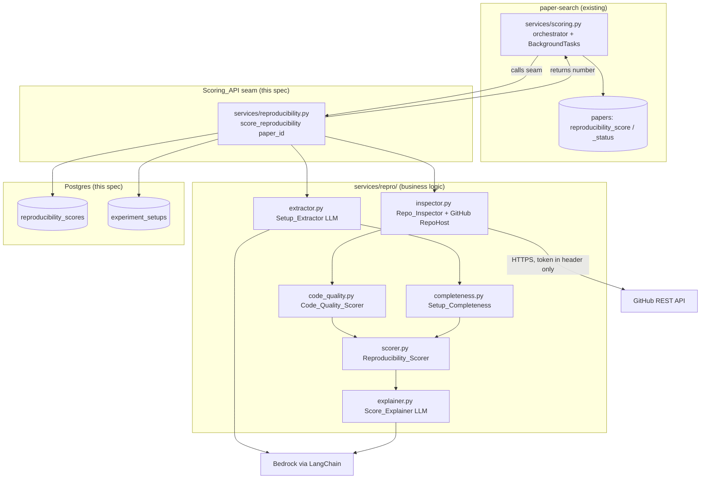

# Design Document

## Overview

The `reproducibility-scoring` feature computes the real `Reproducibility Score`
for a `Paper`, replacing the stub that `paper-search` ships behind the
`score_reproducibility(paper_id)` seam. When this feature lands, the search
ranking's reproducibility term becomes real with no change to `paper-search`
beyond the stub module being swapped for a real implementation at the same
signature. It introduces the `ReproducibilityScore` and `ExperimentSetup` tables
and the Git-host repository inspector and LLM Experiment-Setup extractor.

The number is **rule-based**; the LLM only extracts the `Experiment Setup` and
explains a computed score. This boundary is enforced structurally — the scorer
functions live in modules with no LLM import, and the LLM modules return
structured data or prose, never the number.

Per the mandated layering, the design is organized into three concerns, each
mapping back to specific requirements:

| Layer | Component | Location | Requirements |
| --- | --- | --- | --- |
| Backend | `Scoring_API` (seam + persistence + orchestration) | `backend/app/services/reproducibility.py`, `backend/app/models/reproducibility.py` | R6, R7 |
| Business logic | `Repo_Inspector`, `Code_Quality_Scorer`, `Setup_Extractor`, `Setup_Completeness`, `Reproducibility_Scorer`, `Score_Explainer` | `backend/app/services/repro/` | R1, R2, R3, R4, R5 |
| Frontend | detail-view score breakdown + Experiment Setup + explanation | `frontend/src/components/PaperDetail.tsx` | R8 |

This spec reuses conventions already set: the `services/` package from
`paper-search`, tables under `models/`, env-driven `Settings` in
`core/config.py`, the Alembic-only schema rule, and the `Score_Status`
(`pending`/`ready`/`unavailable`) lifecycle. It adds a `services/repro/`
sub-package to hold the scorers, inspector, and LLM extractor/explainer, so the
single-file `services/reproducibility.py` seam stays small and the heavy logic is
organized behind it.

### How the stub becomes real (the seam, R6.1)

`paper-search` defines:

```python
# backend/app/services/reproducibility.py (paper-search STUB)
def score_reproducibility(paper_id: int) -> float: ...   # returns a fixed value
```

This spec **replaces that file's body** while preserving the signature and the
Score_Status contract the `paper-search` orchestrator relies on
(`services/scoring.py` calls the seam, attaches the value with status `ready`, or
sets `unavailable` on failure, then recomputes the Final Score). The real
implementation runs the full pipeline, persists `ReproducibilityScore` and
`ExperimentSetup`, and returns the computed number (or raises so the orchestrator
records `unavailable`). No other `paper-search` module changes.

### Key design decisions

- **Rule-based number via a field-selected standard, weighted Q/D (R2.3, R4, R10).**
  The `Reproducibility Score` is the weighted, confidence-adjusted roll-up
  `S = 0.30·S_Q + 0.70·S_D` of a `Standard Result` produced by evaluating the
  `Paper` against a `Reproducibility Standard` selected by its `Field of Study`,
  implementing the Standards-Conformance Score of `scoring_rule.md` v1.2:
  **TRIPOD+AI** (26 weighted criteria) for Medicine, the merged **ACM badges + ML
  Code Completeness + FAIR4RS** standard (25 weighted criteria) for CS, and a
  baseline for unknown. Every criterion carries a classification tag (`Q`/`D`/`Q/D`),
  a weight (Q sums to 0.30, D+Q/D sums to 0.70 per field), a display category, and
  its source reference(s). Each criterion is scored `s ∈ {1, 0.5, 0, NA}`,
  confidence-adjusted to `ŝ = c·s + (1−c)·π`; NA criteria are dropped and weights
  renormalized **within their group**. Standards live behind one adapter interface
  in `services/repro/standards/`, selected by `select_standard(field_of_study)`;
  the `Reproducibility_Scorer` is a thin caller that runs the weighted roll-up.
  `Code_Quality_Scorer` and `Setup_Completeness` remain pure contributing signals
  feeding criteria. The LLM may supply per-criterion *evidence as data* for
  criteria heuristics cannot judge (`Setup_Extractor`, `Score_Explainer`, and a
  bounded criterion-evidence helper), but the weighted status→score roll-up has
  **no LLM import** and the LLM output can never change the number (ADR 0009).
- **GitHub-only inspection behind an interface (confirmed).** `Repo_Inspector`
  supports GitHub for the first iteration via the GitHub REST API, implemented
  behind a `RepoHost` interface so GitLab/others can be added later without
  touching the scorers. A non-GitHub or malformed repo URL reports
  "not inspectable" (R1.3), distinct from an API failure (R1.4).
- **GitHub token security (confirmed emphasis).** The token is read **only** from
  the environment (`GITHUB_TOKEN`), never committed and never defaulted in
  source. It is sent only to the GitHub API over HTTPS in the `Authorization`
  header, **never** logged, never included in any API response, never written to
  the database, and never surfaced to the frontend. Error messages and the
  `Score_Explainer` prompt are scrubbed of it. The token is optional for
  unauthenticated low-rate access, but when present it is handled under these
  rules. See the Security section for the full checklist.
- **Reader-side material only (confirmed scope).** The `Setup_Extractor` works
  from the `Paper`'s stored index metadata (title + abstract) and link metadata,
  since Reader `Paper`s are index-only — no stored full text. Richer extraction
  from a Writer's uploaded manuscript/source is deferred to `writer-workspace`.
  This bounds extraction quality on the Reader side and is an accepted first-
  iteration limitation.
- **Repo-absent is still scorable (R2.2, R4.3).** A missing or non-inspectable
  repo yields the lowest `Code-Quality Score` but the `Reproducibility Score` is
  still computed from the `Setup_Completeness` contribution. Only when **both**
  the repo is not inspectable **and** the Experiment Setup is unavailable does the
  scorer report "no score", which the seam maps to Score_Status `unavailable`
  (R4.7).
- **Async + persisted, reusing the paper-search lifecycle (R6.5, R6.6).** The
  seam is invoked from the `paper-search` BackgroundTasks orchestration; it does
  not block search/detail responses. Results are persisted on dedicated
  `ReproducibilityScore` / `ExperimentSetup` rows keyed by `paper_id` and mirrored
  onto the `Paper`'s `reproducibility_score` / `reproducibility_status` fields the
  orchestrator already reads.
- **Schema via Alembic, never `create_all` (R7.3).** The two new tables are
  created by a committed migration under `backend/alembic/versions/`, applied by
  the container entrypoint.

## Architecture



### Scoring pipeline (R6.2, R6.3, R6.4)

```mermaid
sequenceDiagram
    participant ORCH as paper-search orchestrator
    participant SEAM as score_reproducibility
    participant RI as Repo_Inspector
    participant CQ as Code_Quality_Scorer
    participant SE as Setup_Extractor (LLM)
    participant SC as Setup_Completeness
    participant RS as Reproducibility_Scorer
    participant EX as Score_Explainer (LLM)
    participant DB as repro tables + papers

    ORCH->>SEAM: score_reproducibility(paper_id)
    SEAM->>RI: inspect(repo_url)
    alt repo inspectable
        RI-->>SEAM: exists=true, signals
    else absent/malformed/API fail
        RI-->>SEAM: not inspectable (reason: absent | failed)
    end
    SEAM->>CQ: code_quality(signals)
    SEAM->>SE: extract_setup(title, abstract)
    alt extract ok
        SE-->>SEAM: ExperimentSetup
        SEAM->>SC: completeness(setup)
    else extract fails
        SE-->>SEAM: unavailable
    end
    alt repo not inspectable AND setup unavailable
        SEAM-->>ORCH: raise -> status "unavailable" (R4.7, R6.4)
    else at least one signal
        SEAM->>RS: reproducibility(field_of_study, Evidence)
        RS-->>SEAM: StandardResult (S = 0.30·S_Q + 0.70·S_D)
        SEAM->>EX: explain(score, signals)
        alt explain ok
            EX-->>SEAM: explanation
        else explain fails
            EX-->>SEAM: (none) -> score without explanation (R5.3)
        end
        SEAM->>DB: upsert ReproducibilityScore + ExperimentSetup; mirror onto papers
        SEAM-->>ORCH: score -> status "ready" (R6.3)
    end
```

## Components and Interfaces

### 1. Backend — `Scoring_API` seam + persistence + orchestration (R6, R7)

**Seam** — `backend/app/services/reproducibility.py` (replaces the paper-search
stub body, same signature):

```python
def score_reproducibility(paper_id: int) -> float:
    """Compute, persist, and return the rule-based Reproducibility Score.

    Runs the full pipeline (inspect -> code-quality -> extract -> completeness
    -> score -> explain), upserts ReproducibilityScore + ExperimentSetup, mirrors
    the number + status onto the Paper, and returns the number. Raises
    ReproducibilityUnavailable when neither signal is available (R4.7), which the
    paper-search orchestrator maps to Score_Status "unavailable" (R6.4).
    """
```

The function opens its own DB `Session` (it runs inside a BackgroundTasks job
whose request session has closed — same pattern as the paper-search
orchestrator). It loads the `Paper` to obtain `repo_url`, `title`, and
`abstract`, runs the pipeline, and persists. It is deterministic given the same
external responses because every scoring function is deterministic (R2.4, R4.6);
only the GitHub and Bedrock calls introduce external variability.

**Mirroring onto the Paper (R6.3, R6.6):** the seam writes
`reproducibility_score` + `reproducibility_status` on the `papers` row (the
fields the paper-search orchestrator reads to recompute the Final Score). The
dedicated `reproducibility_scores` row holds the full breakdown (code-quality,
repo-exists, completeness) for the detail view.

### 2. Business logic — `services/repro/` (R1–R5)

**`Repo_Inspector` + GitHub `RepoHost`** — `backend/app/services/repro/inspector.py`:

```python
@dataclass(frozen=True)
class RepoSignals:
    exists: bool
    has_readme: bool
    has_license: bool
    has_tests: bool
    recent_activity: bool          # pushed within recency window
    inspectable: bool              # False => absent/malformed/unsupported host
    failed: bool                   # True => API error/timeout/rate-limit (R1.4)

class RepoHost(Protocol):
    def inspect(self, repo_url: str, *, timeout: float) -> RepoSignals: ...

class GitHubRepoHost:
    """GitHub REST API implementation (first iteration).

    - Parses owner/repo from a github.com URL; non-GitHub/malformed -> not
      inspectable (R1.3).
    - GET /repos/{o}/{r} (existence, pushed_at for recent activity, license),
      GET /repos/{o}/{r}/readme (README), and a tests heuristic (search for a
      tests/ dir or test file via the contents/trees API).
    - Auth header from GITHUB_TOKEN only when present; HTTPS only.
    - Any non-2xx that is not a clean 404 -> failed=True (R1.4); 404 on the repo
      -> exists=False, inspectable=True.
    - Never clones; reads metadata only (R1.5).
    """

def inspect_repo(repo_url: str | None) -> RepoSignals:
    # None/empty -> not inspectable (R1.3); otherwise delegate to the configured host.
```

**`Code_Quality_Scorer`** — `backend/app/services/repro/code_quality.py` (no LLM):

```python
def code_quality(signals: RepoSignals) -> float:
    # repo absent/not inspectable -> 0.0 (R2.2).
    # else deterministic weighted sum of {readme, license, tests, recent_activity}
    # normalized to [0,1], monotonic non-decreasing in each positive signal (R2.1).
```

**`Setup_Extractor`** — `backend/app/services/repro/extractor.py` (Bedrock via
LangChain):

```python
@dataclass
class ExperimentSetupData:
    hyperparameters: str | None     # None => absent (R3.2)
    datasets: str | None
    environment: str | None

def extract_setup(title: str, abstract: str | None) -> ExperimentSetupData:
    # LLM extraction from Reader-side index material only (R3.1, R3.4); each field
    # absent when unsupported, never fabricated (R3.2). Raises on failure/timeout
    # so the seam records the setup unavailable (R3.3). Reads model/creds from env
    # (R3.5).
```

**`Setup_Completeness`** — `backend/app/services/repro/completeness.py` (no LLM):

```python
EXPECTED_FIELDS = ("hyperparameters", "datasets", "environment")

def completeness(setup: ExperimentSetupData | None) -> float:
    # None (unavailable) -> 0.0; else populated_fields / len(EXPECTED_FIELDS) (R4.1).
```

**`Reproducibility Standard` adapter** —
`backend/app/services/repro/standards/` (no LLM in the roll-up):

```python
from dataclasses import dataclass, field
from enum import Enum
from typing import Protocol

class CriterionStatus(str, Enum):
    met = "met"; partial = "partial"; unmet = "unmet"; not_applicable = "not_applicable"

_POINTS = {CriterionStatus.met: 1.0, CriterionStatus.partial: 0.5, CriterionStatus.unmet: 0.0}

class Tag(str, Enum):
    Q = "Q"            # code/tool quality  -> 0.30 group
    D = "D"            # paper-to-code discrepancy -> 0.70 group
    QD = "Q/D"         # both; counted in the D (0.70) group

@dataclass(frozen=True)
class Criterion:
    """A weighted scoring-model criterion (scoring_rule.md §3.1 / §4.1)."""
    id: str                         # e.g. "M-D1", "C-A5"
    title: str
    tag: Tag
    weight: float                   # expert prior; per field Q sums 0.30, D+Q/D sums 0.70
    category: str                   # display category (§10), e.g. "Run the Code"
    source_references: list[str]    # e.g. ["R1: item 12c"] or ["R3: Artifacts Available", "R5: F1"]

@dataclass(frozen=True)
class CriterionResult:
    criterion: Criterion
    status: CriterionStatus
    confidence: float               # c in [0,1] (§5.5)
    evidence_note: str
    paper_value: str | None = None  # for D contradictions (discrepancy report, §7)
    code_value: str | None = None

    @property
    def s(self) -> float:           # raw status score
        return _POINTS[self.status]

    def adjusted(self, base_rate: float = 0.5) -> float:
        # confidence-adjusted ŝ = c·s + (1−c)·π  (§5.5)
        return self.confidence * self.s + (1.0 - self.confidence) * base_rate

@dataclass(frozen=True)
class Evidence:
    """Everything a standard may judge against — gathered once, role-aware."""
    repo: RepoSignals
    code_quality: float
    setup: ExperimentSetupData | None
    setup_completeness: float
    manuscript_text: str | None = None   # Writer-claimed papers only (ADR 0003)
    source_files: list[tuple[str, str]] | None = None

@dataclass(frozen=True)
class CategoryScore:
    category: str
    score: float            # S_k (§10.4)
    points_lost: float      # L_k

@dataclass(frozen=True)
class StandardResult:
    field_of_study: str                 # "medicine" / "computer_science" / "unknown"
    standard_key: str                   # "tripod_ai" / "cs_merged" / "baseline"
    reference_versions: dict            # §8 version pinning
    results: list[CriterionResult]
    score: float                        # weighted roll-up S (the number)
    score_q: float                      # S_Q (0.30 group)
    score_d: float                      # S_D (0.70 group)
    categories: list[CategoryScore]     # seven display categories (§10)
    discrepancies: list[CriterionResult] = field(default_factory=list)

class ReproducibilityStandard(Protocol):
    key: str
    field_of_study: str
    reference_versions: dict
    def criteria(self) -> list[Criterion]: ...
    def evaluate(self, evidence: Evidence) -> StandardResult: ...

def roll_up(results: list[CriterionResult]) -> tuple[float, float, float]:
    """Weighted, confidence-adjusted Q/D roll-up (scoring_rule.md §6).

    Returns (S, S_Q, S_D). NA criteria are dropped and the remaining weights are
    renormalized *within each group*, preserving the 0.30/0.70 split. met=1,
    partial=0.5, unmet=0; each ŝ is confidence-adjusted. No LLM import.
    """
    applicable = [r for r in results if r.status is not CriterionStatus.not_applicable]
    q = [r for r in applicable if r.criterion.tag is Tag.Q]
    d = [r for r in applicable if r.criterion.tag in (Tag.D, Tag.QD)]

    def group_mean(rs: list[CriterionResult]) -> float | None:
        wsum = sum(r.criterion.weight for r in rs)
        if wsum == 0:
            return None
        return sum(r.criterion.weight * r.adjusted() for r in rs) / wsum

    s_q, s_d = group_mean(q), group_mean(d)
    if s_q is None and s_d is None:
        return 0.0, 0.0, 0.0
    if s_q is None:          # whole Q group NA -> S = S_D, flagged by caller
        return s_d, 0.0, s_d
    if s_d is None:          # whole D group NA -> S = S_Q, flagged by caller
        return s_q, s_q, 0.0
    return 0.30 * s_q + 0.70 * s_d, s_q, s_d

def select_standard(field_of_study: PaperDomain) -> ReproducibilityStandard:
    # medicine         -> TripodAiStandard      (R1, 26 criteria)
    # computer_science -> CsMergedStandard       (R3/R4/R5, 25 criteria)
    # unknown          -> BaselineStandard
```

Each concrete standard ships the exact weighted criteria table from
`scoring_rule.md`: `tripod_ai.py` carries the 26 Medicine criteria of §3.1 (tags,
weights, categories, R1 items + R2 Thai alignment), `cs_merged.py` carries the 25
CS criteria of §4.1 (the merged ACM/ML/FAIR4RS rows with their R3/R4/R5 source
references), and `baseline.py` a domain-neutral subset. Each criterion is judged
from `Evidence`, calling the bounded LLM criterion-evidence helper only where a
heuristic cannot decide (ADR 0009); standard-specific rules (§5.3 CS, §5.4
Medicine — e.g. C-A5 capped at 0.5 without a badge/sandbox run, C-A7/C-A8 default
NA, no-code-released ⇒ all CS criteria 0) are applied inside the standard before
the roll-up. Adding a standard is a new file + a `select_standard` entry — nothing
else changes (R10.5).

**`Reproducibility_Scorer`** — `backend/app/services/repro/scorer.py` (no LLM in
the roll-up):

```python
def reproducibility(field_of_study: PaperDomain, evidence: Evidence) -> StandardResult:
    # Selects the standard via select_standard(field_of_study), evaluates the
    # Paper against its weighted Criteria, and returns the StandardResult whose
    # `score` is the weighted, confidence-adjusted roll-up S = 0.30·S_Q + 0.70·S_D
    # (R4.2–R4.5, R4.10). A non-inspectable repo still scores from the criteria the
    # remaining evidence satisfies (R4.6). The scorer also fills the per-display-
    # category breakdown and the discrepancy report from the CriterionResults.
```

**`Score_Explainer`** — `backend/app/services/repro/explainer.py` (Bedrock via
LangChain):

```python
def explain(score: float, signals: RepoSignals, completeness: float) -> str:
    # short prose referencing the signals (R5.1). score is a fixed input; never
    # recomputed (R5.2). On failure/timeout the seam proceeds without an
    # explanation (R5.3). The prompt and output are scrubbed of any token.
```

### 3. Frontend — detail-view surfaces (R8)

`paper-search` already renders the detail view's score-breakdown and Experiment
Setup sections against `PaperDetail` from `GET /api/papers/{id}`. This spec
populates them with real data and adds the explanation.

**Detail-response extension (agreed with `paper-search`).** `paper-search`'s
`PaperRead`/`PaperDetail` exposes `reproducibility` as a single `ScoreCell` and
`experiment_setup` as the agreed JSON object, but it does **not** yet carry the
reproducibility *breakdown* (contributing Code-Quality Score, Setup_Completeness,
repo-existence) or the explanation that R8.1/R8.6/R8.7 require. This spec
therefore extends the `GET /api/papers/{id}` response with an optional
`reproducibility_breakdown` object sourced from the `reproducibility_scores` row:

The shape mirrors the `Standard Result` of `scoring_rule.md` v1.2 (the frontend
render of these fields is deferred — see tasks.md task 14):

```ts
// added to PaperDetail (null until reproducibility-scoring has run)
reproducibilityBreakdown: {
  fieldOfStudy: "medicine" | "computer_science" | "unknown";
  standardKey: string;           // selected standard: "tripod_ai" | "cs_merged" | "baseline"
  standardName: string;          // display label, e.g. "TRIPOD+AI" | "ACM + ML Code Completeness + FAIR4RS"
  scoreQ: number;                // S_Q, the Q (0.30) group sub-score
  scoreD: number;                // S_D, the D + Q/D (0.70) group sub-score
  codeQuality: ScoreCell;        // contributing Code-Quality Score (R8.1)
  setupCompleteness: ScoreCell;  // contributing Setup_Completeness (R8.1)
  repoExists: boolean | null;    // null => not inspected; false => repo-absent (R8.7)
  explanation: string | null;    // Score_Explainer output when available (R8.6)
  criteria: {                    // per-Criterion Standard Result (R8.8)
    id: string;                  // e.g. "M-D1" | "C-A5"
    title: string;
    tag: "Q" | "D" | "Q/D";      // classification (Q group 0.30 / D group 0.70)
    weight: number;              // expert-assigned prior from scoring_rule.md
    category: string;            // display category (§10), e.g. "Run the Code"
    sourceReferences: string[];  // e.g. ["R1: item 12c"] or ["R3: Artifacts Available", "R5: F1"]
    status: "met" | "partial" | "unmet" | "not_applicable";
    confidence: number;          // c in [0,1] (§5.5)
    evidenceNote: string;
  }[];
  categories: {                  // seven display categories (§10.4), ordered by points lost
    category: string;
    score: number;               // S_k
    pointsLost: number;          // L_k
  }[];
  discrepancies: {               // D criteria scored 0 by contradiction (§7)
    criterionId: string;
    paperValue: string | null;
    codeValue: string | null;
    reference: string;
  }[];
  referenceVersions: Record<string, string>;  // §8 version pinning
} | null;
```

The field is additive and nullable, so it does not break `paper-search`'s
existing detail reads: when reproducibility has not run (or there is no
`reproducibility_scores` row), it is `null` and the view falls back to the plain
`reproducibility` ScoreCell `paper-search` already shows. No new route or API
client is needed — only this additive field on the existing detail endpoint and
the matching `PaperDetail` type.

The detail view (`frontend/src/components/PaperDetail.tsx`):
- Shows the `Reproducibility Score`, the name of the `Reproducibility Standard`
  it was evaluated against, and its contributing `Code-Quality Score` and
  `Setup_Completeness`, each labeled, replacing the stubbed value (R8.1).
- Shows the per-`Criterion` list — title, status (met / partial / unmet /
  not-applicable), and evidence note — so the Reader sees what drove the score
  (R8.8).
- Renders the reproducibility score as pending / unavailable via the existing
  Score_Status rendering (R8.2, R8.3).
- Populates the Experiment Setup section with hyperparameters / datasets /
  environment, marking each absent field "not provided" (R8.4); shows a
  "could not be extracted" indicator when the setup is unavailable (R8.5).
- Shows the `Score_Explainer` explanation alongside the breakdown when present
  (R8.6).
- Indicates the repository-absent condition in the breakdown so the Reader sees
  it lowered the score (R8.7).

## Data Models

### `ReproducibilityScore` and `ExperimentSetup` tables (R7)

New `backend/app/models/reproducibility.py`. Both are keyed by `paper_id`
(FK to `papers.id`) with a unique constraint so recompute updates rather than
duplicates (R7.4). `ScoreStatus` is reused from the paper-search `Paper` model.

```python
from datetime import datetime, timezone
from sqlmodel import Field, SQLModel
from app.models.paper import ScoreStatus     # reuse the shared enum


class ReproducibilityScore(SQLModel, table=True):
    __tablename__ = "reproducibility_scores"

    id: int | None = Field(default=None, primary_key=True)
    paper_id: int = Field(foreign_key="papers.id", unique=True, index=True)  # R7.4

    score: float | None = Field(default=None)              # weighted roll-up S (R7.1)
    status: ScoreStatus = Field(default=ScoreStatus.pending)
    field_of_study: str | None = Field(default=None)       # scored field (R7.1, R9, R10)
    standard_key: str | None = Field(default=None)         # selected standard (R7.1, R10)
    score_q: float | None = Field(default=None)            # S_Q, Q group (0.30)
    score_d: float | None = Field(default=None)            # S_D, D + Q/D group (0.70)
    criteria: list[dict] | None = Field(                   # full per-criterion Standard Result (R7.1, R8.8)
        default=None, sa_column=Column(JSON)               # id,title,tag,weight,category,source_references,status,confidence,evidence_note
    )
    categories: list[dict] | None = Field(                 # seven display categories: {category,score,points_lost} (R7.1, §10)
        default=None, sa_column=Column(JSON)
    )
    discrepancies: list[dict] | None = Field(              # D contradictions: {criterion_id,paper_value,code_value,reference} (R7.1, §7)
        default=None, sa_column=Column(JSON)
    )
    reference_versions: dict | None = Field(               # §8 version pinning (R10.7)
        default=None, sa_column=Column(JSON)
    )
    code_quality_score: float | None = Field(default=None) # contributing (R7.1)
    repo_exists: bool | None = Field(default=None)
    repo_inspectable: bool | None = Field(default=None)
    setup_completeness: float | None = Field(default=None) # contributing (R7.1)
    explanation: str | None = Field(default=None)          # R5, nullable (R5.3)

    created_at: datetime = Field(
        default_factory=lambda: datetime.now(timezone.utc), nullable=False
    )
    updated_at: datetime = Field(
        default_factory=lambda: datetime.now(timezone.utc), nullable=False
    )


class ExperimentSetup(SQLModel, table=True):
    __tablename__ = "experiment_setups"

    id: int | None = Field(default=None, primary_key=True)
    paper_id: int = Field(foreign_key="papers.id", unique=True, index=True)  # R7.4

    hyperparameters: str | None = Field(default=None)      # None => absent (R7.2)
    datasets: str | None = Field(default=None)
    environment: str | None = Field(default=None)
    available: bool = Field(default=False)                 # False => extraction unavailable (R3.3)

    created_at: datetime = Field(
        default_factory=lambda: datetime.now(timezone.utc), nullable=False
    )
    updated_at: datetime = Field(
        default_factory=lambda: datetime.now(timezone.utc), nullable=False
    )
```

**Alignment with `paper-search` on `Paper.experiment_setup` (agreed, mandatory).**
`paper-search` already defines a `papers.experiment_setup` JSON column and reads
it directly in `GET /api/papers/{id}` (the detail endpoint does **not** join). To
avoid any divergence, the two specs agree on a single contract:

- The normalized `experiment_setups` table is the **source of truth** for the
  Experiment Setup and the only place the breakdown logic reads/writes.
- On every scoring run, the seam **mirrors** the extracted setup into
  `papers.experiment_setup` as the exact object `paper-search`'s detail path
  reads:

  ```json
  {
    "hyperparameters": "string | null",
    "datasets": "string | null",
    "environment": "string | null",
    "available": true
  }
  ```

  `available=false` (with null fields) when extraction was unavailable (R3.3,
  R8.5). This mirror is **required**, not optional: it keeps the existing
  `paper-search` detail endpoint and `PaperDetail` TS type unchanged — they
  already expect this shape. The mirror write happens in the same transaction as
  the `experiment_setups` upsert so the normalized row and the JSON never drift.
- The reproducibility **breakdown** (code-quality, repo-exists, setup-completeness,
  explanation) is served from the `reproducibility_scores` row, not the JSON
  mirror — the mirror carries only the Experiment Setup fields the detail view
  already renders.

No full text is stored in either place (R7.5).

| Table | Field | Type | Requirement |
| --- | --- | --- | --- |
| reproducibility_scores | `paper_id` | FK papers.id, unique | R7.1, R7.4 |
| reproducibility_scores | `score` / `status` | float? / enum (weighted roll-up S) | R7.1, R6.3, R6.4 |
| reproducibility_scores | `field_of_study` | str? ("medicine"/"computer_science"/"unknown") | R7.1, R9, R10 |
| reproducibility_scores | `standard_key` | str? ("tripod_ai"/"cs_merged"/"baseline") | R7.1, R10 |
| reproducibility_scores | `score_q` / `score_d` | float? (Q 0.30 group / D+Q/D 0.70 group) | R4.4, R7.1 |
| reproducibility_scores | `criteria` | JSON? (id,title,tag,weight,category,source_references,status,confidence,evidence_note) | R7.1, R8.8 |
| reproducibility_scores | `categories` | JSON? (seven display categories: score + points_lost) | R7.1, §10 |
| reproducibility_scores | `discrepancies` | JSON? (D contradictions for the discrepancy report) | R7.1, §7 |
| reproducibility_scores | `reference_versions` | JSON? (TRIPOD+AI 2024 / ACM v1.1 / ML 2020 / FAIR4RS v1.0 / rule 1.2) | R10.7, §8 |
| reproducibility_scores | `code_quality_score`, `repo_exists`, `repo_inspectable`, `setup_completeness` | breakdown | R7.1, R8.1, R8.7 |
| reproducibility_scores | `explanation` | str? (nullable) | R5.1, R5.3 |
| experiment_setups | `paper_id` | FK papers.id, unique | R7.2, R7.4 |
| experiment_setups | `hyperparameters`/`datasets`/`environment` | str? (None = absent) | R7.2, R8.4 |
| experiment_setups | `available` | bool | R3.3, R8.5 |
| papers (existing table) | `domain` | enum `computer_science`/`medicine`/`unknown`, default `unknown` | R9 |

### Paper `domain` column + ingestion capture (R9)

A new `PaperDomain` string enum (`computer_science`, `medicine`, `unknown`) and a
`domain: PaperDomain = unknown` column are added to the existing `papers` table.
It is populated at ingestion by extending the source adapters (ADR 0007): the
`SourceRecord`/`MergedPaper` shapes carry a `domain`, OpenAlex `_map` reads
`primary_topic.field.id` (17→CS, 27→Medicine), and arXiv `_map` reads the Atom
`<category>`/`<arxiv:primary_category>` (`cs.*`→CS, `q-bio.*`→Medicine). A missing
or ambiguous classifier yields `unknown` (R9.3). The `Standard_Selector` maps
`unknown` to the baseline standard so every Paper stays scorable (R9.5).

### Alembic migration (R7.3, R9.4)

A revision under `backend/alembic/versions/` (generated via
`alembic revision --autogenerate -m "create reproducibility tables"`, then
reviewed) creates `reproducibility_scores` and `experiment_setups` with the
unique `paper_id` FKs/indexes, now also carrying `standard_key` + `criteria`. A
second (or combined) revision adds the `papers.domain` column, backfilling
existing rows to `unknown` (R9.4). Applied by `alembic upgrade head`
(entrypoint), never `create_all` (R7.3).

### Configuration (R1.6, R3.5, R7.6)

Extend `app/core/config.py` `Settings`:

```python
# GitHub repo inspection (R1.6) — token is a SECRET, env only, no committed default
github_api_base: str = "https://api.github.com"
github_token: str | None = None            # optional; when set, auth to raise rate limit
repo_recency_days: int = 365               # recent-activity window (R1.2)
repo_inspect_timeout_seconds: float = 10.0

# Standards-Conformance roll-up constants (non-AI) — R4.3, R4.4
repro_q_group_weight: float = 0.30         # Q (code/tool quality) group total
repro_d_group_weight: float = 0.70         # D + Q/D (paper-to-code) group total
repro_default_base_rate: float = 0.5       # π for confidence adjustment (§5.5)

# Per-criterion weights, tags, categories and source references are NOT config:
# they are fixed by scoring_rule.md v1.2 and live in the standard definitions
# (services/repro/standards/tripod_ai.py, cs_merged.py, baseline.py).

# Bedrock/LangChain reused from paper-search Settings (R3.5): bedrock_model_id, aws_region, llm_timeout_seconds
```

`github_token` is `str | None` — when the environment supplies it, it is used; it
is **never** given a real default in source. The Bedrock settings are the same
required ones `paper-search` introduced (`bedrock_model_id` has no default, so a
missing value fails startup — R7.6).

## Correctness Properties

*A property is a characteristic or behavior that should hold true across all
valid executions of a system — essentially, a formal statement about what the
system should do. Properties serve as the bridge between human-readable
specifications and machine-verifiable correctness guarantees.*

These properties target the rule-based scorers (`Code_Quality_Scorer`,
`Setup_Completeness`, `Reproducibility_Scorer`) and the seam/persistence
behavior. The LLM components (`Setup_Extractor`, `Score_Explainer`) are
mocked/faked in tests; their non-determinism is not property-tested, but their
failure handling and the token-safety invariant are. The frontend (R8) is
rendering, covered by manual example checks. Each property maps to the
requirement clauses it validates.

### Property 1: Code-Quality Score is deterministic and monotonic in positive signals

*For any* `RepoSignals` for an existing repository, `code_quality` returns a value
in `[0,1]`, is identical for identical inputs, and flipping any single signal from
false to true never decreases the score.

**Validates: Requirements 2.1, 2.4**

### Property 2: Repository-absent yields the minimum code-quality score

*For any* `RepoSignals` with `exists=false` or `inspectable=false`,
`code_quality` returns the lowest value (0.0), regardless of the other fields.

**Validates: Requirements 2.2**

### Property 3: Setup completeness equals the populated-field fraction

*For any* `ExperimentSetupData`, `completeness` equals (number of populated fields
among hyperparameters/datasets/environment) / 3; an unavailable setup yields 0.0.

**Validates: Requirements 4.1**

### Property 4: Reproducibility Score is deterministic, in range, and monotonic

*For any* set of `CriterionResult`s with weights that respect the per-group
totals, the weighted roll-up `S = 0.30·S_Q + 0.70·S_D` returns a value in `[0,1]`,
is identical for identical inputs, and is non-decreasing when any single
criterion's status improves (unmet→partial→met) with its confidence held fixed.

**Validates: Requirements 4.4, 4.5, 4.10**

### Property 4b: Group weights and NA renormalization preserve the 0.30/0.70 split

*For any* standard whose Q criteria weights sum to 0.30 and D+Q/D weights sum to
0.70, dropping any not-applicable criteria and renormalizing within each group
leaves the roll-up a convex combination `0.30·S_Q + 0.70·S_D`; if a whole group is
NA the roll-up equals the surviving group's score and the dropped group is
flagged.

**Validates: Requirements 4.5, 10.3**

### Property 4c: Confidence adjustment stays in range

*For any* status `s ∈ {0, 0.5, 1}`, confidence `c ∈ [0,1]`, and base rate
`π ∈ [0,1]`, the adjusted score `ŝ = c·s + (1−c)·π` lies in `[0,1]` and equals `s`
when `c = 1`.

**Validates: Requirements 4.3**

### Property 5: A paper with no repo but a setup is still scored

*For any* input where the repo is not inspectable but an Experiment Setup is
available, `reproducibility` returns a value computed from the criteria the
remaining evidence can satisfy rather than raising or returning the absent
sentinel.

**Validates: Requirements 4.6**

### Property 6: No signals at all means no score, not a fabricated one

*For any* run where the repo is not inspectable *and* the Experiment Setup is
unavailable, the seam raises `ReproducibilityUnavailable` (mapped to Score_Status
`unavailable`) and never returns a fabricated number.

**Validates: Requirements 4.7, 6.4**

### Property 7: The score number never comes from the LLM

*For any* scoring run, the computed `Reproducibility Score` and `Code-Quality
Score` are produced by the rule-based functions; the `Setup_Extractor` and
`Score_Explainer` outputs do not change either number — mutating or faking the LLM
output changes the Experiment Setup and the explanation text but not the computed
scores.

**Validates: Requirements 2.3, 4.9, 5.2, 6.7**

### Property 8: Extraction and explanation failures degrade gracefully

*For any* `Setup_Extractor` failure the Experiment Setup is recorded unavailable
(distinct from extracted-but-incomplete) while scoring still proceeds if the repo
is inspectable; *for any* `Score_Explainer` failure the score and signals are
returned with no explanation rather than failing the score.

**Validates: Requirements 3.3, 5.3**

### Property 9: Inspection distinguishes "signal absent" from "inspection failed"

*For any* GitHub API outcome, a clean repo-not-found maps to
`exists=false, inspectable=true`, while an API error / timeout / rate-limit maps
to `failed=true` — the two are never conflated.

**Validates: Requirements 1.1, 1.4**

### Property 10: Non-GitHub or malformed repo URLs are not inspectable

*For any* repo URL that is absent, malformed, or not a github.com repository,
`inspect_repo` reports `inspectable=false` and fabricates no repo-quality signals.

**Validates: Requirements 1.3**

### Property 11: Recompute updates in place, never duplicates

*For any* paper scored more than once, exactly one `reproducibility_scores` row
and at most one `experiment_setups` row exist for that `paper_id` afterward, each
reflecting the latest run.

**Validates: Requirements 7.4**

### Property 12: The GitHub token never leaks

*For any* scoring run with a configured `github_token`, the token value never
appears in the API response for the paper, in any persisted row, in log output,
or in the `Score_Explainer` prompt or output.

**Validates: Requirements 1.6, 7.5 (secret handling)**

### Property 13: The seam preserves the paper-search contract

*For any* paper, `score_reproducibility(paper_id)` keeps the stub's signature and
drives the Score_Status to `ready` (value attached) on success or `unavailable`
on no-signal, so the paper-search orchestrator and Final Score recompute without
modification.

**Validates: Requirements 6.1, 6.3, 6.5, 6.6**

## Error Handling

- **Repo not inspectable vs. inspection failed (R1.3, R1.4):** `inspect_repo`
  returns `inspectable=false` for absent/malformed/non-GitHub URLs and
  `failed=true` for API error/timeout/rate-limit. The scorer treats a failed
  inspection like repo-absent for the code-quality contribution but the seam still
  attempts the setup path.
- **Setup extraction failure (R3.3):** `extract_setup` raising is caught; the
  `experiment_setups` row is marked `available=false`, and scoring proceeds from
  the repo contribution if the repo is inspectable.
- **No signals at all (R4.7, R6.4):** when the repo is not inspectable and the
  setup is unavailable, the seam raises `ReproducibilityUnavailable`; the
  paper-search orchestrator maps this to Score_Status `unavailable` (never
  `pending` forever).
- **Explanation failure (R5.3):** `explain` raising is caught; the score persists
  with `explanation=None` and the detail view simply omits the explanation.
- **Score lifecycle termination (R6.4, R6.6):** the seam always resolves the
  paper's reproducibility status to `ready` or `unavailable`; the orchestrator's
  existing guarantee that no component stays `pending` after its job runs is
  preserved.
- **GitHub rate limiting (R1.4):** a `403`/`429` with rate-limit headers is
  treated as `failed=true`, not as a repo lacking signals.
- **Missing config (R7.6):** `bedrock_model_id` has no default (inherited from
  paper-search Settings), so a missing value fails startup. `github_token` is
  optional; its absence degrades to unauthenticated GitHub access, not a startup
  failure.

## Security

GitHub token handling is treated as a first-class requirement (user emphasis).
The checklist below is enforced by design and verified by Property 12:

- **Env-only, no committed default (R1.6):** `github_token` is read from the
  `GITHUB_TOKEN` environment variable; `.env.example` carries a placeholder only;
  there is no real default anywhere in source.
- **Transport:** the token is sent only to `https://api.github.com` over HTTPS, in
  the `Authorization` header. The base URL is validated to be HTTPS; a non-HTTPS
  `github_api_base` is rejected at startup.
- **Never logged:** the HTTP client is configured so the `Authorization` header is
  not emitted in logs or exception messages; error handling logs status codes and
  repo coordinates, never headers. Any wrapped exception is scrubbed.
- **Never persisted:** the token is not written to `reproducibility_scores`,
  `experiment_setups`, or any other table; only derived signals and scores are
  stored.
- **Never surfaced:** the token never appears in any API response or in the
  frontend; the detail response carries only scores, signals, setup fields, and
  the explanation.
- **Never sent to the LLM:** the `Setup_Extractor` and `Score_Explainer` prompts
  are built from paper metadata and computed signals only; the token (and any
  GitHub response field that could echo it) is excluded from prompts and outputs.
- **Index-only storage (R1.5, R3.4, R7.5):** no repository source is cloned or
  stored and no paper full text is stored — only derived signals, the structured
  Experiment Setup, and scores.
- **Bedrock credentials (R3.5):** AWS/Bedrock credentials follow the same env-only
  handling established by paper-search; not committed, not logged, not surfaced.
- **LLM output is data, not control:** `Setup_Extractor` output is parsed into the
  bounded `ExperimentSetupData` structure and `Score_Explainer` output is treated
  as display text; neither can change a score or control flow (Property 7).

## Testing Strategy

Backend tests run with **pytest + testcontainers** against a throwaway
`postgres:17`, on the host (`cd backend && uv run pytest`). Existing fixtures
(`client`, `session`, transaction-rollback isolation) are reused. The GitHub API
and the LLM are **never** called for real in tests — the `RepoHost` and the
`Setup_Extractor`/`Score_Explainer` are faked/mocked so tests are deterministic
and offline. The frontend has no automated test gate (R8 verified manually).

**Dual approach:** property-based tests cover the universal invariants above;
example/edge and integration tests cover concrete scenarios, boundaries, and
infrastructure.

### Property-based tests (Hypothesis)

Use **Hypothesis** (already in the dev group from earlier specs). Each property
test runs **a minimum of 100 iterations** and is tagged with a comment
referencing its design property, e.g.:

```python
# Feature: reproducibility-scoring, Property 1: Code-Quality Score is deterministic and monotonic
```

- Properties 1–5 (`code_quality`, `completeness`, `reproducibility`): pure, fast
  arithmetic over generated signals/completeness — ideal PBT, including the
  monotonicity checks.
- Property 7 (number not from LLM): generate arbitrary faked `Setup_Extractor` /
  `Score_Explainer` outputs and assert the computed scores are unchanged.
- Property 9/10 (inspection outcomes): generate GitHub API response shapes
  (200/404/403-ratelimit/timeout, non-GitHub URLs) against the faked `RepoHost`
  and assert the `inspectable`/`failed`/`exists` mapping.
- Properties 6, 8, 11, 12, 13 (seam/persistence): driven through the seam against
  the testcontainer DB with faked inspector + LLM, generating signal/availability
  combinations and repeated runs.

### Example / edge tests (pytest)

- R4.7/R6.4: no repo + extraction fails → seam raises → status `unavailable`.
- R4.6: no repo + setup present → a real score from the criteria the setup satisfies.
- R1.4 vs R1.1: GitHub 404 → `exists=false, inspectable=true`; GitHub timeout /
  rate-limit → `failed=true`.
- R5.3: explainer fails → score persists with no explanation.
- R7.4: score the same paper twice → one `reproducibility_scores` row, updated.
- Seam happy path end-to-end: faked inspector + faked extractor → score persisted,
  mirrored onto the `papers` row with status `ready`, breakdown + explanation on
  the detail response.
- **Token-leak assertion (Property 12):** run scoring with a sentinel
  `GITHUB_TOKEN`, then assert the sentinel appears in no response body, no DB row,
  and no captured log output.

### Integration / smoke tests

- R7.3: a `test_migrations`-style upgrade → downgrade → upgrade asserting
  `reproducibility_scores` and `experiment_setups` (and their unique `paper_id`
  indexes) exist after upgrade — single run, not PBT.
- Non-HTTPS `github_api_base` rejected at startup — single-run smoke test.
- R6.1 contract: a smoke test importing `score_reproducibility` and asserting its
  signature matches what the paper-search orchestrator calls.
