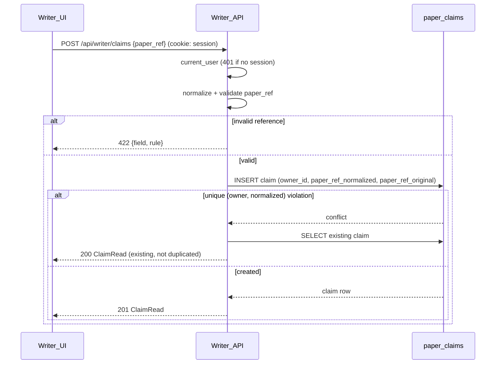
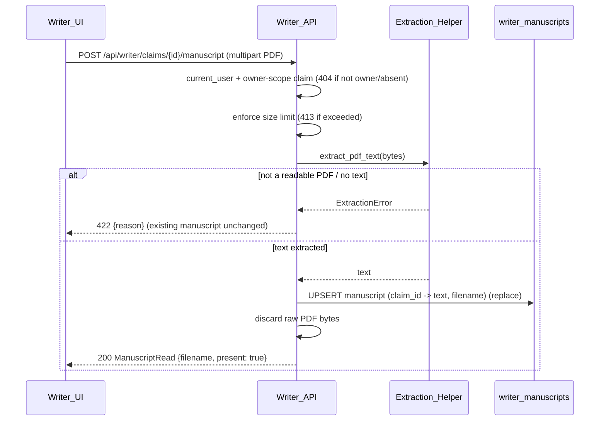

# Design Document

## Overview

The `writer-workspace` feature lets a `User` in `Writer` mode claim a paper and
upload the material to evaluate it: a **manuscript** (PDF → server-side text
extraction) and **source code** (a zip/tarball upload *or* a public Git URL). A
`Paper_Claim` is the owning record; a claim carries at most one
`Writer_Manuscript` (the extracted text + original filename) and a set of
`Writer_Source_File` rows (one `(relative path, content)` row per file). All of
this is **persisted Writer-owned content** — the deliberate carve-out from the
index-only rule (`docs/adr/0003`).

This feature **produces** the inputs that two other specs consume: once a claim
has a `Writer_Manuscript`, the `code-generation` spec's Writer case (its R4.5)
has its precondition met, and `reproducibility-scoring` can score the claimed
paper from the uploaded material. This spec does **not** compute the
`Reproducibility_Score`, extract the `Experiment_Setup`, or generate code.

Per the mandated layering (set by `accounts`), the design is organized into three
concerns, each mapping back to specific requirements:

| Layer | Component | Location | Requirements |
| --- | --- | --- | --- |
| Frontend | `Writer_UI` | `frontend/src/components/`, `frontend/src/api/` | R1, R2, R3, R4 |
| Backend | `Writer_API` | `backend/app/routers/writer.py`, `backend/app/models/writer.py` | R5, R6, R7, R8, R9 |
| Business logic | `Extraction_Helper` | `backend/app/core/extraction.py` | R10 |

It builds on the `accounts` session mechanism (the `current_user` dependency and
the signed session cookie) for ownership and authentication, reuses the existing
`get_session` DB dependency, and leaves the existing routes untouched.

### Key design decisions

- **Uploaded content is persisted — the ADR-0003 carve-out, bounded to Writer
  rows.** The Reader/search side stores only an index and links (`docs/adr/0001`).
  Here we store the *derived* manuscript text and the unpacked source files
  because the `User` owns and consents to the work (`docs/adr/0003`). We **do not**
  keep the raw artifacts: once extraction/unpacking succeeds, the PDF bytes
  (R6.7) and the uploaded archive / downloaded codeload tarball (R7.8) are
  discarded. We store text and `(path, content)` rows, nothing binary and nothing
  external-indexed.
- **PDF text extraction and archive unpacking run synchronously in the request,
  not as background jobs (`docs/adr/0005`).** Unlike `code-generation`
  (minutes-long LLM calls → `BackgroundTasks` + polling), extraction and unpacking
  are seconds-long and bounded by size limits, so the upload endpoints do the work
  inline and return the stored result. **Trade-off:** a very large or slow Git
  fetch holds the request open up to the client's timeout (120s for source, R3.3);
  we bound this with size/file-count limits (R7.5) and a server-side fetch
  timeout, rejecting rather than deferring. The upload endpoints therefore return
  the stored artifact directly (not a job id) — a contract shape the UI depends on
  and recorded in `docs/adr/0005`.
- **A public Git URL is fetched as an HTTP archive, not cloned (`docs/adr/0006`).**
  The backend image is `python3.13-bookworm-slim` with no `git` binary. Rather
  than add an apt layer for `git clone` or a Python Git library, the backend
  downloads the host's codeload tarball (`https://.../archive/<ref>.tar.gz`) over
  HTTP and runs it through the **same** `unpack_archive` path as a direct archive
  upload — reusing the zip-slip, symlink, and cap guards. **Trade-off:** only
  hosts exposing a codeload-style archive endpoint (GitHub, GitLab — the realistic
  sources for a CS/Medicine paper) are supported; an unsupported host or an
  auth-required repo is rejected with the same "repository could not be fetched"
  `422` (R7.4). Swapping to `git clone` later stays possible behind the
  `Source_Upload` seam.
- **Only decodable text source files are stored; binaries are skipped.** A
  repository's images, PDFs, and compiled blobs are not stored — the
  `Extraction_Helper` returns only entries whose content decodes as text (R10.6),
  and the `Source_Upload` response reports the stored relative paths so the Writer
  sees what was kept. The downstream consumers (`reproducibility-scoring`,
  `code-generation`) read text only, so skipping binaries loses nothing and keeps
  Postgres free of unused blobs.
- **De-duplication is scoped to one identifier scheme.** A `Paper_Claim` is unique
  per `(owner, normalized reference)`; the same paper supplied as an arXiv URL and
  as a DOI normalizes to two different references and yields two claims.
  Cross-identifier resolution (knowing those denote the same paper) needs the
  `paper-search`/OpenAlex lookup that does not yet exist, so it is a documented
  deferral, not a bug.
- **Source files are stored as rows, not a JSON blob.** `code-generation` stores
  its small *derived* file set as a JSON column; a Writer's uploaded source can be
  a whole repository, so each file is a `Writer_Source_File` row keyed by
  `(claim_id, path)`. This matches the planned schema in the README ("source
  files stored as (relative path, content) rows"), lets dependent features select
  individual files, and makes replace-on-reupload a scoped delete+insert.
- **The claim, not the paper, is the ownership unit.** This spec does not share
  the Reader-side `Paper` table (owned by `paper-search`, not yet built). A
  `Paper_Claim` carries a normalized `Paper_Reference` (link/DOI/arXiv id) and is
  owned by one `User`; two Writers claiming the same reference get two
  independent claims (R5.4). A partial-free **unique constraint on
  `(owner_id, paper_ref_normalized)`** gives at most one claim per Writer per
  paper (R5.3, R9.3) and makes a duplicate create return the existing claim.
  When `paper-search` lands, a claim can later gain an optional FK to a `Paper`
  without breaking this contract. A `Paper_Claim` may exist with **no uploads**:
  it is created first (claim → workspace → upload), and downstream features
  already guard on a missing manuscript (`code-generation` R4.5 refuses), so an
  empty claim is safe. Deleting a claim is likewise independent of any
  `code-generation` `Generation` derived from it: a `Generation` keys on
  `paper_ref` (a string), not a FK to `Paper_Claim`, and owns its own lifecycle
  (`code-generation` R8.6), so a `Generation` is a point-in-time snapshot that may
  outlive the claim's uploaded material. We deliberately add **no** cross-spec FK
  or delete-guard, keeping the two features on a clean `paper_ref` seam.
- **Zip-slip and archive-bomb defenses live in the helper.** The
  `Extraction_Helper` rejects path-traversal/absolute entries (R10.4), skips
  non-regular entries like symlinks and devices (R10.6), and enforces entry-count
  and total-size caps (R10.7) — before anything is persisted. The helper never
  executes unpacked content (R10.8).
- **Schema via Alembic, never `create_all`.** The `paper_claims`,
  `writer_manuscripts`, and `writer_source_files` tables are created by committed
  migrations applied by the container entrypoint (`alembic upgrade head`), per
  tech.md and R9.1. `ON DELETE CASCADE` on the child FKs backs the claim-delete
  cascade (R9.6).

## Architecture

```mermaid
graph TB
    subgraph Frontend["Writer_UI (React/TS/Tailwind)"]
        CF[ClaimForm]
        ML[ManuscriptUpload]
        SU[SourceUpload file | Git URL]
        CL[ClaimsList]
        CW[ClaimWorkspace + delete controls]
        WApi[api/writer.ts client]
    end
    subgraph Backend["Writer_API (FastAPI)"]
        R[routers/writer.py]
        CU[current_user dep]
        DB[(Postgres: paper_claims, writer_manuscripts, writer_source_files)]
        GIT[public Git fetch]
    end
    subgraph Logic["Business logic (core/extraction.py)"]
        EH[Extraction_Helper]
        PDF[PDF text extract]
        UNZ[archive unpack + guards]
    end

    CF --> WApi
    ML --> WApi
    SU --> WApi
    CL --> WApi
    CW --> WApi
    WApi -->|fetch, credentials: include| R
    R --> CU
    R --> DB
    R --> GIT
    R --> EH
    EH --> PDF
    EH --> UNZ
```

### Create-claim flow (R1, R5)



### Manuscript upload flow (R2, R6, R10)



### Source upload flow (R3, R7, R10)

```mermaid
sequenceDiagram
    participant UI as Writer_UI
    participant API as Writer_API
    participant EH as Extraction_Helper
    participant GIT as public Git
    participant DB as writer_source_files

    UI->>API: POST /api/writer/claims/{id}/source (archive OR {git_url})
    API->>API: current_user + owner-scope claim (404 if not owner/absent)
    alt git_url supplied
        API->>GIT: HTTP GET codeload tarball (timeout; no clone)
        GIT-->>API: tarball bytes OR fetch error (unsupported host / auth / unreachable)
        API->>EH: unpack_archive(tarball bytes)
    else archive supplied
        API->>API: enforce archive size limit
        API->>EH: unpack_archive(bytes)
    end
    alt unpack/fetch error or limit exceeded
        EH-->>API: UnpackError / LimitExceeded
        API-->>UI: 422 / 413 {reason}  (existing source unchanged)
    else text files produced (binaries skipped)
        EH-->>API: [{path, content}] text only
        API->>DB: DELETE old source for claim; INSERT new set
        API->>API: discard tarball / archive bytes
        API-->>UI: 200 SourceRead {paths[]}
    end
```

### Read / delete flow (R4, R8)

```mermaid
sequenceDiagram
    participant UI as Writer_UI
    participant API as Writer_API

    UI->>API: GET /api/writer/claims (cookie)
    API-->>UI: 200 ClaimRead[] (owner's only; has_manuscript, has_source)
    UI->>API: GET /api/writer/claims/{id}
    API-->>UI: 200 ClaimDetail {manuscript?, source_paths[]}
    UI->>API: DELETE /api/writer/claims/{id}/manuscript
    API-->>UI: 204 (claim + source left intact)
    UI->>API: DELETE /api/writer/claims/{id}
    API-->>UI: 204 (cascade: manuscript + all source files)
```

Every owner-scoped read/delete for a resource owned by another `User` returns
`404` — the response does not reveal that the resource exists (R8.5).

## Components and Interfaces

### 1. Frontend — `Writer_UI` (R1, R2, R3, R4)

React/TS/Tailwind under `frontend/src/components/`, with a typed client at
`frontend/src/api/writer.ts`. Every call uses `credentials: "include"` so the
session cookie flows (consistent with the existing CORS `allow_credentials`), and
a per-request `AbortController` enforces the per-endpoint timeouts the
requirements specify (30s claim/delete, 60s manuscript, 120s source).

**`api/writer.ts`** — the single place that talks to `Writer_API`:

```ts
interface ClaimRead {
  id: string;
  paper_ref: string;          // original supplied reference
  paper_ref_normalized: string;
  has_manuscript: boolean;
  has_source: boolean;
  created_at: string;
}
interface ManuscriptRead { filename: string; present: true; }
interface SourceRead { paths: string[]; skipped_paths: string[]; } // skipped = binaries dropped
interface ClaimDetail extends ClaimRead {
  manuscript: ManuscriptRead | null;
  source_paths: string[];
}
interface FieldError { field: string; rule: string; message: string; }

createClaim(paperRef: string):
  Promise<{ ok: true; claim: ClaimRead }
        | { ok: false; kind: "validation" | "network"; errors?: FieldError[] }>; // 30s
listClaims(): Promise<ClaimRead[] | NetworkError>;
getClaim(id: string): Promise<ClaimDetail | NetworkError>;
uploadManuscript(id: string, file: File):
  Promise<{ ok: true; manuscript: ManuscriptRead }
        | { ok: false; kind: "extract" | "too_large" | "network"; message?: string }>; // 60s
uploadSource(id: string, input: { file: File } | { gitUrl: string }):
  Promise<{ ok: true; source: SourceRead }
        | { ok: false; kind: "unpack" | "too_large" | "network"; message?: string }>; // 120s
deleteManuscript(id: string): Promise<{ ok: boolean }>;   // 30s
deleteSource(id: string): Promise<{ ok: boolean }>;       // 30s
deleteClaim(id: string): Promise<{ ok: boolean }>;        // 30s
```

**`ClaimForm`** (R1): a single `Paper_Reference` field + submit; submit disabled
while the field is empty (R1.2) and while a request is in flight (R1.3). On
success or an existing-claim response it opens that claim's workspace (R1.4). On
`422` it shows the validation message and retains the value (R1.5); on
timeout/network it re-enables and retains the value (R1.6).

**`ManuscriptUpload`** (R2): a single-PDF file input. Client-side type/size gate
rejects non-PDF or oversized files before any request (R2.2). On submit it posts
multipart with a progress indicator until response or the 60s timeout (R2.3). On
success it shows the manuscript as present with a **Replace** control (R2.4); on
extract failure (R2.5) or timeout/network (R2.6) it shows the reason, keeps any
prior manuscript, and re-enables.

**`SourceUpload`** (R3): a tabbed control offering an archive file input (zip/tar)
and a Git URL field. Client-side type/size gate on the archive (R3.2). On submit
it posts and shows progress until response or the 120s timeout (R3.3). On success
it lists the stored relative paths read-only, notes "N binary files skipped" when
`skipped_paths` is non-empty, and shows a **Replace** control (R3.4); on
unpack/fetch failure (R3.5) or timeout/network (R3.6) it shows the reason, keeps
any prior source, and re-enables.

**`ClaimsList` + `ClaimWorkspace`** (R4): the list shows only the current
`User`'s claims (R4.1) and, per claim, whether a manuscript and source are present
(R4.2). The workspace hosts `ManuscriptUpload`, `SourceUpload`, and delete
controls for the manuscript, the source set, and the whole claim; a successful
delete removes just that item from the view, leaving the rest intact (R4.3,
R4.4); a failed/timed-out delete keeps the item and shows an error (R4.5).

#### Visual direction (frontend-design)

The subject is a Writer's *own* work-in-progress — a workspace, not a published
record. The UI should feel like a quiet staging area where material is gathered
and clearly marked present/absent, consistent with the engine's existing voice.

- **Palette:** reuse the engine palette established in `code-generation` —
  `paper` `#FBFAF7` (base), `ink` `#1A1D21` (text), `graphite` `#5B6269`
  (secondary/dividers), `signal` `#2F6F6A` (deep teal — the single accent, used
  for the primary action and the "present" marker), `caution` `#B4551D` (burnt
  amber, reserved for destructive confirmations and upload-failure states). No
  gradient washes; amber is never decorative.
- **Type:** one family, `IBM Plex Sans`, for UI text; `IBM Plex Mono` only for
  stored source file paths and the manuscript filename (the artifacts are the
  subject). Scale 28/20/16/14 with weight, not color, carrying hierarchy.
- **Layout:** a claim workspace is a single column with two clearly separated
  **slots** — Manuscript and Source — each showing an empty state ("No manuscript
  yet") or a filled state (filename / file-path list) with a Replace control.
  Presence is communicated by a small teal filled marker, absence by a hollow
  graphite one; the two slots never look identical-but-empty.
- **Destructive affordances:** delete controls are text buttons in `graphite`
  that turn `caution` amber on a confirm step, never a one-click destroy. The
  claim-level delete states plainly that it removes the manuscript and all source.
- **Motion:** none on load; upload progress is a calm inline determinate/indeter-
  minate bar, not a modal spinner. Reduced-motion respected; visible keyboard
  focus on every control, and the file inputs are reachable and labelled.
- **Copy:** active and plain. Buttons: **Claim paper**, **Upload manuscript** /
  **Replace manuscript**, **Upload source** / **Replace source**, **Delete**.
  Errors say what to do next in the interface's voice (e.g. "That file isn't a
  readable PDF, so there's no text to store — try exporting it again.").

### 2. Backend — `Writer_API` (R5, R6, R7, R8, R9)

New `backend/app/routers/writer.py` exposing `APIRouter(prefix="/api/writer")`,
registered in `main.py` via `app.include_router(writer.router)`. It reuses the
`accounts` `current_user` dependency for authentication/ownership and the existing
`get_session` DB dependency. Existing routes are untouched.

**`Paper_Reference` normalization** (R5.1) — a small module-level function
`normalize_reference(raw) -> str | None`:
- an arXiv id (bare `2401.01234` or an `arxiv.org/abs/...` URL) → `arxiv:<id>`;
- a DOI (bare `10.x/...` or a `doi.org/...` URL) → `doi:<lowercased-doi>`;
- an `http(s)` URL → the URL with scheme/host lowercased and tracking/query noise
  trimmed;
- anything unrecognized → `None` (→ `422`, R5.2).

**Upload endpoints** read the file into memory bounded by the size limit, call the
`Extraction_Helper`, and persist — then discard the raw bytes (R6.7, R7.8).
Replace is a scoped operation inside one transaction: manuscript upsert (R6.2);
source = delete-old-set-then-insert-new-set (R7.3).

**Public Git fetch** (R7.2, `docs/adr/0006`): the backend parses the supplied Git
URL into `(host, owner, repo, ref?)` — honoring a ref embedded in the URL (e.g. a
GitHub `/tree/<ref>` or `/releases/tag/<ref>` segment, so a Writer can link the
exact tagged release for their paper) and otherwise resolving the repository's
default branch. It then builds the host's codeload archive endpoint (e.g.
`https://codeload.github.com/<owner>/<repo>/tar.gz/<ref>`, or the GitLab
equivalent) and downloads the tarball over HTTP under a server-side timeout — it
does **not** clone, so no `git` binary is required. The tarball is run through the
same `unpack_archive` path and guards as a direct archive upload. An unsupported
host (no derivable archive endpoint), an unreachable URL, or a private/auth-gated
repo (the public archive endpoint returns 4xx) all surface as `422` "repository
could not be fetched" (R7.4) — we never fetch private repos. The downloaded
tarball bytes are discarded after unpacking (R7.8).

**Owner scoping** (R8.5): every `/claims/{id}...` handler filters by
`owner_id == user.id` and returns `404` otherwise, so existence is not disclosed.

### 3. Business logic — `Extraction_Helper` (R10)

New thin module `backend/app/core/extraction.py`. No FastAPI/SQLModel imports —
it takes bytes in and returns plain data out. It is the only place that touches a
PDF parser or an archive library.

```python
from dataclasses import dataclass

@dataclass
class SourceFile:
    path: str      # relative, forward-slash, root-normalized
    content: str   # decoded text; see binary handling below

class ExtractionError(Exception): ...   # unreadable PDF / no text (R10.2)
class UnpackError(Exception): ...       # unsupported/corrupt archive (R10.5)
class LimitExceeded(Exception): ...     # entry count or total size cap (R10.7)

def extract_pdf_text(data: bytes) -> str:
    """Extract plain text from a PDF. Raise ExtractionError if not a readable
    PDF or if the extracted text is empty (e.g. a pure scan with no text layer)
    (R10.1, R10.2)."""

def unpack_archive(data: bytes) -> list[SourceFile]:
    """Detect zip or tar(.gz/.bz2/.xz); return one SourceFile per *regular,
    text-decodable* file (R10.3, R10.6). Reject path-escaping entries (R10.4).
    Skip directories, symlinks, device entries, and binary files. Enforce
    MAX_SOURCE_FILES and MAX_SOURCE_TOTAL_BYTES (R10.7). Raise UnpackError on an
    unsupported/corrupt archive (R10.5). Never executes content (R10.8)."""
```

A Git URL is handled by downloading the host's codeload tarball (above) and
passing its bytes straight to `unpack_archive`, so there is a single unpack path
and a single set of guards — no separate `unpack_tree`.

PDF text extraction uses a pure-Python library added via `uv` (e.g. `pypdf`);
archive handling uses the stdlib `zipfile`/`tarfile`. Each entry's content is
decoded as UTF-8; an entry that fails to decode (or trips a simple null-byte
binary sniff) is treated as binary and **skipped**, so a stored
`Writer_Source_File.content` is always real text and the store holds no binary
blobs (R10.6). The helper enforces caps *while* reading entries so a zip bomb
cannot be fully materialized before the limit trips (R10.7).

## Data Models

### `PaperClaim` table (R9.2, R9.3)

New `backend/app/models/writer.py`. `paper_ref_normalized` is the canonical form;
`paper_ref_original` preserves what the Writer typed (R5.6).

```python
import uuid
from datetime import datetime, timezone
from sqlmodel import Field, SQLModel, Relationship

class PaperClaim(SQLModel, table=True):
    __tablename__ = "paper_claims"
    id: uuid.UUID = Field(default_factory=uuid.uuid4, primary_key=True)
    owner_id: int = Field(foreign_key="users.id", index=True)       # R5.1 ownership
    paper_ref_normalized: str = Field(index=True, max_length=512)   # canonical (R5.1)
    paper_ref_original: str = Field(max_length=1024)                # as supplied (R5.6)
    created_at: datetime = Field(default_factory=lambda: datetime.now(timezone.utc))
```

### `WriterManuscript` table (R6, R9.4)

```python
class WriterManuscript(SQLModel, table=True):
    __tablename__ = "writer_manuscripts"
    id: uuid.UUID = Field(default_factory=uuid.uuid4, primary_key=True)
    claim_id: uuid.UUID = Field(foreign_key="paper_claims.id", index=True, unique=True)  # one per claim (R9.4)
    filename: str = Field(max_length=512)       # original filename (R6.1)
    text: str = Field()                         # extracted text only; no raw PDF (R6.7)
    created_at: datetime = Field(default_factory=lambda: datetime.now(timezone.utc))
```

### `WriterSourceFile` table (R7, R9.5)

```python
class WriterSourceFile(SQLModel, table=True):
    __tablename__ = "writer_source_files"
    id: uuid.UUID = Field(default_factory=uuid.uuid4, primary_key=True)
    claim_id: uuid.UUID = Field(foreign_key="paper_claims.id", index=True)
    path: str = Field(max_length=1024)          # relative path, unique per claim (R9.5)
    content: str = Field()                      # decodable text only; binaries skipped, no raw archive (R7.8, R10.6)
    created_at: datetime = Field(default_factory=lambda: datetime.now(timezone.utc))
```

Read schemas (`ClaimRead`, `ClaimDetail`, `ManuscriptRead`, `SourceRead`) expose
the fields in the API contracts below; none exposes another `User`'s rows (owner
scoping is enforced in the handlers).

| Constraint | Purpose | Requirement |
| --- | --- | --- |
| unique on `(owner_id, paper_ref_normalized)` | one claim per Writer per paper | R5.3, R9.3 |
| unique on `writer_manuscripts.claim_id` | at most one manuscript per claim | R6.2, R9.4 |
| unique on `(claim_id, path)` in `writer_source_files` | one row per file within a claim | R9.5 |
| FK `claim_id → paper_claims.id` `ON DELETE CASCADE` (manuscript + source) | claim delete removes all material | R9.6 |
| FK `owner_id → users.id` | ownership + visibility | R5.1, R8.5 |

### Alembic migration (R9.1)

A new revision under `backend/alembic/versions/` (autogenerated, then reviewed)
creates `paper_claims`, `writer_manuscripts`, and `writer_source_files` with the
unique constraints above. The two child FKs are declared `ON DELETE CASCADE` so
deleting a claim removes its manuscript and source rows (R9.6) — verify the
autogenerated draft actually emits the cascade and the composite unique index on
`(claim_id, path)`, adding them by hand if autogenerate omits them. Applied by the
entrypoint's `alembic upgrade head`, never `create_all` (R9.1).

### Configuration (R2.2, R6.4, R7.5, R10.7)

Extend `app/core/config.py` `Settings`:

```python
max_manuscript_bytes: int = 25 * 1024 * 1024     # PDF upload cap (R6.4)
max_source_archive_bytes: int = 50 * 1024 * 1024 # archive upload cap (R7.5)
max_source_total_bytes: int = 100 * 1024 * 1024  # unpacked total cap (R7.5, R10.7)
max_source_files: int = 5000                     # unpacked file-count cap (R7.5, R10.7)
git_fetch_timeout_seconds: int = 60              # public codeload tarball fetch bound (R7.4, ADR-0006)
```

These have sensible defaults (not secrets), so they need no `.env` entry to boot;
they are documented in `.env.example` for tuning. No new secret is introduced by
this feature. The codeload fetch is a plain outbound HTTP GET, so no `git` binary
or new system package is added to the backend image.

## Correctness Properties

*A property is a characteristic or behavior that should hold true across all valid
executions of a system — a formal statement about what the system should do,
bridging the human-readable spec and machine-verifiable guarantees.*

These target the input-varying logic: the pure `Extraction_Helper` and the
`Writer_API` persistence/ownership rules. The `Writer_UI` (R1–R4) is rendering/
interaction, covered by manual example checks (no frontend test gate). The public
Git fetch is an outbound HTTP GET of a codeload tarball (`docs/adr/0006`), so it
is exercised with a **mocked HTTP transport** returning a canned tarball — never a
live network dependency in the suite.

### Property 1: One claim per (user, normalized reference)

*For any* sequence of create-claim requests from one `User` whose references
normalize to the same canonical form, exactly one `Paper_Claim` exists for that
`(user, normalized)` pair afterward, and every request after the first returns the
existing claim rather than creating another.

**Validates: Requirements 5.3, 9.3**

### Property 2: Distinct users claiming the same reference get independent claims

*For any* two distinct `User`s claiming the same `Paper_Reference`, two separate
`Paper_Claim` rows exist, each owned by and visible only to its creator.

**Validates: Requirements 5.4**

### Property 3: Reference normalization is deterministic and canonical

*For any* two raw references that denote the same arXiv id, DOI, or URL (up to
case, scheme, and trimmed query noise), `normalize_reference` returns the same
canonical string; *for any* unrecognized input it returns `None`.

**Validates: Requirements 5.1, 5.2**

### Property 4: PDF extraction round-trips text PDFs and rejects the rest, including empty scans

*For any* readable PDF carrying extractable text, `extract_pdf_text` returns
non-empty text; *for any* input that is not a readable PDF or carries no
extractable text (including a readable but text-empty PDF such as a pure scan),
it raises `ExtractionError` and returns nothing.

**Validates: Requirements 10.1, 10.2**

### Property 5: Archive unpack returns only safe, regular, text-file entries

*For any* supported archive, every entry `unpack_archive` returns has a relative,
root-contained path, corresponds to a regular file, and has text-decodable
content; no entry escapes the root (absolute or `..`), and no directory, symlink,
device, or binary entry is returned.

**Validates: Requirements 10.3, 10.4, 10.6**

### Property 6: Unpack enforces count and size caps without a partial result

*For any* archive whose entry count or total unpacked size would exceed the
configured maximum, `unpack_archive` raises `LimitExceeded` and returns no
entries (never a truncated set); *for any* unsupported or corrupt archive it
raises `UnpackError`.

**Validates: Requirements 10.5, 10.7**

### Property 7: Manuscript upload stores text only and replaces, never duplicates

*For any* sequence of manuscript uploads to one claim, at most one
`Writer_Manuscript` exists for it, its stored value is the extracted text plus the
filename (never the raw PDF bytes), and a later successful upload replaces the
earlier one.

**Validates: Requirements 6.1, 6.2, 6.7, 9.4**

### Property 8: Failed manuscript extraction leaves prior state unchanged

*For any* manuscript upload whose content is not a readable PDF or yields no text,
the request is rejected and any previously stored `Writer_Manuscript` for the
claim is unchanged.

**Validates: Requirements 6.3**

### Property 9: Source upload replaces the whole set and stores only unpacked text files

*For any* successful source upload to a claim (archive or codeload tarball), the
stored `Writer_Source_File` set equals exactly the helper's returned
`(path, content)` text entries for that upload, every path is unique within the
claim, no binary file is stored, and no raw archive or downloaded tarball is
retained.

**Validates: Requirements 7.1, 7.3, 7.8, 9.5, 10.6**

### Property 10: Failed source upload leaves prior state unchanged

*For any* source upload whose archive cannot be unpacked, whose Git URL cannot be
fetched or requires authentication, or whose limits are exceeded, the request is
rejected and any previously stored `Writer_Source_File` set for the claim is
unchanged.

**Validates: Requirements 7.4, 7.5**

### Property 11: Deleting a claim removes all its material

*For any* `Paper_Claim` with a manuscript and any number of source files,
deleting the claim removes the claim, its `Writer_Manuscript`, and every
`Writer_Source_File`, leaving no orphaned rows.

**Validates: Requirements 8.4, 9.6**

### Property 12: Deleting one material item leaves the claim and the other item intact

*For any* `Paper_Claim` with both a manuscript and source, deleting the manuscript
leaves the claim and the source set unchanged, and deleting the source set leaves
the claim and the manuscript unchanged.

**Validates: Requirements 8.3**

### Property 13: Owner scoping — cross-user access is indistinguishable from absent

*For any* two distinct `User`s and any `Paper_Claim` (or its material) owned by
one, every read/upload/delete request from the other returns a not-found response
that does not disclose the resource's existence.

**Validates: Requirements 6.5, 7.6, 8.5**

### Property 14: Unauthenticated requests never act

*For any* Writer request carrying no valid session, the request is rejected as
unauthenticated and no claim or material is created, read, replaced, or deleted.

**Validates: Requirements 5.5, 6.6, 7.7, 8.6**

## API Endpoint Contracts

All endpoints live on the `/api/writer` router; JSON unless noted (uploads are
`multipart/form-data`). Every endpoint requires a valid session (`current_user`);
a missing/invalid session is `401` (R5.5, R6.6, R7.7, R8.6).

### POST /api/writer/claims (R5)

- **Request:** `{ "paper_ref": string }`
- **201 Created:** `ClaimRead` — new claim (R5.1)
- **200 OK:** `ClaimRead` — existing claim for this `(user, normalized)` (R5.3)
- **422 Unprocessable Entity:** `{ "detail": [{ "field": "paper_ref", "rule": "..." }] }` — empty or unrecognized reference (R5.2)
- **401:** `{ "detail": "not authenticated" }` (R5.5)

### GET /api/writer/claims (R8.1)

- **200 OK:** `ClaimRead[]` — only the caller's claims, each with `has_manuscript`, `has_source`, newest first

### GET /api/writer/claims/{id} (R8.2)

- **200 OK:** `ClaimDetail { ..., manuscript, source_paths }`
- **404:** owned by another user or absent (R8.5)
- **401:** no session (R8.6)

### POST /api/writer/claims/{id}/manuscript (R6)

- **Request:** `multipart/form-data` with a single PDF `file`
- **200 OK:** `ManuscriptRead { filename, present: true }` — stored/replaced (R6.1, R6.2)
- **413 Payload Too Large:** `{ "detail": "manuscript exceeds <N> bytes" }` (R6.4)
- **422 Unprocessable Entity:** `{ "detail": "<extraction reason>" }` — not a readable PDF / no text; prior manuscript unchanged (R6.3)
- **404 / 401:** as above (R6.5, R6.6)

### POST /api/writer/claims/{id}/source (R7)

- **Request:** `multipart/form-data` with an archive `file` **or** `{ "git_url": string }`
- **200 OK:** `SourceRead { paths: string[], skipped_paths: string[] }` — stored (text) paths plus binary paths skipped (R7.1, R7.2, R7.3)
- **413 Payload Too Large:** `{ "detail": "<which limit> exceeded" }` (R7.5)
- **422 Unprocessable Entity:** `{ "detail": "<unpack/fetch reason>" }` — bad archive, unreachable/auth-required Git; prior source unchanged (R7.4)
- **404 / 401:** as above (R7.6, R7.7)

### DELETE /api/writer/claims/{id}/manuscript (R8.3)

- **204 No Content:** manuscript removed; claim + source intact
- **404 / 401:** as above

### DELETE /api/writer/claims/{id}/source (R8.3)

- **204 No Content:** source set removed; claim + manuscript intact
- **404 / 401:** as above

### DELETE /api/writer/claims/{id} (R8.4)

- **204 No Content:** claim removed with its manuscript and all source files (cascade, R9.6)
- **404 / 401:** as above

## Error Handling

- **Invalid reference (R5.2):** `normalize_reference` returns `None`; the endpoint
  returns `422` with a per-field violation and creates nothing.
- **Duplicate claim (R5.3, R9.3):** the unique constraint on
  `(owner_id, paper_ref_normalized)` is the source of truth; a concurrent second
  create catches the `IntegrityError`, rolls back, re-selects, and returns the
  winning claim (same race-closing pattern as `accounts`/`code-generation`).
- **Oversize upload (R6.4, R7.5):** the endpoint checks the declared/streamed size
  against the configured cap and returns `413` before invoking the helper; the
  helper also enforces unpacked caps so a small archive that expands past the
  limit is rejected mid-read (R10.7).
- **Unreadable PDF / unpack failure (R6.3, R7.4):** the helper raises
  `ExtractionError`/`UnpackError`; the endpoint maps it to `422` with the reason
  and leaves prior stored material unchanged (the replace happens only inside the
  success transaction).
- **Git fetch failure / auth required (R7.4):** a non-zero/timeout fetch or a
  credential prompt is caught and returned as `422` "repository requires
  authentication" / "repository could not be fetched"; we never fetch private
  repos.
- **Zip-slip / archive bomb (R10.4, R10.6, R10.7):** path-escaping and
  non-regular entries are dropped and count/size caps trip `LimitExceeded` while
  reading — before anything is persisted.
- **Cross-user / absent resource (R6.5, R7.6, R8.5):** handlers filter by
  `owner_id` and return `404` — identical for "not yours" and "doesn't exist",
  disclosing nothing.
- **Unauthenticated (R5.5, R6.6, R7.7, R8.6):** the reused `current_user`
  dependency raises `401` before any handler logic runs.
- **Frontend network/timeout (R1.6, R2.6, R3.6, R4.5):** the client uses
  `AbortController` (30/60/120s per endpoint); on abort/network/5xx the components
  show a retry-oriented message, keep prior stored material, and re-enable
  controls.

## Security

- **Writer-owned content only (R9.7, `docs/adr/0003`):** this feature stores
  derived manuscript text and unpacked source for the owning `User`; it stores no
  Reader-side indexed-`Paper` full text and no external repository contents beyond
  the Writer's own uploaded source. Raw PDF bytes (R6.7) and the archive /
  downloaded codeload tarball (R7.8) are discarded after ingestion.
- **Ownership isolation (R4.1, R8.5):** every claim and its material are
  owner-scoped; cross-user access is a `404`, so one `User` cannot enumerate or
  read another's uploads.
- **Untrusted upload handling:** uploaded PDFs, archives, and fetched repos are
  untrusted. The `Extraction_Helper` never executes, builds, or runs any of it
  (R10.8); archive extraction defends against zip-slip (R10.4), skips symlinks and
  other non-regular entries (R10.6), and caps entry count and total size to resist
  archive bombs (R10.7). The size cap on the PDF (R6.4) bounds parser memory.
- **No private repositories:** the public Git fetch rejects anything requiring
  authentication (R7.4) and runs under a server-side timeout, so this feature
  cannot be used to pull credential-gated or arbitrarily large remote content.
- **No new secrets:** the feature adds only size/limit/timeout settings with safe
  defaults; it introduces no credential and reads none from committed source.
- **Self-asserted claims:** a `Paper_Claim` is a self-assertion of authorship; we
  do not verify it. Nothing in the system treats a claim as proof of authorship,
  and claims are owner-isolated, so a false claim affects only that `User`'s own
  workspace.

## Testing Strategy

Backend tests run with **pytest + testcontainers** against a throwaway
`postgres:17`, on the host (`cd backend && uv run pytest`), per `backend/README`.
Existing fixtures (`client`, `session`, transaction isolation) are reused. The
frontend has **no automated test gate** (team tests UI manually), so R1–R4 are
verified by manual example checks, not an invented suite. The public **Git fetch
is tested against a local repository** (a temp dir `git init`ed and served over
`file://` or `http://` on loopback) or a mocked transport — never a live remote.

**Dual approach:** property-based tests for the universal invariants above;
example/edge and integration tests for concrete scenarios and infrastructure.

### Property-based tests (Hypothesis)

Use **Hypothesis** (dev dependency via `uv`), minimum **100 iterations** per
property test, each tagged with a comment referencing its design property, e.g.:

```python
# Feature: writer-workspace, Property 5: Archive unpack returns only safe, regular-file entries
```

- Properties 3, 4, 5, 6 (`Extraction_Helper`): pure, fast, in-memory — ideal PBT.
  Generate reference strings for normalization; generate in-memory zip/tar
  archives (including entries with `..`, absolute paths, symlinks, oversized
  payloads, and bomb-like repetition) and assert the safety/limit guarantees.
  Build small valid/invalid PDFs for the extraction property (use a tiny PDF
  writer or fixtures; keep `max_examples` modest since PDF parsing is heavier).
- Properties 1, 2, 7, 8, 9, 10, 11, 12, 13, 14 (`Writer_API`): driven through
  `TestClient` against the testcontainer DB, generating reference/owner/upload
  permutations and session states, asserting one-claim-per-tuple, replace-not-
  duplicate, failed-upload-leaves-prior-state, cascade delete, scoped delete,
  owner `404`s, and unauthenticated rejection.

### Example / edge tests (pytest)

- R5.3 race: two near-simultaneous creates of the same normalized reference for
  one user → exactly one claim; the loser returns the winner.
- R6.3 / R7.4: a corrupt PDF and a corrupt archive → `422` with a reason, prior
  material unchanged; a `git_url` that requires auth → `422`.
- R6.4 / R7.5: oversized PDF, oversized archive, and a bomb-like archive that
  expands past the unpacked cap → `413`, nothing persisted.
- R9.6: deleting a claim with a manuscript and several source files removes all
  rows (no orphans) — asserted directly against the DB after the cascade.
- Happy-path smoke: claim → upload PDF (text stored, no raw bytes) → upload a
  small archive (paths stored) → list/read → delete.

### Integration / smoke tests

- R9.1: a `test_migrations`-style upgrade → downgrade → upgrade asserting the
  three tables, the two unique constraints, the `(claim_id, path)` composite
  unique, and the cascade FKs exist after upgrade (single run, not PBT).
- Git-fetch integration: with the HTTP transport mocked to return a canned
  codeload tarball, assert the URL resolves to the right archive endpoint, its
  text files are unpacked and stored, binaries are skipped, and the tarball bytes
  are not retained (R7.2, R7.8); an unsupported host and a 4xx (auth/absent)
  response both map to `422` (R7.4).
