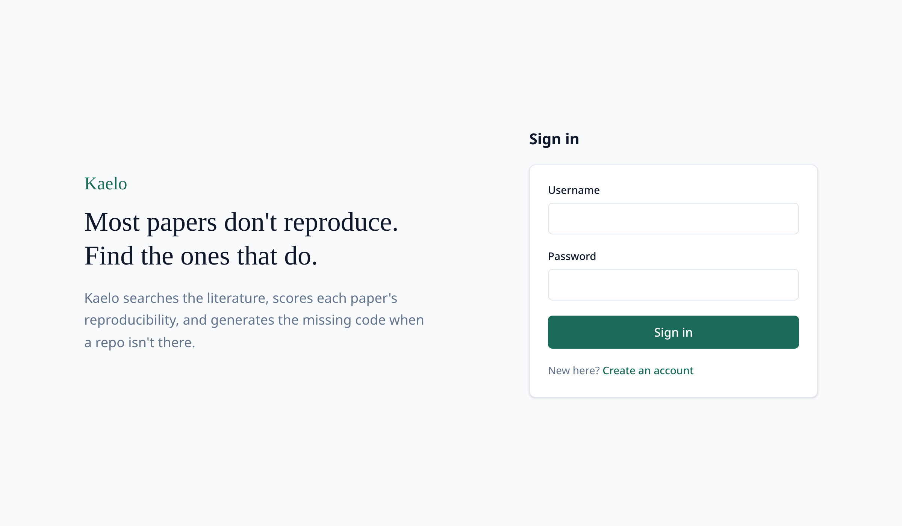
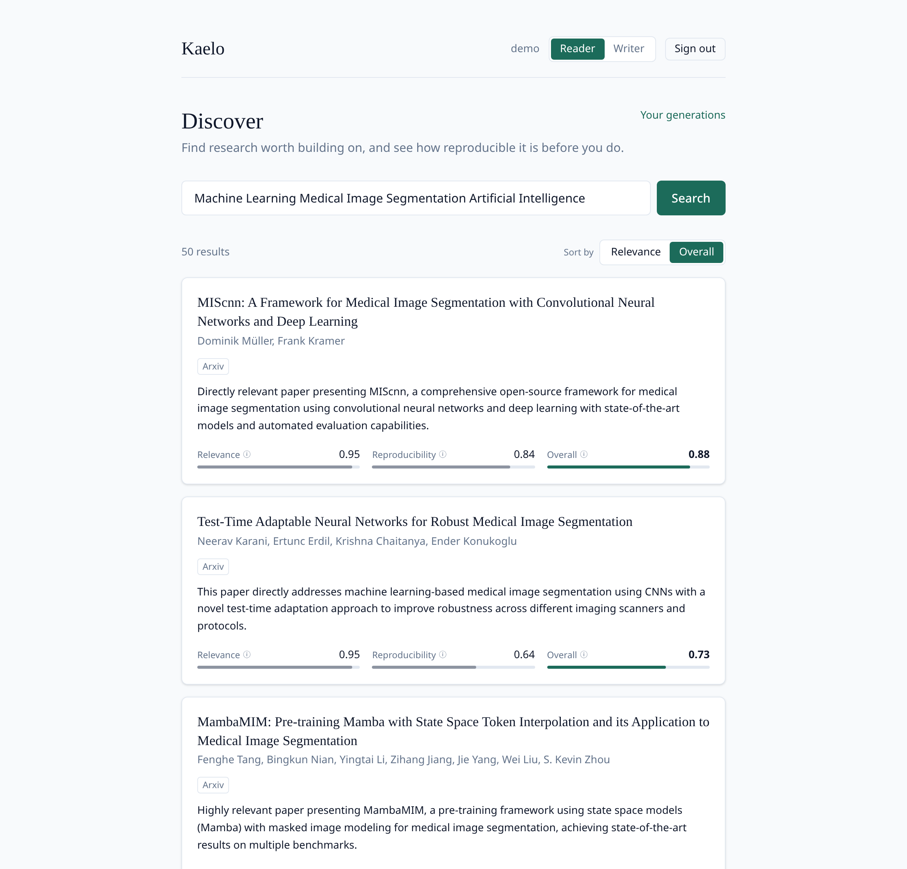
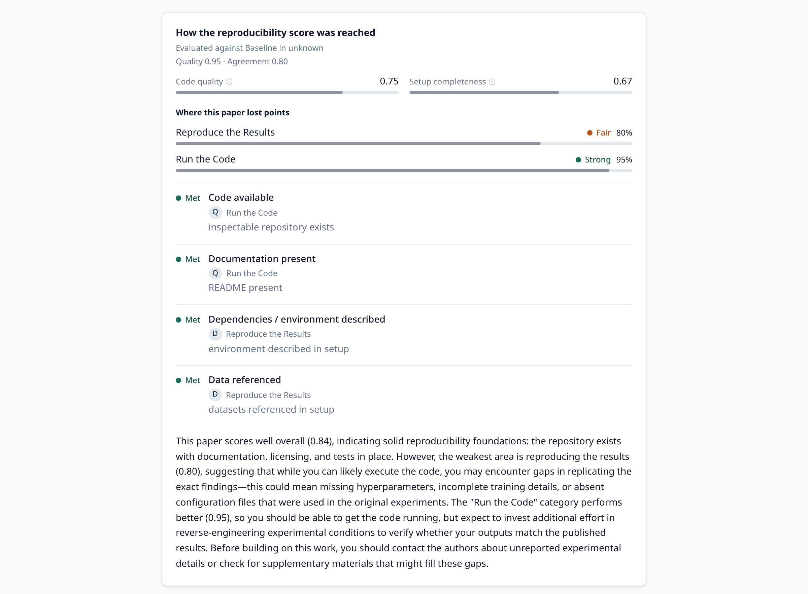
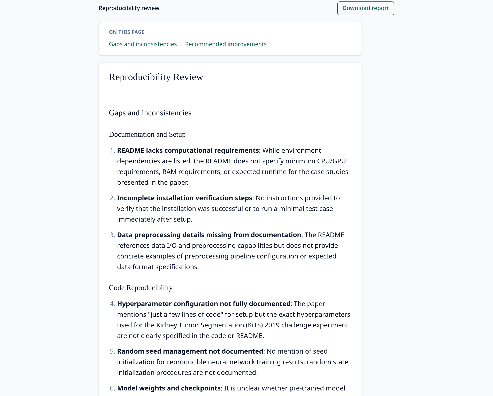
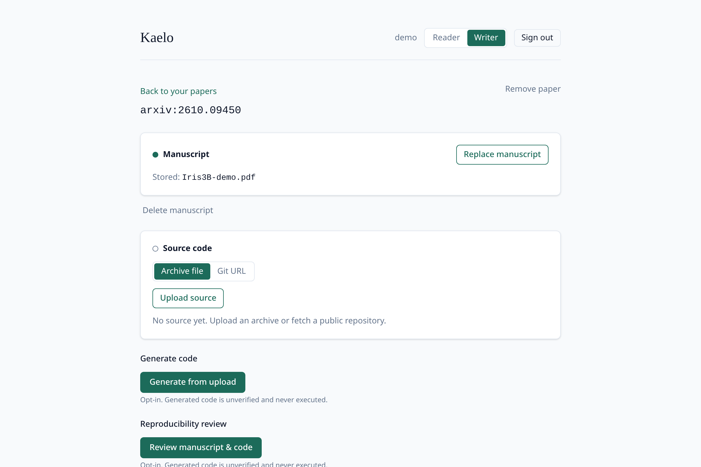
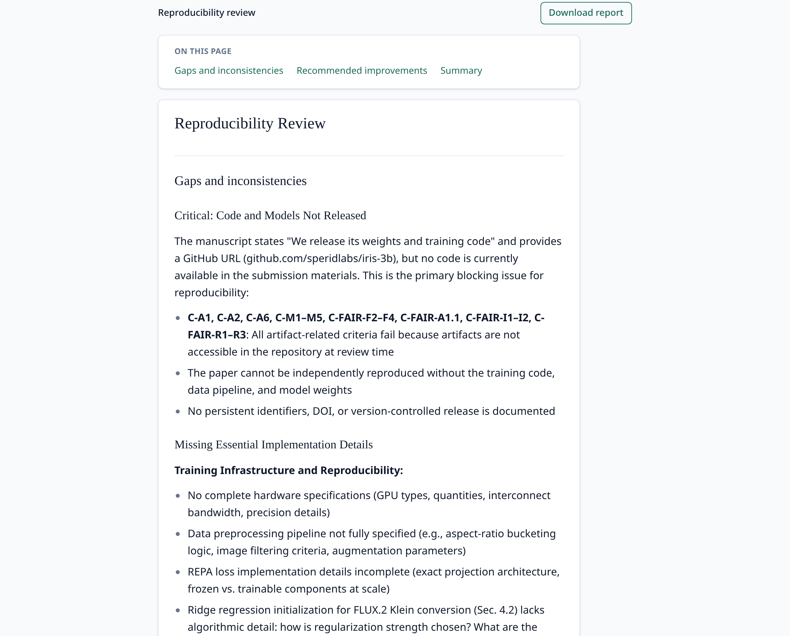
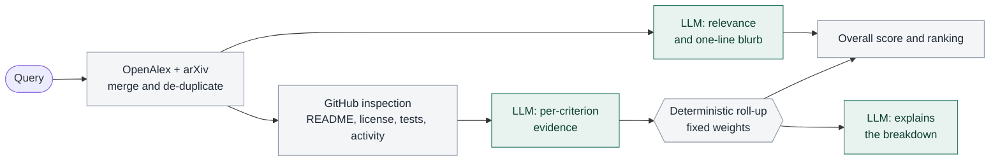
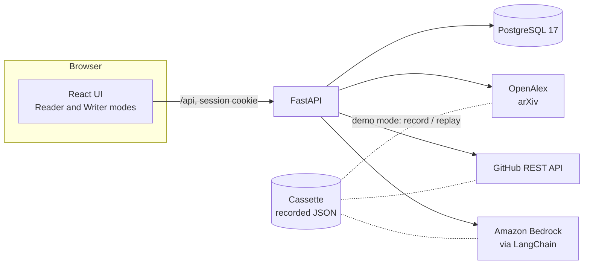

<div align="center">

# Kaelo

**Find research you can actually rebuild.**

An AI-assisted search engine for scientific papers that scores how reproducible each paper is, explains the score against a published standard, and helps close the gap when a paper ships without usable code.


<br />



<sub>Built for the **Mahidol AI Community 2026 hackathon (Track B)**.</sub>

</div>

---

## The problem

> *"If I have seen further, it is by standing on the shoulders of giants."* — Isaac Newton

Those shoulders are shaky.

- **More than 70%** of researchers have tried and failed to reproduce another scientist's experiments (survey of 1,576 researchers, *Nature*, 2016).
- **53.5 days** is the median time to reproduce one machine-learning paper, even when the attempt succeeds (Raff, AAAI-21).

Search engines rank papers by relevance. Nothing tells you, before you spend weeks on it, whether you can rebuild what the paper claims.

## What Kaelo does

One account, two modes.

| | **Reader** | **Writer** |
| --- | --- | --- |
| **For** | Finding and evaluating other people's papers | Checking your own paper before you submit it |
| **You get** | Search results ranked by relevance *and* reproducibility, with a full score breakdown | A review of your manuscript against the standard: gaps, inconsistencies and specific fixes |
| **If code is missing** | Opt-in code generation, or alignment of an existing repo to the paper | Opt-in code generation from your manuscript and source |

### 1. Search that shows reproducibility, not just relevance

Every result card carries a **relevance** score, a rule-based **reproducibility** score, and an **overall** score. Switch the sort to *Overall* and papers you can build on rise above papers you can only read.



### 2. A score you can audit

Open any paper to see exactly how its reproducibility score was reached: the standard it was evaluated against, the criteria met or missed, where it lost points, and a plain-language explanation.



The number comes from fixed weights over published standards. The language model supplies evidence and writes the explanation; it never invents the score ([ADR 0009](docs/adr/0009-llm-supplies-evidence-score-rollup-is-deterministic.md)).

### 3. A reproducibility review in one click

For a cheaper alternative to generating a whole codebase, ask for a **review**: findings only, listing the gaps against the standard and concrete improvements. It never writes code, never computes a score, and never runs anything.



### 4. Writer mode: review your own paper before reviewers do

Claim your paper by arXiv ID, DOI or URL. Upload the manuscript PDF (and optionally source code or a public Git URL). Kaelo grades the manuscript against the computer-science standard and tells you what a careful reader would question about reproducibility.

<p>
  
  
</p>

Writer uploads are stored, as a deliberate exception to the otherwise link-only design ([ADR 0003](docs/adr/0003-writer-uploads-are-persisted.md)). Generated code is always marked unverified and is never executed.

## How the score works

Reproducibility is evaluated against a **published standard** chosen by the paper's field of study, captured at ingestion from the source's own classification.

| Field | Standard | Criteria |
| --- | --- | --- |
| Medicine | TRIPOD+AI | 26 weighted criteria |
| Computer Science | ACM Artifact Review and Badging v1.1, ML Code Completeness Checklist and FAIR4RS v1.0, merged | 25 weighted criteria |
| Anything else | Domain-neutral baseline | 4 criteria |

Each criterion is tagged **Q** (quality of the code and tooling) or **D** (agreement between the paper and its code), weighted, and scored *met*, *partial*, *unmet* or *not applicable*, adjusted by the confidence of the evidence.

```
S       = 0.30 · S_Q + 0.70 · S_D          reproducibility score
Overall = 0.30 · relevance + 0.70 · S      only orders the results
```

`D` carries more weight than `Q` because a repository that contradicts its paper is not reproducible, however tidy it looks. The full model is in [`scoring_rule.md`](scoring_rule.md).

## How AI is used



Green boxes are LLM calls (Amazon Bedrock through LangChain). Everything that produces a number is deterministic code, and the LLM never writes a score. A generated artifact's own quality score never feeds back into a paper's reproducibility score ([ADR 0004](docs/adr/0004-generated-code-never-feeds-paper-repro-score.md)).

## Architecture



| Layer | Tech |
| --- | --- |
| Backend | FastAPI, SQLModel, Alembic, Python 3.13, uv |
| Frontend | Vite, React, TypeScript, Tailwind v4, pnpm |
| Database | PostgreSQL 17 |
| AI | Amazon Bedrock through LangChain |
| Data sources | OpenAlex, arXiv, GitHub REST API |
| Dev infrastructure | Docker Compose (Compose Watch) |
| Tests | pytest, Hypothesis, testcontainers |

## Try it in two minutes, with no API keys

Demo mode replays a committed **Cassette** of recorded OpenAlex, arXiv, GitHub and Bedrock responses, so the app runs with no network access and no AWS credentials. Scoring and ranking still run for real on top of the recorded values.

You need [Docker](https://docs.docker.com/get-docker/) with Compose v2.22 or newer.

```bash
git clone https://github.com/NNLoat/kaelo.git
cd kaelo
cp .env.example .env        # set SESSION_SECRET to any long random string
scripts/demo-reset.sh       # builds the stack in replay mode and creates the demo account
```

Then open <http://localhost:5173>, sign in as `demo` / `demo-password`, and search for:

```
Machine Learning Medical Image Segmentation Artificial Intelligence
```

Switch the sort to **Overall**, open **MIScnn**, and click **Review manuscript & code**.

> `scripts/demo-reset.sh` runs `docker compose down -v`, so it wipes the local database. Only the recorded query is answered offline; anything else falls back to live calls and needs credentials. The Writer review replays only for the author's own manuscript, which is not in this repository.

## Run it live

With real credentials, the app works on any query and any paper.

```bash
cp .env.example .env
# set SESSION_SECRET, BEDROCK_MODEL_ID, AWS_REGION, AWS_ACCESS_KEY_ID, AWS_SECRET_ACCESS_KEY
# optional: GITHUB_TOKEN raises the GitHub API rate limit
docker compose up --watch
```

| Service | URL |
| --- | --- |
| Frontend | <http://localhost:5173> |
| Backend API | <http://localhost:8000> |
| API docs | <http://localhost:8000/docs> |

The [development guide](docs/DEVELOPMENT.md) covers commands, running without Docker, migrations, tests and demo mode in detail.

## Engineering practices

This started as a hackathon prototype but was built the way a long-lived product would be.

- **Spec-driven.** Six features, each with `requirements.md`, `design.md` and `tasks.md` under [`specs/`](specs/): [accounts](specs/accounts), [paper search](specs/paper-search), [reproducibility scoring](specs/reproducibility-scoring), [code generation](specs/code-generation), [writer workspace](specs/writer-workspace) and [demo mode](specs/demo-mode). Requirements are written in EARS form and every one traces to a task.
- **Decisions on record.** Ten [architecture decision records](docs/adr/) and a shared [glossary](GLOSSARY.md) keep the reasons, not only the code.
- **Tested properties, not just examples.** 190+ backend tests, including Hypothesis property tests that run at least 100 generated cases each, against a real PostgreSQL through testcontainers. LLM and external sources are always faked in tests.
- **Repeatable by design.** Demo mode wraps the outside world at three seams, so a live demo is deterministic ([ADR 0010](docs/adr/0010-demo-mode-records-and-replays-at-the-seams.md)).
- **Built with AI assistance, with guardrails.** Kiro for the original build, then Claude Code. Shared skills for requirements grilling, glossary and ADR capture, and minimal-diff implementation live in [`.claude/skills/`](.claude/skills/).

## Where it could go

The pitch laid out three phases for rolling out at Mahidol University:

1. **Integrate** (months 1–3): connect with the university's systems (MARVIS and MU IT accounts), together with the IT division.
2. **Pilot and measure** (months 4–6): start with faculties whose standards Kaelo already supports.
3. **Scale** (months 7–12): add each field's standard without rebuilding the system. The standard adapter ([ADR 0008](docs/adr/0008-reproducibility-standard-adapter.md)) is the extension point.

The estimated benefit, to be measured in a pilot: about 70 hours a year per researcher spent finding papers today, around 49 with Kaelo, so at least 21 hours saved.

## Project documents

| | |
| --- | --- |
| [Development guide](docs/DEVELOPMENT.md) | Setup, commands, tests, workflow |
| [Pitch deck](demo/20261107-kaelo-pitching-vF.html) | The slides from the hackathon presentation (open in a browser) |
| [Concept paper](docs/concept-paper.pdf) | The original idea |
| [Scoring rule](scoring_rule.md) | The standards-conformance model |
| [Glossary](GLOSSARY.md) | Shared vocabulary |
| [ADRs](docs/adr/) | Architecture decisions |
| [Specs](specs/) | Requirements, design and tasks per feature |
| [Demo story](demo/STORY.md) | The two-minute live demo script |

## Team

**Noppachanin Kongsathitporn**, **Pisut Manorat** and **Krisanakorn Rugbumroong**. Mahidol AI Community 2026, Track B.

## License

[MIT](LICENSE)

## References

1. Baker M. 1,500 scientists lift the lid on reproducibility. *Nature*. 2016;533:452–454.
2. Raff E. Research reproducibility as a survival analysis. *Proceedings of AAAI-21*. 2021.
3. Tenopir C, Volentine R, King DW. Scholarly reading and the value of academic library collections. *Insights*. 2012;25(2):130–149.
4. O'Mara-Eves A, et al. Using text mining for study identification in systematic reviews. *Systematic Reviews*. 2015;4:5.
