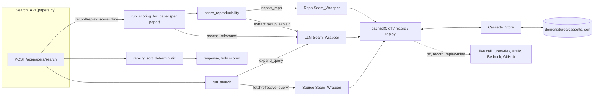

# Design Document

## Overview

`demo-mode` makes a scripted live demo repeatable by putting a **record/replay
cache at the three boundaries to the outside world** and by making the search
response fully scored and sorted before it is returned. The real pipeline (merge,
scoring, the deterministic roll-up, ranking) is unchanged and runs on top of the
recorded values, so the demo shows real output, not canned cards.

A single setting, `DEMO_MODE` (`off` | `record` | `replay`), selects the
behavior. With `off` (the default) nothing changes. With `record` each outside
call is made live and its result written to a **Cassette** JSON file committed to
the repo. With `replay` each call is answered from the Cassette with no network,
Bedrock or GitHub access; a call the Cassette lacks falls back to live and is
logged.

Per the project layering, the design is organized into concerns, each mapping back
to requirements:

| Layer | Component | Location | Requirements |
| --- | --- | --- | --- |
| Backend | `Settings` additions, startup log, compose wiring | `backend/app/core/config.py`, `backend/app/main.py`, `compose.yaml` | R1, R8 |
| Business logic | `Cassette_Store` + generic `cached()` | `backend/app/services/demo/cassette.py` | R2, R3, R4, R8 |
| Business logic | `Seam_Wrapper`s (source, LLM, repo) + codecs | `backend/app/services/demo/seams.py` | R3, R4, R5 |
| Backend | Inline scoring + deterministic ordering in `Search_API` | `backend/app/routers/papers.py`, `backend/app/services/scoring.py`, `backend/app/services/ranking.py` | R6 |
| Demo tooling | Reset/record scripts, queries, demo script | `scripts/demo-*.sh`, `demo/` | R7 |

This spec **consumes** the existing seams without changing their contracts. It
adds no table, no migration and no endpoint. The frontend is unchanged.

### Key design decisions

- **Cache at the seams (VCR-style), not canned data and not a DB dump.** The three
  boundaries (`adapter.fetch`, the Bedrock `invoke`, the GitHub inspection) are the
  only non-repeatable inputs. Recording their results and replaying them lets every
  line of real pipeline code run, including ranking. A DB dump was rejected:
  searches are not persisted, so there is no query→papers mapping to restore.
  Canned cards were rejected: they skip the real pipeline and make a weaker demo.
- **One generic function, `cached(seam, key_input, live, encode, decode, label)`,
  holds the whole off/record/replay state machine.** The three wrappers only
  supply the codecs. One state machine means one place to get the semantics right
  (R3, R4) and one set of properties to test.
- **The Request_Key is a SHA-256 of the canonical input, and excludes the model id
  and timeouts.** Excluding them means a replay still hits after a model-id or
  timeout change, which is a feature for a demo. The trade-off is that a changed
  model is silently served the old model's text; the entry records the `model`
  as metadata so a reviewer can see it, and re-recording is one command.
- **The LLM entry stores the message text only.** Every caller reads the reply via
  `_content_text(resp)`, which accepts any object with a `.content`. Replay
  returns `AIMessage(content=text)`; no LangChain internals are serialized.
- **Entries are written through, one atomic rename per stored entry.** A
  full-run Cassette is a few hundred entries (well under 2 MB), so a rewrite per
  entry is cheap, and a crash mid-record never loses recorded work or leaves a
  truncated file (R2.4, R3.5). Batching was rejected as more state for no gain.
- **The chat client is built lazily.** `ChatBedrock` is only constructed on a live
  call (record, miss, or `off`), so `replay` never needs AWS credentials (R4.2).
- **Inline scoring only in `record`/`replay`.** The router scores every returned
  paper, sequentially, before it responds, then sorts. The existing background path
  is untouched for `off` (R1.3, R6.7). Sequential is deliberate: it is instant in
  replay and, in record, the cost is paid once, offline.
- **A new `ranking.sort_deterministic`, rather than changing
  `sort_by_final_score`.** The existing function is stable on input order and has
  no id tie-break; changing it would alter `off` behavior (R6.7).
- **Frontend parity falls out of the comparator, so no frontend change is needed.**
  The frontend's *Final score* sort is `value if ready else -1`, descending, and
  stable. A backend order already sorted that way is a fixed point of that sort
  (Property 9).
- **The Cassette reaches the container through a bind mount** (`./demo:/demo`).
  The backend image only contains `./backend`, so `demo/` is not otherwise
  visible. This makes the compose default path a container path (R1.5 was worded
  to match). The mount is read-write; `replay` never writes (R4.5).
- **Candidate ADR:** *0010 — Demo mode records and replays at the seams.* It is a
  hard-to-reverse-in-spirit decision (the demo shows recorded real output) that
  outlives this feature. Write it when the feature ships (see Tasks).

## Architecture



### The `cached()` state machine (R2, R3, R4, R8)

```
cached(seam, key_input, live, encode, decode, label):
  mode = settings.demo_mode
  if mode == off:      return live()                       # R1.3: no file access at all
  key = f"{seam}:{sha256(canonical_json(key_input))}"
  if mode == replay:
      entry = store.get(key)
      if entry:        return decode(entry.recorded)       # R4.1: no live call
      log.warning("demo replay miss seam=%s key=%s", seam, digest)   # R4.4
      return live()                                        # R4.3, R4.5: never writes
  # record
  result = live()                                          # R3.2: raises propagate, nothing stored
  store.put(key, {seam, label, recorded: encode(result)})  # R3.1, R3.3: replace; R8.4: secret guard
  return result                                            # R3.4: caller sees the live result
```

### Search flow, `record` / `replay` (R6)

```mermaid
sequenceDiagram
    participant FE as Frontend
    participant R as papers.search
    participant SC as scoring
    participant DB as Postgres
    FE->>R: POST /search {query}
    R->>SC: run_search(query)  # sources via Source seam, upsert papers
    SC-->>R: paper_ids
    loop each paper_id, in order
        R->>SC: run_scoring_for_paper(id, query)  # LLM + repo seams, writes DB
    end
    R->>DB: session.expire_all(); reload papers
    R->>R: sort_deterministic(papers)
    R-->>FE: cards, all cells ready|unavailable, sorted by Final Score
```

In `off` the router keeps `schedule_scoring` and `sort_by_final_score` exactly as
today.

### Why replay is deterministic end to end (R6.5)

Replay is deterministic only if every step between the recorded boundaries is
deterministic. Each was checked:

- **Sources → papers:** adapters return lists; `merge_dedup` uses sets only for
  overlap tests (`_norm_authors`), never for ordering, so merge order is the
  recorded order.
- **Prompts → LLM entries:** the relevance prompt embeds the paper's title and
  abstract plus the query, all of which are recorded, so the Request_Key is stable
  run to run.
- **Scoring → order:** `final_score` is arithmetic on recorded values; ties break
  by `id`. Paper ids are stable only if the database starts empty, which is what
  `demo-reset.sh` guarantees (R7.2).

## Components and Interfaces

### 1. Backend — settings, startup, compose (R1, R8)

`backend/app/core/config.py` adds two fields to `Settings`:

```python
demo_mode: Literal["off", "record", "replay"] = "off"        # R1.1, R1.2, R8.1
demo_cassette_path: str = "demo/fixtures/cassette.json"      # R1.4
```

Pydantic rejects any other `DEMO_MODE` value at `Settings()` construction, which
`main.py` already performs at import, so the process fails at startup with an
error that names the field and the accepted literals (R1.2).

`backend/app/main.py` `lifespan` logs one line when the mode is not `off`
(R8.3):

```python
if settings.demo_mode != "off":
    logging.getLogger("uvicorn.error").info(
        "demo mode=%s cassette=%s", settings.demo_mode, settings.demo_cassette_path)
```

`compose.yaml` (backend service):

```yaml
environment:
  DEMO_MODE: ${DEMO_MODE:-off}
  DEMO_CASSETTE_PATH: ${DEMO_CASSETTE_PATH:-/demo/fixtures/cassette.json}
volumes:
  - ./demo:/demo          # Cassette; the image only contains ./backend
```

`.env.example` documents both, with `DEMO_MODE=off`.

### 2. Business logic — `Cassette_Store` (R2, R8.4)

`backend/app/services/demo/cassette.py`. No FastAPI, SQLModel or domain imports.

```python
class CassetteError(Exception): ...

def request_key(seam: str, key_input: dict) -> str: ...   # "seam:" + sha256 hex
def cached(seam, key_input, live, encode, decode, label="") -> T: ...

class Cassette_Store:
    def get(self, key: str) -> dict | None: ...
    def put(self, key: str, entry: dict) -> None: ...     # secret guard, atomic write
```

- `request_key`: `json.dumps(key_input, sort_keys=True, separators=(",", ":"),
  ensure_ascii=False)` → UTF-8 → SHA-256 hex (R2.2). Independent of dict insertion
  order and of process.
- Storage is **one JSON file**:
  ```json
  {
    "version": 1,
    "entries": {
      "llm:3f9c…": {"seam": "llm", "label": "Rate how relevant this paper…",
                    "model": "anthropic.claude-…", "recorded": {"content": "{\"score\": 0.9, …}"}},
      "repo:a1b2…": {"seam": "repo", "label": "https://github.com/o/r", "recorded": {"exists": true, …}},
      "source:77de…": {"seam": "source", "label": "openalex|deep learning|25", "recorded": [ {…} ]}
    }
  }
  ```
  `label` is a short human aid for reviewing diffs (a query, a URL, the first 80
  characters of a prompt); it is not part of the key and carries no secret (R2.7).
- **Serialization:** `json.dumps(doc, sort_keys=True, indent=2, ensure_ascii=False)`
  plus a trailing newline, so recording the same calls twice is byte-identical
  (R2.3).
- **Atomic write:** write `path.tmp` in the same directory, `fsync`, then
  `os.replace` onto the target (R2.4). A missing parent directory is created.
- **Loading:** lazily on first use, once per process, under a `threading.RLock`
  (scoring runs on worker threads). Missing file → empty (R2.5). Invalid JSON or
  `version != 1` → `CassetteError(f"... {path} ...")`, and the file is never
  written (R2.6).
- **Secret guard (R8.4):** before writing, serialize the new entry and, for each
  non-empty configured secret (`AWS_SECRET_ACCESS_KEY` from the environment,
  `settings.github_token`, `settings.session_secret`), refuse with `CassetteError`
  if it appears in the text. The check is a plain substring test: conservative,
  with the cost of an occasional false positive on a very short secret, which fails
  loudly rather than leaking.

### 3. Business logic — `Seam_Wrapper`s (R3, R4, R5)

`backend/app/services/demo/seams.py`. Each wrapper is a thin adapter around
`cached()`. None changes a public signature (R5.5).

**LLM seam (R5.2).** A proxy with the one method callers use:

```python
class _CassetteChat:
    def __init__(self, build): self._build, self._real = build, None   # lazy (R4.2)
    def invoke(self, prompt: str):
        return cached(
            "llm", {"prompt": prompt},
            live=lambda: self._live(prompt),
            encode=lambda r: {"content": _content_text(r)},
            decode=lambda d: AIMessage(content=d["content"]),
            label=prompt[:80])

def wrap_chat(build) -> _CassetteChat | ChatBedrock:
    return build() if settings.demo_mode == "off" else _CassetteChat(build)
```

The three modules' existing `_client()` functions keep their names and
signatures (tests monkeypatch `llm._client`, `extractor._client`,
`explainer._client`) and change only their body, from `return ChatBedrock(...)` to
`return wrap_chat(lambda: ChatBedrock(...))`. `_content_text` is imported
lazily inside `encode` to avoid an import cycle with `services/llm.py`. In `off`
`wrap_chat` returns the real client, so behavior and the existing `lru_cache` on
`llm._client` are unaffected. `core/codegen.py`'s `_client` is **not** touched
(R5.4).

**Source seam (R5.1).** `scoring._adapters()` returns
`[wrap_source(a) for a in _ADAPTERS]`; `wrap_source` returns the adapter itself
when the mode is `off`. Tests that monkeypatch `scoring._ADAPTERS` still work.

```python
class _CassetteSource:
    def __init__(self, inner): self._inner, self.name = inner, inner.name
    def fetch(self, query, *, limit, timeout):
        return cached(
            "source",
            {"source": self.name, "query": query, "limit": limit,
             "domains": settings.source_domains},
            live=lambda: self._inner.fetch(query, limit=limit, timeout=timeout),
            encode=_encode_records, decode=_decode_records,
            label=f"{self.name}|{query}|{limit}")
```

`_encode_records` maps each `SourceRecord` field to JSON (`published_date` →
ISO string or null, `domain` → enum value, `source_links` → list of pairs) and
`_decode_records` rebuilds the dataclass with the original types, so a replayed
record is indistinguishable from a live one (R4.6).

**Repo seam (R5.3, R5.6).** In `inspector.inspect_repo` the existing early return
for an empty URL stays first (no lookup, R5.6); the host call becomes:

```python
return cached("repo", {"repo_url": repo_url.strip()},
              live=lambda: _HOST.inspect(repo_url, timeout=...),
              encode=asdict, decode=lambda d: RepoSignals(**d),
              label=repo_url)
```

Tests that monkeypatch `inspector.inspect_repo` wholesale, or `_HOST`, are
unaffected. The one wrapper keys on the URL, so all of the GitHub REST calls inside
`GitHubRepoHost.inspect` (repo, readme, contents) are covered by a single entry.

### 4. Backend — inline scoring and ordering (R6)

`backend/app/services/scoring.py` adds:

```python
def score_inline(paper_ids: list[int], query: str) -> None:
    """Score each paper to completion, in order (demo record/replay)."""
    for pid in paper_ids:
        run_scoring_for_paper(pid, query)
```

`run_scoring_for_paper` already assigns every component and the final score on each
run (success or `unavailable`), so no value from an earlier search can survive it
(R6.4), and no cell is left `pending` (R6.2).

`backend/app/services/ranking.py` adds a pure function:

```python
def sort_deterministic(papers: list) -> list:
    """Final Score desc; non-ready/None last; id asc as tie-break (R6.3)."""
    def key(p):
        ready = p.final_status is ScoreStatus.ready and p.final_score is not None
        return (not ready, -(p.final_score or 0.0), p.id)
    return sorted(papers, key=key)
```

`backend/app/routers/papers.py` `search` branches on mode:

```python
result = scoring.run_search(payload.query, session)
if result.all_failed: ...                       # unchanged (502)
if get_settings().demo_mode == "off":
    scoring.schedule_scoring(result.paper_ids, payload.query, tasks)
    order = ranking.sort_by_final_score
else:
    scoring.score_inline(result.paper_ids, payload.query)
    session.expire_all()                        # reload what the scoring sessions committed
    order = ranking.sort_deterministic
papers = [session.get(Paper, pid) for pid in result.paper_ids]
ordered = order([p for p in papers if p is not None])
```

An unexpected exception during inline scoring (for example a database error)
propagates as a 500 rather than being swallowed: it is loud for the presenter
during rehearsal, and every expected failure is already handled inside
`run_scoring_for_paper` (it maps them to `unavailable`).

### 5. Demo tooling (R7)

A shared `scripts/demo-env.sh` exports the settings both scripts use so record and
replay always agree: `QUERY_EXPANSION_ENABLED=false`, `CODEGEN_MOCK=true`, and the
`DEMO_MODE` each script sets. Shell environment overrides `.env` for compose
interpolation, so the scripts do not edit `.env`.

- **`scripts/demo-reset.sh`** (R7.1, R7.2): `docker compose down -v` → export
  `DEMO_MODE=replay` → `docker compose up -d --build` → poll `GET /health` (bounded,
  120 s, exit non-zero on timeout) → `POST /api/auth/register` for the demo account
  (a conflict is treated as success). The demo credentials are fixed, non-secret,
  local-only values defined at the top of the script.
- **`scripts/demo-record.sh`** (R7.3, R7.4, R7.6): same reset, but with
  `DEMO_MODE=record`; logs in and keeps the session cookie; for each non-blank,
  non-`#` line of `demo/queries.txt`, `POST /api/papers/search` with a long client
  timeout (`curl -m 900`, since inline live scoring is slow); prints the ordered
  `title  final-score` table via a small `python3 -c` JSON parse; exits non-zero on
  any non-200 or empty result; finally `chown`s the Cassette to the invoking user
  (the container writes as root).
- **`demo/queries.txt`**, **`demo/SCRIPT.md`** (R7.5): the query list in
  presentation order; per query the expected top results, the required settings,
  which sort the presenter uses (the frontend defaults to *Relevance*; the script
  says when to click *Final score*), the re-record steps, and the line to say about
  results being pre-recorded.
- **`demo/fixtures/cassette.json`** is committed only by the presenter after
  reviewing the `demo-record.sh` output. Nothing else writes it (R7.6).

## Data Models

No table, no Alembic migration, no change to any model. The only new persistent
artifact is the Cassette file described under *Cassette_Store*.

### Configuration (R1, R8)

| Setting | Env | Default | Notes |
| --- | --- | --- | --- |
| `demo_mode` | `DEMO_MODE` | `off` | `off` \| `record` \| `replay`; anything else fails startup |
| `demo_cassette_path` | `DEMO_CASSETTE_PATH` | `demo/fixtures/cassette.json` | compose overrides to `/demo/fixtures/cassette.json` |

Both are forwarded in `compose.yaml` and documented in `.env.example`.

## Correctness Properties

*A property is a characteristic that holds across all valid executions. These
drive the property-based tests.*

### Property 1: Request keys are canonical

*For any* seam name and JSON-serializable key input, `request_key` returns the same
key for the same input regardless of dict insertion order and across processes, and
*for any* two key inputs that differ, the keys differ.

**Validates: R2.2**

### Property 2: Cassette serialization round-trips and is byte-stable

*For any* set of entries, writing then loading returns an equal mapping, and
writing the same entries in any insertion order produces a byte-identical file.

**Validates: R2.1, R2.3**

### Property 3: Record then replay returns the recorded result with no live call

*For any* seam call whose live result is encodable, running it under `record` and
then under `replay` returns an equal result, and the `replay` run makes zero live
calls.

**Validates: R3.1, R3.4, R4.1, R4.6**

### Property 4: A replay miss falls through, logs once, and writes nothing

*For any* key not in the Cassette, `replay` calls `live` exactly once, returns its
result, logs exactly one warning containing the seam and key digest and no prompt
text, and leaves the Cassette file's bytes unchanged.

**Validates: R4.3, R4.4, R4.5**

### Property 5: A failed live call in record is propagated and never recorded

*For any* seam call whose live function raises, `record` re-raises the same
exception and the Cassette contains no entry for that key.

**Validates: R3.2**

### Property 6: Re-recording replaces

*For any* key already in the Cassette, recording a new result for it leaves exactly
one entry for that key holding the new result.

**Validates: R3.3**

### Property 7: Off is transparent

*For any* seam call under `off`, the result equals the live result and the Cassette
path is neither read nor created.

**Validates: R1.3, R5.5**

### Property 8: Codecs round-trip

*For any* `SourceRecord` (including `published_date` of `None`, every `PaperDomain`,
and any `source_links`), `decode(encode(x)) == x`; likewise for `RepoSignals` and
for LLM text (any string, including empty and non-ASCII).

**Validates: R4.6, R5.1, R5.2, R5.3**

### Property 9: Secret values are never written

*For any* entry whose serialized form contains a configured non-empty secret,
`put` raises `CassetteError` and the file is unchanged; *for any* entry that does
not, it is written.

**Validates: R2.7, R8.2, R8.4**

### Property 10: Corrupt or unsupported Cassettes are rejected and preserved

*For any* file content that is not a valid version-1 Cassette, loading raises
`CassetteError` naming the path and the file is never modified by a later `put`
attempt in the same process.

**Validates: R2.5, R2.6**

### Property 11: Demo ordering is total, deterministic, and a fixed point of the frontend sort

*For any* set of papers with arbitrary statuses and scores, `sort_deterministic`
orders ready papers by Final Score descending then id ascending, with
non-ready/`None` last; and applying the frontend's *Final score* comparator (value
if ready else −1, descending, stable) to that ordered list leaves it unchanged.

**Validates: R6.3, R6.6**

### Property 12: Inline scoring leaves no pending cell and no stale value

*For any* set of papers returned by a search under `record` or `replay`, including
papers with scores stored by an earlier search and papers whose components fail,
every score cell in the response is `ready` or `unavailable`, and every value comes
from this request's scoring run.

**Validates: R6.1, R6.2, R6.4**

### Property 13: Replay is repeatable end to end

*For any* set of fake sources and fake LLM and repo responses, a search recorded
under `record` and then searched twice under `replay` (with every live call made to
fail the test) returns three identical responses: same cards, order and values.

**Validates: R4.1, R4.2, R6.5**

## API Endpoint Contracts

No endpoint is added or changed. `POST /api/papers/search` keeps its request and
response shapes and its status codes (`200`, `422`, `502` when every source fails).
Only two behaviors vary by mode:

| Mode | Scoring | Response order | Score cells in the response |
| --- | --- | --- | --- |
| `off` | background, after the response | `sort_by_final_score` (unchanged) | may be `pending` |
| `record` / `replay` | inline, before the response | `sort_deterministic` | `ready` or `unavailable` only |

`GET /api/papers/scores` and `GET /api/papers/{id}` are unchanged.

## Error Handling

| Situation | Behavior |
| --- | --- |
| `DEMO_MODE` not one of the three values | Startup fails; error names the setting and values (R1.2) |
| Cassette missing | Treated as empty; `record` creates it (R2.5) |
| Cassette not valid JSON / unsupported version | `CassetteError` naming the path; file untouched (R2.6) |
| Interrupted write | Cannot truncate the Cassette: temp file + atomic rename (R2.4) |
| Live call raises in `record` | Propagates unchanged; nothing recorded (R3.2) |
| Replay miss | One warning log, live call, result returned, nothing written (R4.3–R4.5) |
| Replay miss and no credentials/network | The live call fails and the existing handling at that call site applies (relevance `unavailable`, source failure, and so on) |
| An entry would contain a configured secret | `CassetteError`; entry not written (R8.4) |
| Unexpected error in inline scoring | Propagates as 500; expected component failures are already mapped to `unavailable` |

## Security

- **No credentials in the Cassette.** Entries hold source index metadata, prompts,
  model text and repository signals only; request headers and environment values
  are never read into an entry (R2.7, R8.2), and the secret guard rejects an entry
  containing a configured secret (R8.4).
- **Prompts contain the query and paper title/abstract**, which is index metadata
  already exposed by the sources (`docs/adr/0001`), plus the presenter's scripted
  queries. The Cassette is intended to be committed and public; do not record
  private queries.
- **Off by default, in every layer.** The code default, the compose default and
  `.env.example` are all `off`; only the demo scripts set another value, and only
  in their own process environment (R1.1, R8.1).
- **Replay needs no AWS credentials**, so the demo machine need not hold a key
  (and the leaked key in `.env` is not needed for the demo).
- The reset script's demo account uses a fixed, local-only password; it must not
  be reused anywhere else.

## Testing Strategy

Backend tests run with **pytest + testcontainers** on the host (`cd backend && uv
run pytest`). All sources, Bedrock and GitHub are **faked**; no live call is made
by any test. The frontend has no automated test gate; the *Final score* parity is
verified by the Property 11 test (which mirrors the frontend comparator) plus a
manual check.

**Dual approach:** property-based tests for the universal invariants above;
example/edge tests and integration tests for concrete scenarios and wiring.

### Property-based tests (Hypothesis, ≥100 iterations each)

Properties 1–11 and 13 as above; each carries a comment of the form
`# Feature: demo-mode, Property N: <title>`. Properties 1–10 run against
`cassette.py`/`seams.py` with a `tmp_path` Cassette and no database. Property 11 is
pure. Property 13 and Property 12 run through `TestClient` against the
testcontainer database with fake adapters and fake chat clients, and a
`live` that raises when it must not be called.

### Example / edge tests (pytest)

- `DEMO_MODE=bogus` fails `Settings()` with a message naming the setting and the
  accepted values (R1.2); defaults are `off` and the documented path (R1.1, R1.4).
- `off`: a search still returns with `pending` score cells and the Cassette path is
  never opened (R1.3, R6.7).
- Missing Cassette in `replay` behaves as empty and a miss goes live (R2.5, R4.3).
- `record` writes the file on the first stored entry, and a second `record` of
  the same call leaves one entry (R3.3, R3.5).
- A paper with no repository URL performs no Repo-seam lookup (R5.6).
- `core/codegen.py` is unaffected: codegen still follows `CODEGEN_MOCK` in every
  mode (R5.4).
- The startup log line is emitted for `record`/`replay` and not for `off` (R8.3).

### Integration / smoke tests

- **Existing suites pass unchanged** with `DEMO_MODE` unset (the whole backend
  suite is the regression gate for `off`).
- **Manual rehearsal (final checkpoint):** run `scripts/demo-record.sh` against the
  real sources once, review the printed order, commit the Cassette, then run
  `scripts/demo-reset.sh` with the network and AWS key disabled and confirm in the
  browser that each scripted query shows the same cards and that switching to
  *Final score* does not reorder them.
